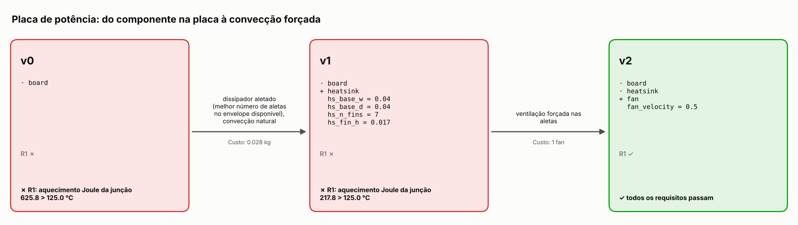
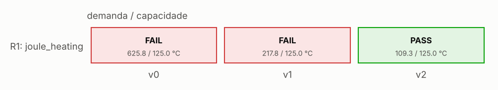
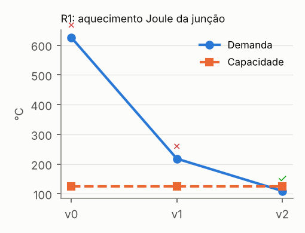

# Placa de potência: do componente na placa à convecção forçada

**Status:** resolvido · **Decisão:** APPROVED · 2 passos · 4 avaliações físicas

## Requisitos

- **R1** — conduzir 20 A sem passar do limite de junção (`joule_heating`)

## Linha do tempo: versão 0 → versão N, e por quê

### Versão 0 — board

**✗ R1 falha: aquecimento Joule da junção.** Com 20 A o MOSFET dissipa 36.8 W (eram 8 W a 25 °C: R_on sobe com a temperatura, ganho de realimentação 0.763); pelo caminho térmico (só a placa, 15.9 K/W da junção ao ar) a junção chega a 626 °C, acima do limite de 125 °C (muito além do que o silício suporta: o número mede o tamanho do problema).

*Prova:* temperatura de junção = 625.8 °C > limite de junção = 125.0 °C — Joule loss I^2 R_on(T) coupled to the thermal path: board: 3-D finite-volume PCB model (pinneapple_physics.pcb.solve), JEDEC two-resistor package.

Opções testadas:

| | Resolve | Margem | Custo | Mudanças |
|---|---|---|---|---|
|  thermal_vias | não | -5.892 → -2.014 | 40.0 vias × 0.005 = 0.2 | thermal_vias = 40 |
| **→** heatsink_natural | não | -5.892 → -1.092 | 0.028 kg × 10.0 = 0.284 | hs_base_w = 0.04, hs_base_d = 0.04, hs_n_fins = 7, hs_fin_h = 0.017 |
|  forced_air | inviável: precisa antes de: heatsink | | | |

**Escolhida: dissipador aletado (melhor número de aletas no envelope disponível), convecção natural.** o calor sai pela aba do componente para uma área de aletas muito maior que a placa, e o ar sobe entre as aletas por empuxo. *Por quê:* nenhuma opção resolve sozinha; esta é a que mais melhora a margem (-5.89 → -1.09), e o passo seguinte continua.

### Versão 1 — board, heatsink

**✗ R1 falha: aquecimento Joule da junção.** Com 20 A o MOSFET dissipa 17.3 W (eram 8 W a 25 °C: R_on sobe com a temperatura, ganho de realimentação 0.495); pelo caminho térmico (dissipador em convecção natural, 10.3 K/W da junção ao ar) a junção chega a 218 °C, acima do limite de 125 °C (muito além do que o silício suporta: o número mede o tamanho do problema).

*Prova:* temperatura de junção = 217.8 °C > limite de junção = 125.0 °C — Joule loss I^2 R_on(T) coupled to the thermal path: plate-fin heat sink, natural convection (Bar-Cohen & Rohsenow 1984) (pinneapple_physics.closed_form.plate_fin_heatsink.evaluate).

Opções testadas:

| | Resolve | Margem | Custo | Mudanças |
|---|---|---|---|---|
|  thermal_vias | inviável: incompatível com: heatsink | | | |
|  heatsink_natural | inviável: o conceito já tem 'heatsink' | | | |
| **→** forced_air | sim | -1.092 → 0.185 | 1 fan × 0.5 = 0.5 | fan_velocity = 0.5 |

**Escolhida: ventilação forçada nas aletas.** o coeficiente de convecção nas aletas sobe várias vezes com a velocidade do ar (canais em desenvolvimento). *Por quê:* resolve a falha sem quebrar nenhum requisito que passava.

### Versão 2 — board, heatsink, fan

✓ todos os requisitos passam.

## Verificações da versão final

| Verificação | Demanda | Capacidade | Margem | Método |
|---|---|---|---|---|
| ✓ R1/joule_heating | 109.3 °C | 125.0 °C | 0.185 | Joule loss I^2 R_on(T) coupled to the thermal path: plate-fin heat sink, forced convection (Teertstra et al. 2000) (pinneapple_physics.closed_form.plate_fin_heatsink.evaluate) |

### Números medidos

- **joule_heating**: junction temperature (electrothermal fixed point) = 109.3 °C; conduction loss at T_j = 12.0 W; conduction loss at 25 °C = 8 W; junction-to-ambient resistance = 5.751 K/W; electrothermal loop gain a I^2 R_25 R_th = 0.276 1; heat-sink resistance (TIM + spreading + fins) = 4.951 K/W; heat-sink mass = 0.028 kg; fin heat-transfer coefficient = 19.8 W/(m^2 K); air power through the fins (dp x flow) = 0.000185 W; fin-channel pressure drop the fan must supply = 0.545 Pa

## Figuras

## Premissas e parâmetros da versão final

| Parâmetro | Valor | Fonte |
|---|---|---|
| `board_d_mm` | 80.0 | premise |
| `board_layers` | 4 | premise |
| `board_w_mm` | 100.0 | premise |
| `current` | 20.0 | premise |
| `design_margin` | 0.05 | premise |
| `fan_velocity` | 0.5 | countermeasure:forced_air |
| `hs_base_d` | 0.04 | countermeasure:heatsink_natural |
| `hs_base_t` | 0.003 | countermeasure:heatsink_natural |
| `hs_base_w` | 0.04 | countermeasure:heatsink_natural |
| `hs_fin_h` | 0.017 | countermeasure:heatsink_natural |
| `hs_fin_t` | 0.0012 | countermeasure:heatsink_natural |
| `hs_material` | al6063 | premise |
| `hs_max_d` | 0.04 | premise |
| `hs_max_h` | 0.02 | premise |
| `hs_max_w` | 0.04 | premise |
| `hs_n_fins` | 7 | countermeasure:heatsink_natural |
| `max_vias` | 40 | premise |
| `package` | TO-263 D2PAK | premise |
| `r_on_25` | 0.02 | premise: datasheet-style R_DS(on) at 25 °C |
| `r_on_tc` | 0.006 | premise: R_DS(on) about x1.75 at 150 °C |
| `t_ambient` | 40.0 | premise |
| `tab_d` | 0.015 | premise |
| `tab_w` | 0.01 | premise |
| `thermal_vias` | 0 | premise |
| `theta_jb` | 1 | premise: junction-to-board through the soldered tab |
| `theta_jc_tab` | 0.8 | premise: junction to mounting tab, tab-mount package on the heat sink |
| `tim_r` | 1e-05 | premise: thin grease, K m^2/W |
| `tj_max` | 125.0 | premise |

## Confiança

**Decisão:** APPROVED · score 1 · 5 checks

| Verificação | status | Valor | limit | Fonte |
|---|---|---|---|---|
| inputs recorded and finite | supports | 28.0 | — | concept parameters with their sources |
| R1/joule_heating | supports | 109.3 | 125.0 | Joule loss I^2 R_on(T) coupled to the thermal path: plate-fin heat sink, forced convection |
| electrothermal fixed point converged | supports | 0 | 0.01 | T_j iteration |
| applicability: joule_heating: junction below the silicon model limit | supports | 109.3 | 200.0 | R_on(T) linear fit |
| uncertainty: R1/joule_heating worst margin (r_on_tc +20 %) | supports | 0.103 | 0 | one-at-a-time spread of the mode's uncertain premises |

### Cartão de confiança (6 etapas)

| Etapa | status | Evidência | Próximo passo |
|---|---|---|---|
| Data and geometry | answered | inputs recorded: v0, v1, v2 PASS inputs recorded and finite (concept parameters with their sources) PASS electrothermal fixed point converged (T_j iteration) |  |
| Model | answered | PASS electrothermal fixed point converged (T_j iteration) |  |
| Physical constraints | answered | PASS electrothermal fixed point converged (T_j iteration) |  |
| Benchmark | open | no comparison with a solver, data or baseline | compare with a reference or a simple baseline |
| Uncertainty | answered | PASS applicability: joule_heating: junction below the silicon model limit (R_on(T) linear fit) PASS uncertainty: R1/joule_heating worst margin (r_on_tc +20 %) (one-at-a-time spread of the mode's uncertain premises) PASS uncertainty: R1/joule_heating worst margin (r_on_tc +20 %) (one-at-a-time spread of the mode's uncertain premises) |  |
| Engineering decision | answered | tier B (solid), ready for design screening 3 limitations bound the use |  |

## Hipóteses

- R_on linear na temperatura
- no dissipador, o caminho pela placa é desprezado (conservador)
- só perdas de condução (sem chaveamento)

## Fontes

- Incropera et al., ch. 3 and 9
- pinneapple_physics.closed_form.plate_fin_heatsink (Teertstra et al. 2000; Bar-Cohen & Rohsenow 1984; Lee et al. 1995)
- pinneapple_physics.pcb (3-D finite-volume board model)
