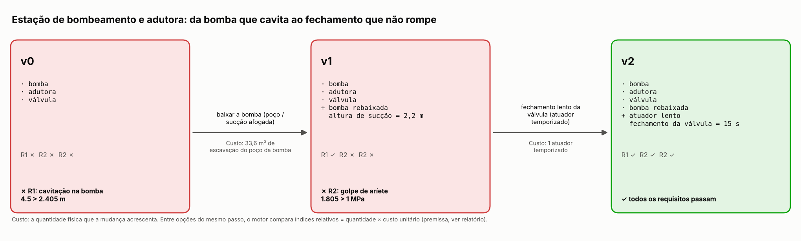
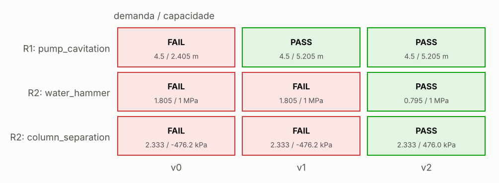
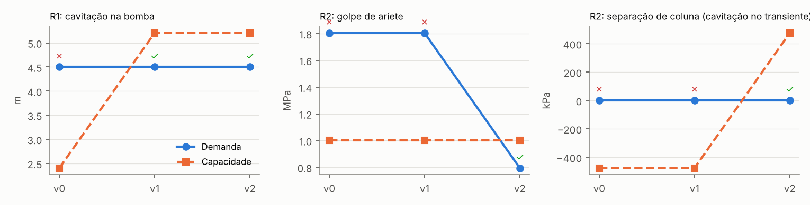
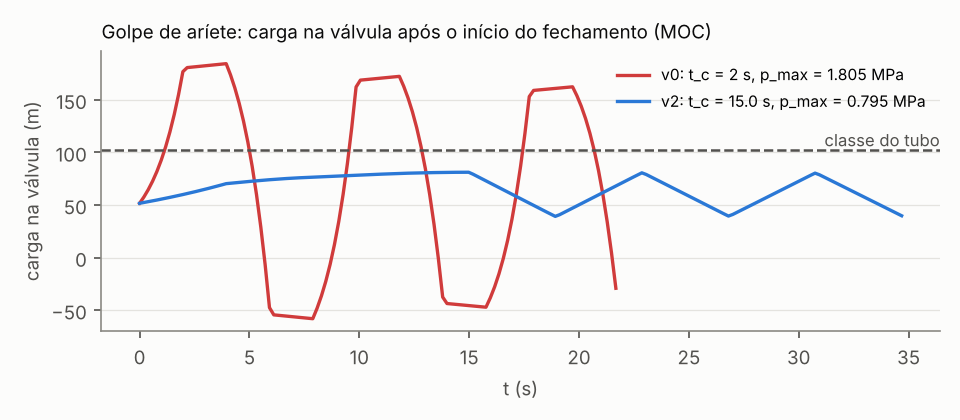

# Estação de bombeamento e adutora: da bomba que cavita ao fechamento que não rompe

**Status:** resolvido · **Decisão:** APPROVED · 2 passos · 15 avaliações físicas

## Requisitos

- **R1** — bombear sem cavitar (`pump_cavitation`)
- **R2** — fechar a válvula sem romper a adutora (`water_hammer`, `column_separation`)

## Linha do tempo: versão 0 → versão N, e por quê

### Versão 0 — bomba, adutora, válvula

**✗ R1 falha: cavitação na bomba.** Na sucção sobram 2.41 m de NPSH: 9.41 m de pressão atmosférica a 800 m de altitude, menos 0.238 m de pressão de vapor, 5 m de altura de sucção e 1.76 m de perda na tubulação (2.83 m/s); a bomba precisa de 4.5 m (NPSH requerido + margem): a pressão na entrada do rotor cai abaixo da de vapor, formam-se bolhas que implodem — cavitação, ruído e erosão.

*Prova:* NPSH requerido + margem = 4.5 m > NPSH disponível = 2.405 m — NPSH_a = (p_atm - p_v)/(rho g) - z_s - h_f, Darcy-Colebrook suction loss + minor losses.

Opções testadas:

| | Resolve | Margem | Custo | Mudanças |
|---|---|---|---|---|
| **→** lower_pump | sim | -0.466 → 0.157 | 33,6 m³ de escavação do poço da bomba (índice 33.6) | altura de sucção = 2,2 m |
|  larger_suction_pipe | não | -0.466 → -0.095 | +266 kg de aço na sucção (índice 266.3) | diâmetro da sucção = 300 mm |

**Escolhida: baixar a bomba (poço / sucção afogada).** cada metro a menos de altura de sucção devolve um metro de NPSH disponível. *Por quê:* resolve a falha sem quebrar nenhum requisito que passava.

### Versão 1 — bomba, adutora, válvula, bomba rebaixada

**✗ R2 falha: golpe de aríete.** Fechar a válvula em 2 s para 1.02 m/s de água numa tubulação onde a onda de pressão corre a 1.22e+03 m/s (ida e volta 2L/a = 3.94 s): o fechamento é mais rápido que a ida e volta da onda, e o golpe é o de Joukowsky, a carga máxima no MOC é 184 m (1.81 MPa), acima da classe de pressão do tubo (1 MPa): o tubo ou as juntas rompem.

*Prova:* pressão máxima do transiente = 1.805 MPa > classe de pressão do tubo = 1 MPa — method of characteristics, reservoir-pipe-valve, Korteweg wave speed, Colebrook friction.

Opções testadas:

| | Resolve | Margem | Custo | Mudanças |
|---|---|---|---|---|
| **→** slow_valve_closure | sim | -0.805 → 0.205 | 1 atuador temporizado (índice 40.0) | fechamento da válvula = 15 s |
|  higher_pressure_class | sim | -0.805 → 0.223 | +110977 kg de aço na parede da adutora (índice 1.11e+05) | parede = 12,5 mm, classe de pressão = 2,5 MPa |

**Escolhida: fechamento lento da válvula (atuador temporizado).** a vazão cai durante várias idas e voltas da onda: as reflexões negativas do reservatório cancelam parte da sobrepressão (Michaud). *Por quê:* resolve a falha sem quebrar nenhum requisito que passava; entre 2 opções que resolvem, é a de menor custo (40, 3 verificações passando; contra higher_pressure_class: 2 passando, custo 1.11e+05).

### Versão 2 — bomba, adutora, válvula, bomba rebaixada, atuador lento

✓ todos os requisitos passam.

## Verificações da versão final

| Verificação | Demanda | Capacidade | Margem | Método |
|---|---|---|---|---|
| ✓ R1/pump_cavitation | 4.5 m | 5.205 m | 0.157 | NPSH_a = (p_atm - p_v)/(rho g) - z_s - h_f, Darcy-Colebrook suction loss + minor losses |
| ✓ R2/water_hammer | 0.795 MPa | 1 MPa | 0.205 | method of characteristics, reservoir-pipe-valve, Korteweg wave speed, Colebrook friction |
| ✓ R2/column_separation | 2.333 kPa | 476.0 kPa | 5.145 | method of characteristics (no cavity model: a minimum below vapour pressure flags column separation) |

### Números medidos

- **pump_cavitation**: available NPSH = 5.205 m; suction friction + minor losses = 1.763 m; suction velocity = 2.829 m/s; atmospheric head = 9.406 m; vapour-pressure head = 0.238 m
- **water_hammer**: pressure-wave speed = 1217.9 m/s; wave round trip 2L/a = 3.941 s; peak head (MOC) = 81.2 m; Joukowsky surge a V/g = 126.5 m; Michaud surge estimate = 33.2 m; steady velocity = 1.019 m/s
- **column_separation**: minimum head (MOC) = 39.2 m; minimum absolute pressure = 4.76e+05 Pa

## Figuras

## Premissas e parâmetros da versão final

| Parâmetro | Valor | Fonte |
|---|---|---|
| `altitude` | 800.0 | premise |
| `closure_exponent` | 1 | premise |
| `design_margin` | 0.15 | premise: covers the spread of the NPSH curve and losses |
| `h_downstream` | 0 | premise |
| `h_reservoir` | 60.0 | premise |
| `main_d` | 0.25 | premise |
| `main_length` | 2400.0 | premise |
| `main_q` | 0.05 | premise |
| `main_wall` | 0.005 | premise |
| `npsh_margin` | 0.5 | premise |
| `npsh_required` | 4 | premise: pump curve at the duty point |
| `pressure_rating` | 1e+06 | premise: PN10 pipe class |
| `pump_pit_area` | 12.0 | premise |
| `pump_q` | 0.05 | premise |
| `suction_d` | 0.15 | premise |
| `suction_k` | 3 | premise: foot valve with strainer, elbow and entrance |
| `suction_length` | 12.0 | premise |
| `suction_lift` | 2.2 | countermeasure:lower_pump |
| `t_water` | 20.0 | premise |
| `valve_close_time` | 15.0 | countermeasure:slow_valve_closure |

## Confiança

**Decisão:** APPROVED · score 1 · 13 checks

| Verificação | status | Valor | limit | Fonte |
|---|---|---|---|---|
| inputs recorded and finite | supports | 20.0 | — | concept parameters with their sources |
| R1/pump_cavitation | supports | 4.5 | 5.205 | NPSH_a = (p_atm - p_v)/(rho g) - z_s - h_f, Darcy-Colebrook suction loss + minor losses |
| applicability: pump_cavitation: suction Reynolds number (turbulent Colebrook) | supports | 4.23e+05 | 4000.0 |  |
| R2/water_hammer | supports | 0.795 | 1 | method of characteristics, reservoir-pipe-valve, Korteweg wave speed, Colebrook friction |
| solver vs closed form: MOC instantaneous closure vs Joukowsky | supports | 1.12e-16 | 1e-06 | pinneapple_simulation.numerical_solvers.water_hammer_moc.valve_closure_moc (method of char |
| energy: surge decays after closure (friction) | supports | 0.972 | 1 | pinneapple_simulation.numerical_solvers.water_hammer_moc.valve_closure_moc (method of char |
| applicability: water_hammer: main Reynolds number (turbulent Colebrook) | supports | 2.54e+05 | 4000.0 |  |
| R2/column_separation | supports | 2.333 | 476.0 | method of characteristics (no cavity model: a minimum below vapour pressure flags column s |
| known answer: pump_cavitation.h_atm | supports | 0 | 1e-09 | sea-level standard atmosphere 101325 Pa = 10.35 m of water |
| known answer: water_hammer.wave_speed | supports | 0 | 1e-12 | Korteweg wave speed, Wylie & Streeter eq. 2.29, c1 = 1 - nu^2 |
| uncertainty: R1/pump_cavitation worst margin (npsh_required +10 %) | supports | 0.062 | 0 | one-at-a-time spread of the mode's uncertain premises |
| uncertainty: R2/water_hammer worst margin (main_q +10 %) | supports | 0.177 | 0 | one-at-a-time spread of the mode's uncertain premises |
| uncertainty: R2/column_separation worst margin (main_q +10 %) | supports | 4.841 | 0 | one-at-a-time spread of the mode's uncertain premises |

### Cartão de confiança (6 etapas)

| Etapa | status | Evidência | Próximo passo |
|---|---|---|---|
| Data and geometry | answered | inputs recorded: v0, v1, v2 PASS inputs recorded and finite (concept parameters with their sources) |  |
| Model | answered | PASS known answer: pump_cavitation.h_atm (sea-level standard atmosphere 101325 Pa = 10.35 m of water) PASS known answer: water_hammer.wave_speed (Korteweg wave speed, Wylie & Streeter eq. 2.29, c1 = 1 - nu^2) |  |
| Physical constraints | answered | PASS energy: surge decays after closure (friction) (pinneapple_simulation.numerical_solvers.water_hammer_moc.valve_closure_moc (method of char) |  |
| Benchmark | answered | PASS solver vs closed form: MOC instantaneous closure vs Joukowsky (pinneapple_simulation.numerical_solvers.water_hammer_moc.valve_closure_moc (method of char) |  |
| Uncertainty | answered | PASS applicability: pump_cavitation: suction Reynolds number (turbulent Colebrook) PASS applicability: water_hammer: main Reynolds number (turbulent Colebrook) PASS uncertainty: R1/pump_cavitation worst margin (npsh_required +10 %) (one-at-a-time spread of the mode's uncertain premises) |  |
| Engineering decision | answered | tier B (solid), ready for design screening 3 limitations bound the use |  |

## Hipóteses

- NPSH requerido do catálogo da bomba no ponto de operação (premissa)
- lei de fechamento τ = (1 - t/t_c)^Em
- tubo horizontal na cota da válvula; ancorado contra movimento axial

## Fontes

- Alduchov & Eskridge (1996), 'Improved Magnus form approximation of saturation vapor pressure', J. Appl. Meteor. 35, 601-609 (a = 17.625, b = 243.04 °C)
- ISO 2533:1975 Standard Atmosphere (troposphere barometric formula)
- Joukowsky (1898) dH = a dV/g; Michaud (1878) for slow closure; Wylie & Streeter (1993) ch. 1-3
- Karassik, Messina, Cooper & Heald, Pump Handbook, 4th ed., McGraw-Hill, 2008, ch. 2 (NPSH)
- Wylie & Streeter, Fluid Transients in Systems, Prentice Hall, 1993, ch. 2-3
- pinneapple_physics.closed_form.pipe_flow.colebrook (Colebrook 1939)
- pinneapple_simulation.numerical_solvers.water_hammer_moc.valve_closure_moc (method of characteristics)
