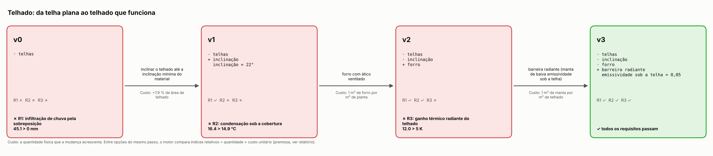
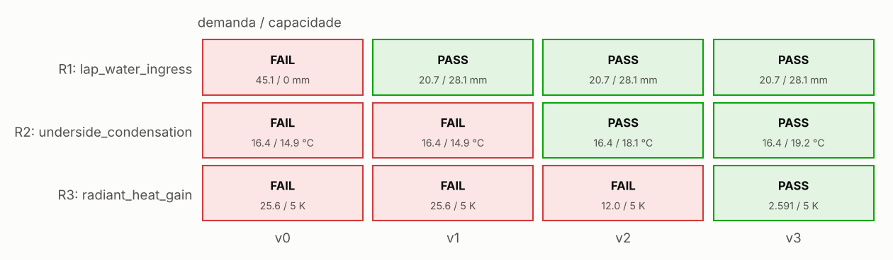
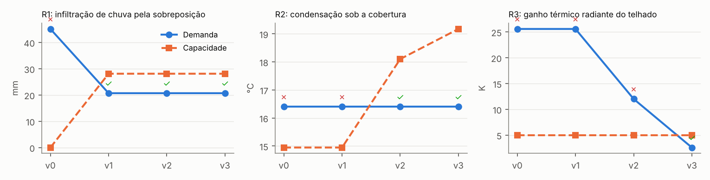
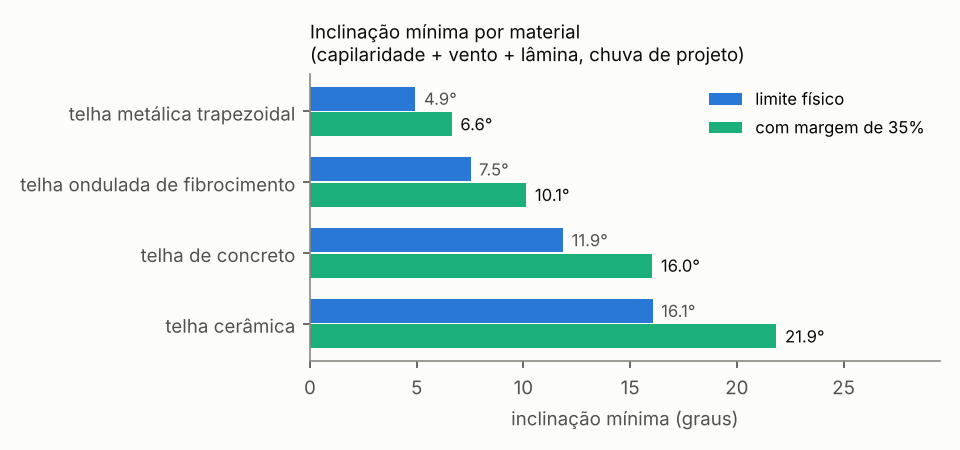

# Telhado: da telha plana ao telhado que funciona

**Status:** resolvido · **Decisão:** APPROVED · 3 passos · 15 avaliações físicas

## Requisitos

- **R1** — manter a chuva de projeto fora do ambiente (`lap_water_ingress`)
- **R2** — não pingar condensação no ambiente (`underside_condensation`)
- **R3** — teto sem desconforto radiante num dia de sol (`radiant_heat_gain`)

## Linha do tempo: versão 0 → versão N, e por quê

### Versão 0 — telhas

**✗ R1 falha: infiltração de chuva pela sobreposição.** A água sobe pela fresta de 1 mm da sobreposição por capilaridade até 14 mm, o vento empurra mais 6.15 mm e sem inclinação nada tira a água do telhado: a chuva de projeto empoça 25 mm: a carga total (14 + 6.15 + 25 = 45.1 mm) é maior que os 0 mm que a sobreposição de 75 mm levanta a 0°. A água passa por cima da sobreposição e pinga dentro.

*Prova:* carga capilar + vento + lâmina = 45.1 mm > altura que a sobreposição levanta = 0 mm — hydraulic barrier of a lapped joint: capillary rise between plates + wind head + Nusselt film / ponding vs lap rise.

Opções testadas:

| | Resolve | Margem | Custo | Mudanças |
|---|---|---|---|---|
| **→** increase_slope | sim | -1 → 0.358 | +7,9 % de área de telhado (índice 0.079) | inclinação = 22° |
|  longer_lap | inviável: sem inclinação nenhuma sobreposição levanta a água (L·sen 0 = 0) | | | |

**Escolhida: inclinar o telhado até a inclinação mínima do material.** a gravidade passa a tirar a água (lâmina fina em vez de poça) e a sobreposição ganha altura (L·sen α) contra a capilaridade e o vento. *Por quê:* resolve a falha sem quebrar nenhum requisito que passava.

### Versão 1 — telhas, inclinação

**✗ R2 falha: condensação sob a cobertura.** À noite de céu limpo a telha irradia para o céu a -1.74 °C e esfria até 14.2 °C; a face inferior da telha, em contato com o ar do ambiente, fica a 14.9 °C, abaixo do ponto de orvalho do ar interno (16.4 °C a 21 °C e 75 %): o vapor condensa e pinga no ambiente.

*Prova:* ponto de orvalho do ar interno = 16.4 °C > temperatura da superfície voltada ao ambiente = 14.9 °C — steady roof heat-balance network (clear night) + Magnus dew point.

Opções testadas:

| | Resolve | Margem | Custo | Mudanças |
|---|---|---|---|---|
| **→** ceiling_ventilated_attic | sim | -0.316 → 0.37 | 1 m² de forro por m² de planta (índice 1.5) |  |
|  ceiling_insulation | inviável: precisa antes de: ceiling | | | |

**Escolhida: forro com ático ventilado.** o ar do ambiente deixa de tocar a telha fria (ou quente): entre os dois fica um ático ventilado e o forro, que recebe a radiação da telha e a devolve ao ambiente bem mais perto da temperatura do ar. *Por quê:* resolve a falha sem quebrar nenhum requisito que passava.

### Versão 2 — telhas, inclinação, forro

**✗ R3 falha: ganho térmico radiante do telhado.** O sol de 900 W/m² aquece a telha até 59.1 °C; o forro sobre as pessoas fica a 39 °C, 12 K acima do ar do ambiente (27 °C), mais que os 5 K de assimetria radiante aceitáveis para teto quente: irradia 78.7 W/m² para dentro e incomoda.

*Prova:* assimetria radiante do teto = 12.0 K > limite de conforto (teto quente) = 5 K — steady roof heat-balance network (clear day, sun on the roof).

Opções testadas:

| | Resolve | Margem | Custo | Mudanças |
|---|---|---|---|---|
|  ceiling_ventilated_attic | inviável: o conceito já tem 'ceiling' | | | |
| **→** radiant_barrier | sim | -1.402 → 0.482 | 1 m² de manta por m² de telhado (índice 0.4) | emissividade sob a telha = 0,05 |
|  ceiling_insulation | sim | -1.402 → 0.438 | 50 mm de lã mineral sobre o forro (índice 0.4) | R do forro = 1,3 m²K/W, isolante = 50 mm |

**Escolhida: barreira radiante (manta de baixa emissividade sob a telha).** a face inferior da telha passa a ter emissividade ~0,05: a troca radiante telha-forro, a parcela dominante, cai uma ordem de grandeza. *Por quê:* resolve a falha sem quebrar nenhum requisito que passava; entre 2 opções que resolvem, é a de menor custo (0.4, 3 verificações passando; contra ceiling_insulation: 3 passando, custo 0.4).

### Versão 3 — telhas, inclinação, forro, barreira radiante

✓ todos os requisitos passam.

## Verificações da versão final

| Verificação | Demanda | Capacidade | Margem | Método |
|---|---|---|---|---|
| ✓ R1/lap_water_ingress | 20.7 mm | 28.1 mm | 0.358 | hydraulic barrier of a lapped joint: capillary rise between plates + wind head + Nusselt film / ponding vs lap rise |
| ✓ R2/underside_condensation | 16.4 °C | 19.2 °C | 0.603 | steady roof heat-balance network (clear night) + Magnus dew point |
| ✓ R3/radiant_heat_gain | 2.591 K | 5 K | 0.482 | steady roof heat-balance network (clear day, sun on the roof) |

### Números medidos

- **lap_water_ingress**: capillary rise in the lap gap = 0.014 m; wind pressure head = 0.00615 m; run-off film depth = 0.000555 m; vertical rise of the lap = 0.028 m; run-off per unit width at the eaves = 0.000208 m^2/s; film Reynolds number 4q/nu = 830.2 1
- **underside_condensation**: outer tile surface = 10.6 °C; tile underside = 10.9 °C; attic air = 14.9 °C; ceiling top surface = 18.2 °C; ceiling underside = 19.2 °C; effective sky temperature = -1.741 °C; heat flux into the room (negative: out of the room) = -18.5 W/m^2; net long-wave loss to the sky = 53.8 W/m^2; absorbed solar flux = 0 W/m^2; dew point of the room air = 16.4 °C; dew point of the attic (outdoor) air = 14.4 °C
- **radiant_heat_gain**: outer tile surface = 63.7 °C; tile underside = 63.3 °C; attic air = 36.3 °C; ceiling top surface = 30.4 °C; ceiling underside = 29.6 °C; effective sky temperature = 21.1 °C; heat flux into the room (negative: out of the room) = 16.3 W/m^2; net long-wave loss to the sky = 274.7 W/m^2; absorbed solar flux = 585.0 W/m^2

## Figuras

## Premissas e parâmetros da versão final

| Parâmetro | Valor | Fonte |
|---|---|---|
| `attic_vent` | 0.003 | countermeasure:ceiling_ventilated_attic |
| `barrier_emissivity` | 0.05 | premise |
| `ceiling_R` | 0.05 | countermeasure:ceiling_ventilated_attic |
| `ceiling_emissivity` | 0.9 | premise |
| `contact_angle_deg` | 20.0 | premise |
| `design_margin` | 0.35 | premise: covers the spread of the lap gap, wind and rain premises |
| `insulation_k` | 0.04 | premise |
| `lap_gap` | 0.001 | premise |
| `lap_length` | 0.075 | premise |
| `rain_intensity` | 4.17e-05 | 150 mm/h: intensity ABNT NBR 10844:1989 allows for small roofs without local rainfall data (premise; use the local 5-year intensity) |
| `rh_out_night` | 0.9 | premise |
| `rh_room_night` | 0.75 | premise |
| `roof_run` | 5 | premise |
| `slope_deg` | 22.0 | countermeasure:increase_slope |
| `solar_irradiance` | 900.0 | premise |
| `storm_duration` | 600.0 | premise |
| `t_out_day` | 32.0 | premise |
| `t_out_night` | 16.0 | premise |
| `t_room_day` | 27.0 | premise |
| `t_room_night` | 21.0 | premise |
| `tile_absorptance` | 0.65 | premise |
| `tile_emissivity` | 0.9 | premise |
| `tile_k` | 1 | premise |
| `tile_thickness` | 0.012 | premise |
| `tile_under_emissivity` | 0.05 | countermeasure:radiant_barrier |
| `unit_length` | 0.4 | premise |
| `wind_cp` | 1 | premise |
| `wind_day` | 2 | premise |
| `wind_night` | 1 | premise |
| `wind_speed_rain` | 10.0 | premise |

## Confiança

**Decisão:** APPROVED · score 1 · 15 checks

| Verificação | status | Valor | limit | Fonte |
|---|---|---|---|---|
| inputs recorded and finite | supports | 30.0 | — | concept parameters with their sources |
| R1/lap_water_ingress | supports | 20.7 | 28.1 | hydraulic barrier of a lapped joint: capillary rise between plates + wind head + Nusselt f |
| applicability: lap_water_ingress: film Reynolds number 4q/nu (laminar film) | supports | 830.2 | 1800.0 | Incropera et al., sec. 10.6: falling film wave-free for Re_f < 30, wavy-laminar up to 1800 |
| applicability: lap_water_ingress: gap much smaller than capillary length (plates model) | supports | 0.37 | 1 | capillary length of water sqrt(sigma/(rho g)) = 2.7 mm |
| R2/underside_condensation | supports | 16.4 | 19.2 | steady roof heat-balance network (clear night) + Magnus dew point |
| roof energy balance closes | supports | 2.44e-15 | 1e-06 | steady network: sun = sky + wind + ventilation + room |
| applicability: underside_condensation: room temperature within Magnus range | supports | 21.0 | 50.0 |  |
| R3/radiant_heat_gain | supports | 2.591 | 5 | steady roof heat-balance network (clear day, sun on the roof) |
| roof energy balance closes | supports | 1.09e-16 | 1e-06 | steady network: sun = sky + wind + ventilation + room |
| applicability: radiant_heat_gain: solar irradiance on the plane | supports | 900.0 | 1361.0 |  |
| known answer: lap_water_ingress.h_capillary | supports | 0 | 1e-09 | h = 2 sigma / (rho g w) for w = 1 mm, sigma = 0.0728 N/m (14.87 mm) |
| known answer: lap_water_ingress.h_film | supports | 1.39e-16 | 1e-09 | flat roof: 150 mm/h for 10 min ponds 25 mm |
| uncertainty: R1/lap_water_ingress worst margin (lap_gap -30 %) | supports | 0.053 | 0 | one-at-a-time spread of the mode's uncertain premises |
| uncertainty: R2/underside_condensation worst margin (rh_room_night +10 %) | supports | 0.41 | 0 | one-at-a-time spread of the mode's uncertain premises |
| uncertainty: R3/radiant_heat_gain worst margin (wind_day -50 %) | supports | 0.391 | 0 | one-at-a-time spread of the mode's uncertain premises |

### Cartão de confiança (6 etapas)

| Etapa | status | Evidência | Próximo passo |
|---|---|---|---|
| Data and geometry | answered | inputs recorded: v0, v1, v2, v3 PASS inputs recorded and finite (concept parameters with their sources) |  |
| Model | answered | PASS known answer: lap_water_ingress.h_capillary (h = 2 sigma / (rho g w) for w = 1 mm, sigma = 0.0728 N/m (14.87 mm)) PASS known answer: lap_water_ingress.h_film (flat roof: 150 mm/h for 10 min ponds 25 mm) |  |
| Physical constraints | answered | PASS roof energy balance closes (steady network: sun = sky + wind + ventilation + room) PASS roof energy balance closes (steady network: sun = sky + wind + ventilation + room) |  |
| Benchmark | open | no comparison with a solver, data or baseline | compare with a reference or a simple baseline |
| Uncertainty | answered | PASS applicability: lap_water_ingress: film Reynolds number 4q/nu (laminar film) (Incropera et al., sec. 10.6: falling film wave-free for Re_f < 30, wavy-laminar up to 1800) PASS applicability: lap_water_ingress: gap much smaller than capillary length (plates model) (capillary length of water sqrt(sigma/(rho g)) = 2.7 mm) PASS applicability: underside_condensation: room temperature within Magnus range |  |
| Engineering decision | answered | tier B (solid), ready for design screening 8 limitations bound the use |  |

## Hipóteses

- assimetria = temperatura da superfície do teto - ar (teto grande sobre o ocupante, piso à temperatura do ar)
- condensação no ático (telha abaixo do orvalho do ar externo) não avaliada: o requisito é o ambiente
- céu limpo (temperatura de céu de Swinbank)
- fresta da sobreposição como duas placas paralelas, molhamento pelo ângulo de contato dado
- lâmina somada à carga sobre a junta (conservador)
- pressão do vento integral através da cobertura (Cp dado)
- regime permanente, uma dimensão, por m² de telhado
- ático ventilado com a vazão dada; placas paralelas cinzas entre telha e forro

## Fontes

- ANSI/ASHRAE Standard 55, Thermal Environmental Conditions for Human Occupancy: allowable radiant temperature asymmetry, warm ceiling < 5 °C
- Alduchov & Eskridge (1996), 'Improved Magnus form approximation of saturation vapor pressure', J. Appl. Meteor. 35, 601-609 (a = 17.625, b = 243.04 °C)
- Bird, Stewart & Lightfoot, Transport Phenomena, 2nd ed., sec. 2.2 (laminar falling film)
- CRC Handbook of Chemistry and Physics (properties of water at 20 °C)
- Garden (1963), 'Rain penetration and its control', NRC Canada, Canadian Building Digest CBD-40
- ISO 6946:2017, Building components and building elements - Thermal resistance, Table 7 and Annex C
- Incropera et al., eq. 13.24 (radiation between large parallel grey plates)
- Swinbank (1963), 'Long-wave radiation from clear skies', Q. J. R. Meteorol. Soc. 89, 339-348
- Watmuff, Charters & Proctor (1977), wind heat-transfer coefficient h = 2.8 + 3.0 V, as given in Duffie & Beckman, Solar Engineering of Thermal Processes, sec. 3.15
- de Gennes, Brochard-Wyart & Quere (2004), Capillarity and Wetting Phenomena, ch. 1 (rise between plates)
