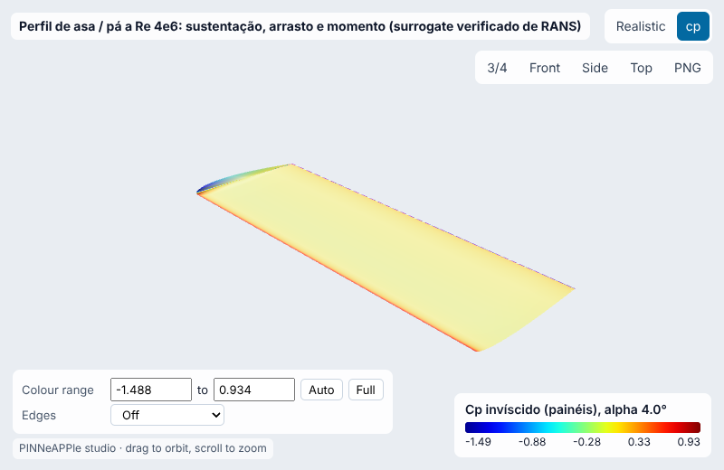
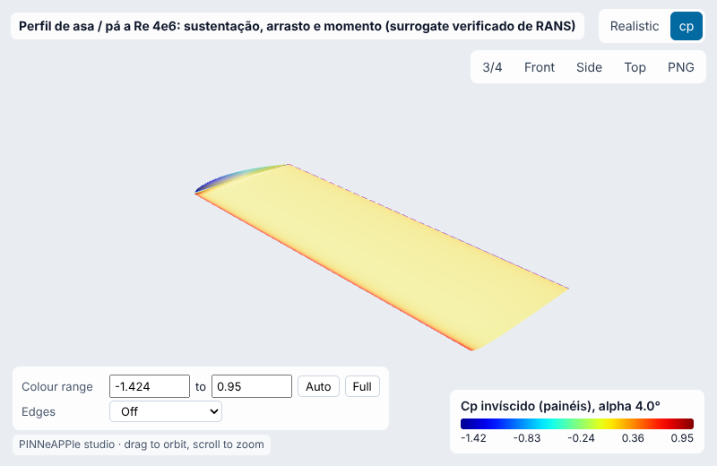
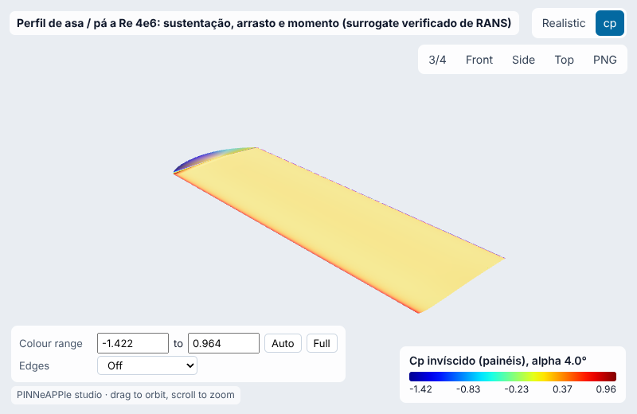
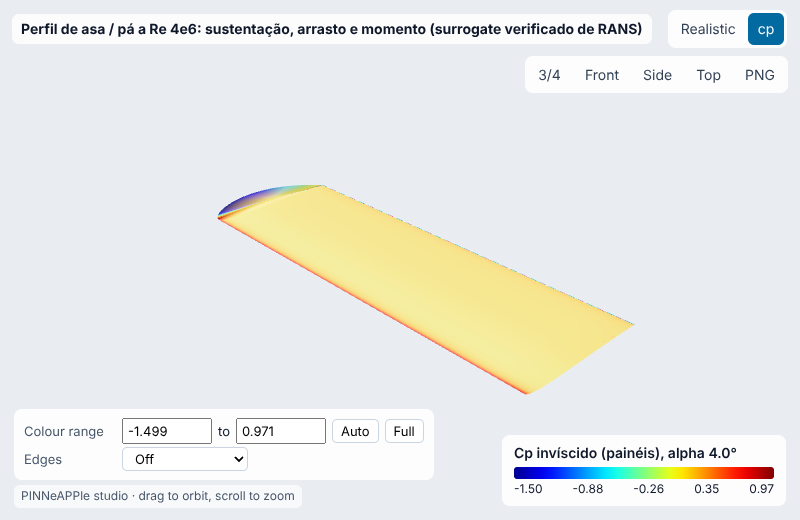
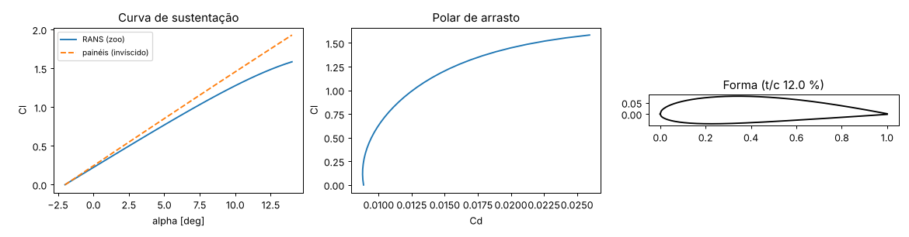
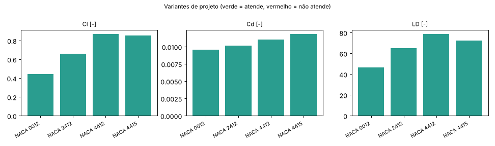
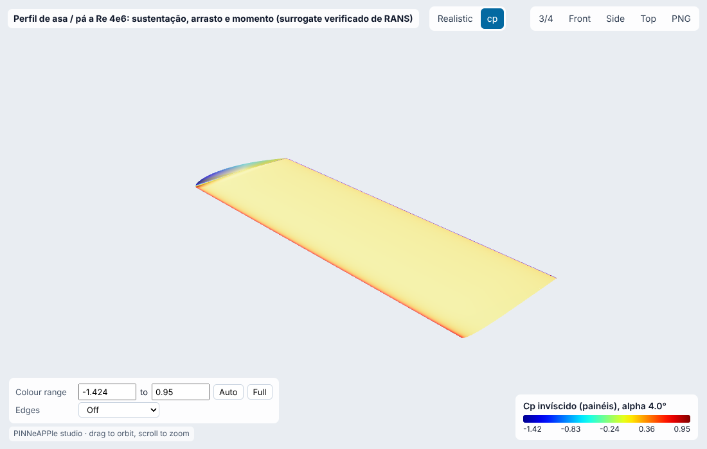

# Perfil de asa / pá a Re 4e6: sustentação, arrasto e momento (surrogate verificado de RANS)

**Setor:** Aerodinâmica / aeronaves leves, VANTs, pás de turbina eólica  
**Preset:** `airfoil_section_re4e6`

**Problema.** Seção de asa ou pá descrita por 6 parâmetros CST (3 de espessura, 3 de arqueamento), escoamento subsônico incompressível a Re = 4e6. Cl, Cd e Cm pelo modelo do zoo (ensemble de MLPs treinado em OpenFOAM RANS k-omega SST), com o desvio do ensemble; o método de painéis de Hess-Smith dá a referência invíscida.

**Pergunta de engenharia.** Qual a sustentação, o arrasto e a eficiência L/D deste perfil no ângulo de ataque de operação? Que perfil maximiza L/D com espessura estrutural >= 12 % e Cm >= -0,12?

## Uso

```python
import pinneapple as pp

p = pp.presets.load("airfoil_section_re4e6")
r = p.run()                      # valores padrão abaixo; troque qualquer entrada: p.run(nome=valor)
print(r)                         # saídas, decisão, trust report
p.validate()                     # casos de referência com o erro medido
```

CLI: `python -m pinneapple_presets run airfoil_section_re4e6 nome=valor`  
Flow Studio: nó `preset.run` com `preset = airfoil_section_re4e6`.

## Entradas (SI) e fonte de cada valor padrão

| entrada | unidade | padrão | domínio | fonte |
|---|---|---|---|---|
| `T0` | - | 0.1696 | 0.1 – 0.24 | CST de espessura, ajuste do NACA 2412 (pinneapple_design.aero.naca4) |
| `T1` | - | 0.145 | 0.08 – 0.22 | idem |
| `T2` | - | 0.1314 | 0.08 – 0.22 | idem |
| `M0` | - | 0.02492 | -0.03 – 0.08 | CST de arqueamento, ajuste do NACA 2412 |
| `M1` | - | 0.07109 | -0.02 – 0.14 | idem |
| `M2` | - | 0.05896 | -0.04 – 0.12 | idem |
| `alpha_deg` | deg | 4 | -2 – 14 | premissa: cruzeiro de aeronave leve (Cl ~0,6) |
| `chord` | m | 1.5 | 0.1 – 5 | premissa: corda média de aeronave leve (V ~ 40 m/s dá Re 4e6) |
| `velocity` | m/s | 40 | 5 – 120 | premissa; Re = V c / nu, nu do ar a 15 °C = 1,46e-5 m2/s (ISA) |

## Saídas (caso padrão, rodado aqui)

| saída | valor | unidade | significado |
|---|---|---|---|
| `Cl` | 0.6615 | - | coeficiente de sustentação (RANS, ensemble) |
| `Cd` | 0.01016 | - | arrasto |
| `Cm` | -0.04726 | - | momento em c/4 |
| `LD` | 65.13 | - | Cl/Cd |
| `Cl_std` | 0.0008502 | - | desvio do ensemble |
| `Cl_inviscid` | 0.7306 | - | Cl pelo método de painéis |
| `thickness` | 0.1202 | - | espessura máxima / corda |
| `reynolds` | 4.11e+06 | - | Re da condição dada |
| `lift_per_span` | 972.4 | N/m | sustentação por metro de envergadura |

**Decisão:** OK

- Cl 0.662 ± 0.001, Cd 0.01016, L/D 65.1, Cm -0.047 (limite -0,12)
- espessura 12.0 %, sustentação 972 N/m

**Trust report:** APPROVED (score 1, cobertura 1)

| checagem | status | valor | limite | fonte |
|---|---|---|---|---|
| shape valid (no crossing / waviness) | supports | None | None |  |
| Reynolds within 25 % of the trained 4e6 | supports | 4.11e+06 | 4e+06 | zoo airfoil_cst_rans_mlp: ensemble de 5 MLPs treinados em OpenFOAM simpleFoam k-omega SST, Re 4e6; cartão com hold-out, grade verificada (GCI), XFOIL e NASA TMR |
| ensemble spread small (Cl std < 0.01) | supports | 0.0008502 | 0.01 |  |
| viscous Cl below inviscid Cl (boundary-layer decambering) | supports | 0.6615 | 0.7306 |  |
| panel method: Kutta-Joukowski lift = pressure integral | supports | 0.7288 | 0.7306 | Hess-Smith |
| inside the validity domain | supports | None | None | preset data sheet |

## Validação

| caso | saída | calculado | referência | erro relativo | tolerância | tipo | fonte |
|---|---|---|---|---|---|---|---|
| Cl vs naca_reference (36 pontos): erro = MAE absoluto em Cl | `Cl` | 0.003231 - | 0 - | 0.323 % | 1 % | independent_solver | OpenFOAM RANS, 36 rodadas NACA 0012/2412/4412/4415 fora do treino (dados do zoo); erro absoluto médio em Cl, medido aqui |
| Cd vs naca_reference: erro = erro relativo médio | `Cd` | 0.006156 - | 0 - | 0.616 % | 2 % | independent_solver | OpenFOAM RANS, 36 rodadas NACA 0012/2412/4412/4415 fora do treino (dados do zoo) |
| Cl vs xfoil_naca2412 (9 pontos): erro = MAE absoluto em Cl | `Cl` | 0.01009 - | 0 - | 1.01 % | 3 % | independent_solver | XFOIL 6.99 com transição forçada, NACA 2412, 9 ângulos (dados do zoo); erro absoluto médio em Cl, medido aqui |
| Cd vs xfoil_naca2412: erro = erro relativo médio | `Cd` | 0.02813 - | 0 - | 2.81 % | 8 % | independent_solver | XFOIL 6.99 com transição forçada, NACA 2412, 9 ângulos (dados do zoo) |
| ângulo de sustentação nula do NACA 2412 | `alpha_L0` | -2.002 deg | -2.077 deg | 3.64 % | 10 % | analytic | teoria do aerofólio fino (Anderson, Fundamentals of Aerodynamics, cap. 4): alpha_L0 = -(1/pi) int dz/dx (cos t - 1) dt |
| inclinação dCl/dalpha: RANS vs painéis (viscoso ~5-10 % menor) | `Cl_alpha` | 0.1104 1/deg | 0.1219 1/deg | 9.43 % | 12 % | independent_solver | Hess-Smith (Moran 1984), invíscido |

Convergência (painéis por face (Hess-Smith) = [50, 100, 200, 400]): variação relativa entre os dois últimos níveis 1.34e-03 (passa).

## Inversão

Erro de calagem (incidência) de um perfil no túnel de vento a partir do Cl medido pela balança em 5 ângulos nominais (ruído 0,01 em Cl). Verdade sintética: +1,3°.

- **true:** 1.3
- **recovered:** 1.305
- **ci95:** ['1.222', '1.388']
- **rel_error:** 0.003839
- **noise:** 0.01 em Cl
- **how:** mínimos quadrados (Brent) sobre o ensemble do zoo, IC pela sensibilidade dCl/dalpha

## Otimização

- **objective:** L/D máximo no alpha dado com t/c >= 12 %, Cm >= -0,12, forma válida
- **method:** evolução diferencial (scipy) no ensemble do zoo
- **evaluations:** 5490
- **T0:** 0.2142
- **T1:** 0.08363
- **T2:** 0.08023
- **M0:** 0.07976
- **M1:** 0.1397
- **M2:** 0.1192
- **LD_opt:** 82.33
- **LD_base:** 65.13
- **Cl_opt:** 0.9273
- **Cl_std_opt:** 0.004384
- **Cm_opt:** -0.08905
- **thickness_opt:** 0.1201
- **trust_at_opt:** APPROVED
- **panel_Cl_opt:** 0.9889

## Variantes de projeto

| variante | parâmetros | Cl | Cd | LD | decisão |
|---|---|---|---|---|---|
| NACA 0012 | `{'T0': 0.16884793174362853, 'T1': 0.14578920644459822, 'T2': 0.1307308023715651, 'M0': 0.0, 'M1': 0.0, 'M2': 0.0}` | 0.4455 | 0.009566 | 46.57 | OK |
| NACA 2412 | `{'T0': 0.1695912146244289, 'T1': 0.14495873416070895, 'T2': 0.13143323808820245, 'M0': 0.02492222636259679, 'M1': 0.07108767218761686, 'M2': 0.05895967523554786}` | 0.6615 | 0.01016 | 65.13 | OK |
| NACA 4412 | `{'T0': 0.1717796874680488, 'T1': 0.142522827363271, 'T2': 0.13350098998316845, 'M0': 0.04977357717505065, 'M1': 0.14225871164978887, 'M2': 0.1178595807981071}` | 0.8698 | 0.01105 | 78.73 | OK |
| NACA 4415 | `{'T0': 0.21514704409095592, 'T1': 0.17728325873125672, 'T2': 0.1698975175261915, 'M0': 0.05501330125579129, 'M1': 0.13585083867566644, 'M2': 0.12314259806560625}` | 0.8551 | 0.01184 | 72.21 | OK |

   

## Figuras





Visualizador 3-D interativo (arquivo único, abre do disco): regenere com `python -m pinneapple_presets report airfoil_section_re4e6` → `results/3d/airfoil_section_re4e6_viewer.html`.

## Capacidades

| capacidade | tem? | por quê não |
|---|---|---|
| visualização 3-D | sim |  |
| surrogate | não | o solver deste preset já é um surrogate verificado do zoo (erros de hold-out no cartão e medidos aqui); o OpenFOAM não está instalado neste container para conferir ótimos |
| inversão | sim |  |
| otimização | sim |  |
| variação de projeto | sim |  |
| cadeia de porquês | não | não há caso aerodinâmico no pinneapple_reason |

## Pipeline

1. geometria: CST de 6 parâmetros (pinneapple_design.aero.geometry), propriedades e validade da forma
1. modelo: RANS k-omega SST (OpenFOAM) aprendido pelo zoo; painéis de Hess-Smith (invíscido)
1. solver: pp.zoo.load('airfoil_cst_rans_mlp').predict + panel_solve
1. pós: Cl, Cd, Cm, L/D, incerteza do ensemble, sustentação por envergadura
1. decisão: forma válida, dentro do domínio, L/D e Cm aceitáveis

**Domínio de validade.** Re = 4e6 (a condição dada é avisada se o Re diferir mais de 25 %), Mach < 0,3, ângulo -2 a 14° (sem estol profundo), formas dentro da caixa CST do treino; transição livre não modelada (RANS totalmente turbulento).

**Limitações.**

- Os ótimos são conferidos com o mesmo surrogate (ensemble, domínio) e com o método de painéis, não com uma nova rodada de OpenFOAM (não instalado aqui).

## Proveniência

Rodado em 2026-10-24T02:19:27Z · solver 1.68 s · relatório completo 70.2 s · Intel(R) Xeon(R) Processor @ 2.10GHz (4 núcleos) · python 3.13.17, pinneapple 0.7.0, numpy 2.5.3, scipy 1.18.1, torch 2.14.1
