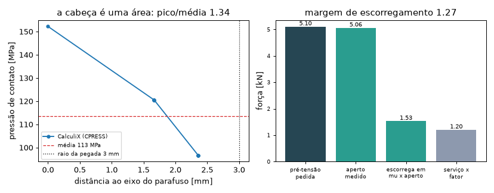
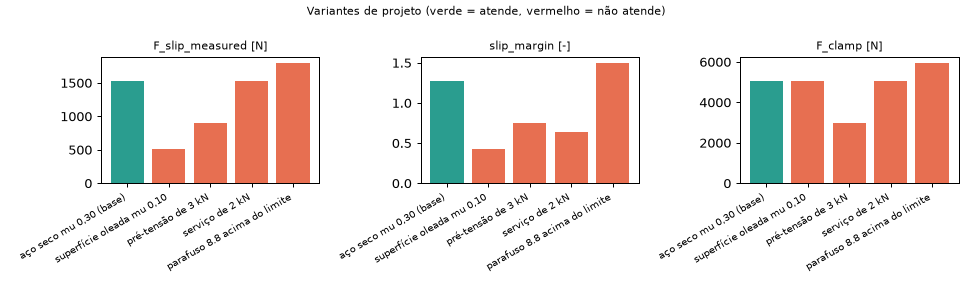
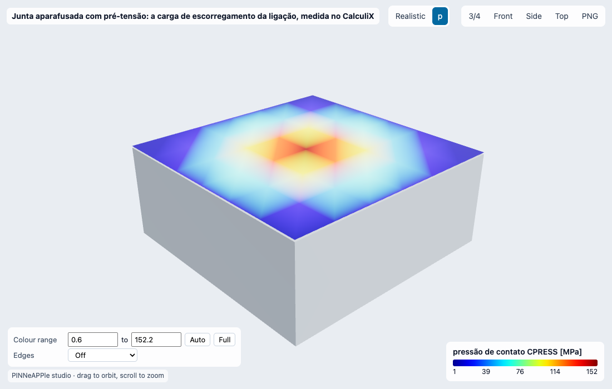

# Junta aparafusada com pré-tensão: a carga de escorregamento da ligação, medida no CalculiX

**Setor:** Estrutural / ligações aparafusadas, máquinas e estruturas metálicas  
**Preset:** `bolted_joint_preload`

**Problema.** Duas chapas de aço apertadas por um parafuso cuja pré-tensão é aplicada por um *PRE-TENSION SECTION, com a cabeça e a porca chegando às chapas por *DISTRIBUTING COUPLING sobre a pegada (carga distribuída por área, como a de uma cabeça real). A junta é puxada tangencialmente até a interface deslizar: o deck é resolvido pelo CalculiX 2.23, os resultados são lidos de volta por pinneapple_data.cae e a força de escorregamento é comparada com mu vezes o aperto medido.

**Pergunta de engenharia.** Quanta força cisalhante esta junta transmite antes de escorregar, a pré-tensão chega mesmo às chapas, e a cabeça pressiona como área ou morde um nó? A junta atende a carga de serviço com o fator de segurança pedido, e qual pré-tensão seria necessária se não atendesse?

## Uso

```python
import pinneapple as pp

p = pp.presets.load("bolted_joint_preload")
r = p.run()                      # valores padrão abaixo; troque qualquer entrada: p.run(nome=valor)
print(r)                         # saídas, decisão, trust report
p.validate()                     # casos de referência com o erro medido
```

CLI: `python -m pinneapple_presets run bolted_joint_preload nome=valor`  
Flow Studio: nó `preset.run` com `preset = bolted_joint_preload`.

## Entradas (SI) e fonte de cada valor padrão

| entrada | unidade | padrão | domínio | fonte |
|---|---|---|---|---|
| `preload` | N | 5100 | 500 – 6e+04 | VDI 2230 Blatt 1 (2015) Tab. A5 e eq. (5): pré-tensão de montagem F_M = 0,70 S_p A_s numa junta única; mu de projeto 0,24 a 0,35 para aço-aço seco; ISO 898-1:2013 Tab. 3: classe 8.8, tensão de prova S_p = 580 MPa para d <= 16 mm com a haste de raio 2 mm (A = 12,57 mm²) |
| `mu` | - | 0.3 | 0.05 – 0.6 | VDI 2230 Blatt 1 (2015) Tab. A5 e eq. (5): pré-tensão de montagem F_M = 0,70 S_p A_s numa junta única; mu de projeto 0,24 a 0,35 para aço-aço seco |
| `plate_side` | m | 0.01 | 0.004 – 0.2 | premissa: chapa de 10 mm de lado, para a pegada de 3 mm caber com folga |
| `plate_thickness` | m | 0.004 | 0.001 – 0.05 | premissa: duas chapas de 4 mm (o comprimento aparafusado) |
| `bolt_radius` | m | 0.002 | 0.0005 – 0.02 | premissa: haste de raio 2 mm (M4/M5); só dimensiona a viga do parafuso |
| `head_radius` | m | 0.003 | 0.0012 – 0.03 | raio da pegada da cabeça e da porca (a área por onde o aperto entra) |
| `slip_imposed` | m | 5e-05 | 0 – 0.001 | deslizamento prescrito no segundo passo, grande o bastante para a interface chegar ao limite de atrito |
| `mesh` | - | 6 | 4 – 16 | células por direção nas chapas; a carga de escorregamento varia 0,02 % entre 4, 6 e 8 células |
| `E` | Pa | 2.1e+11 | 7e+10 – 2.2e+11 | aço carbono (BPVC II-D Tab. TM-1, ~201 GPa; aqui o aço do caso) |
| `nu` | - | 0.3 | 0.25 – 0.35 | aço carbono |
| `service_load` | N | 1000 | 10 – 5e+04 | premissa: 1 kN de cisalhamento de serviço na junta |
| `safety_factor` | - | 1.2 | 1 – 3 | Richmond & DeVries / Shigley sec. 8-11: a ligação por atrito não escorrega em serviço, e a carga de escorregamento é mu x aperto com 20 % de margem (ligação que não pode deslizar) |
| `proof_strength` | Pa | 5.8e+08 | 2e+08 – 1.2e+09 | ISO 898-1:2013 Tab. 3: classe 8.8, tensão de prova S_p = 580 MPa para d <= 16 mm |

## Saídas (caso padrão, rodado aqui)

| saída | valor | unidade | significado |
|---|---|---|---|
| `F_clamp` | 5055 | N | aperto medido: integral de CPRESS na interface no fim do passo de pré-tensão |
| `clamp_loss` | 0.008736 | - | perda entre a pré-tensão pedida e o aperto medido (0,009 = 0,9 % a menos) |
| `F_slip` | 1517 | N | capacidade de escorregamento do atrito: mu vezes o aperto medido |
| `F_slip_measured` | 1528 | N | força tangencial medida no apoio quando a interface desliza (a prova do F_slip) |
| `slip_margin` | 1.274 | - | F_slip_measured / (fator de segurança x carga de serviço); >= 1 atende |
| `F_preload_required` | 4000 | N | pré-tensão que a carga de serviço exige: fator x carga / mu (conta fechada) |
| `p_head_mean` | 1.135e+08 | Pa | pressão média de contato sob a pegada da cabeça |
| `p_head_peak` | 1.522e+08 | Pa | pressão de pico sob a pegada |
| `head_ratio` | 1.342 | - | pico / média sob a pegada: 1 é carga distribuída, muito acima disso é um nó |
| `bolt_stress` | 4.058e+08 | Pa | tensão nominal no fuste do parafuso com a pré-tensão |
| `bolt_utilisation` | 0.6997 | - | tensão no fuste / tensão de prova da classe |
| `slip_measured` | 4.692e-05 | m | escorregamento relativo medido na interface no fim do puxamento |
| `contact_opening` | 0 | m | maior abertura (COPEN) na interface: a junta não pode abrir em serviço |
| `razao_coulomb` | 0.3 | - | maior |tau| / p na interface carregada: toca mu quando a junta escorrega |

**Decisão:** OK

- escorrega a 1.53 kN (mu x aperto medido = 1.52 kN) contra 1.00 kN de serviço x 1.20 = margem 1.27
- aperto medido 5.06 kN para 5.10 kN de pré-tensão (+0.9 %), pressão sob a cabeça 113 MPa média e 152 MPa de pico (pico/média 1.34)
- tensão no fuste 406 MPa = 70 % da tensão de prova de 580 MPa

**Trust report:** APPROVED (score 1, cobertura 1)

| checagem | status | valor | limite | fonte |
|---|---|---|---|---|
| CalculiX (ccx) disponível para resolver o deck | supports | 2.23 | None | ccx -v |
| o CalculiX terminou o deck do contato | supports | 1 | 1 | .sta e log do CalculiX |
| o aperto medido é a pré-tensão aplicada | supports | 5055 | 5100 | força de aperto medida pela integral de CPRESS na interface, contra a pré-tensão aplicada |
| o aperto não se perde quando a junta é puxada | supports | 5282 | 5055 | o aperto não se perde quando a junta é puxada |
| a cabeça do parafuso pressiona como área, não como um nó | supports | 1.342 | 1.5 | cabeça como área: pressão uniforme sobre a pegada daria 1; um nó só concentra a carga (1,6 neste caso, medido com o parafuso de um nó só na mesma malha) |
| a força tangencial satura em mu x N quando a interface desliza | supports | 1528 | 1517 | junta pré-tensionada: F = mu x N = 0.3 x (aperto medido no primeiro passo) N |
| a reação tangencial transmitida não passa do limite de atrito | supports | 1528 | 1517 | junta pré-tensionada: F = mu x N = 0.3 x (aperto medido no primeiro passo) N |
| |tau| <= mu p em cada nó carregado (cone de Coulomb) | supports | 0.3 | 0.3 | |tau| <= mu p em cada nó carregado |
| a junta não abre sob o puxamento (COPEN <= 0 em todos os nós) | supports | 0 | 0 | a junta não abre sob o puxamento (COPEN <= 0 em todos os nós) |
| a carga de escorregamento atende a carga de serviço com o fator | supports | 1.274 | 1 | Richmond & DeVries / Shigley sec. 8-11: a ligação por atrito não escorrega em serviço, e a carga de escorregamento é mu x aperto |
| a tensão no fuste fica em 75 % da tensão de prova ou menos | supports | 0.6997 | 0.75 | ISO 898-1:2013 Tab. 3: classe 8.8, tensão de prova S_p = 580 MPa para d <= 16 mm e Shigley, Mechanical Engineering Design, 10a ed., sec. 8-8: F_i = 0,75 S_p A_t para junta reutilizada |
| o aperto medido é a pré-tensão a menos de 2 % | supports | 0.008736 | 0.02 | equilíbrio do *PRE-TENSION SECTION: a força de aperto é a pré-tensão aplicada |
| equilíbrio vertical da junta (reação fora do plano nula) | supports | 1.074e-11 | 5.1 | soma das reações em y no apoio é nula: nada empurra a junta fora do plano |
| inside the validity domain | supports | None | None | preset data sheet |

## Validação

| caso | saída | calculado | referência | erro relativo | tolerância | tipo | fonte |
|---|---|---|---|---|---|---|---|
| aperto = pré-tensão (8 kN) | `F_clamp` | 7861 N | 8000 N | 1.74 % | 3 % | analytic | equilíbrio do *PRE-TENSION SECTION: a força que o parafuso devolve às chapas é a pré-tensão (medido -1,7 %, a mesma perda que a checagem do caso declara em 3 %) (CalculiX 2.23 manual, *PRE-TENSION SECTION e *DISTRIBUTING COUPLING) |
| escorregamento em mu x N com mu = 0,5 e 4 kN | `F_slip_measured` | 1997 N | 2000 N | 0.129 % | 3 % | analytic | Coulomb: a interface escorrega quando a força tangencial passa de mu x N (CalculiX 2.23 manual, *PRE-TENSION SECTION e *DISTRIBUTING COUPLING) |
| escorregamento em mu x N com mu = 0,15 e 6 kN (junta oleada) | `F_slip_measured` | 899.1 N | 900 N | 0.0986 % | 3 % | analytic | Coulomb: a interface escorrega quando a força tangencial passa de mu x N (CalculiX 2.23 manual, *PRE-TENSION SECTION e *DISTRIBUTING COUPLING) |
| cone de Coulomb: |tau|/p na interface igual a mu = 0,5 | `razao_coulomb` | 0.5 - | 0.5 - | 0.000317 % | 5 % | analytic | cada nó carregado fica dentro do cone de atrito, e o maior |tau|/p o toca quando a interface desliza (CalculiX 2.23 manual, *PRE-TENSION SECTION e *DISTRIBUTING COUPLING) |

Convergência (malha (células por direção nas chapas) = [4, 6, 8]): variação relativa entre os dois últimos níveis 5.23e-06 (passa).

## Variantes de projeto

| variante | parâmetros | F_slip_measured | slip_margin | F_clamp | decisão |
|---|---|---|---|---|---|
| aço seco mu 0,30 (base) | `{}` | 1528 | 1.274 | 5055 | OK |
| superfície oleada mu 0,10 | `{'mu': 0.1}` | 509.6 | 0.4247 | 5055 | NOT OK |
| pré-tensão de 3 kN | `{'preload': 3000.0}` | 899.4 | 0.7495 | 2974 | NOT OK |
| serviço de 2 kN | `{'service_load': 2000.0}` | 1528 | 0.6368 | 5055 | NOT OK |
| parafuso 8.8 acima do limite | `{'preload': 6000.0}` | 1798 | 1.498 | 5947 | NOT OK |

## Figuras





Visualizador 3-D interativo (arquivo único, abre do disco): regenere com `python -m pinneapple_presets report bolted_joint_preload` → `results/3d/bolted_joint_preload_viewer.html`.

## Capacidades

| capacidade | tem? | por quê não |
|---|---|---|
| visualização 3-D | sim |  |
| surrogate | não | cada ponto do DOE custa uma corrida de 15 a 25 s do ccx em dois passos; o domínio é pequeno e a conta que importa (mu x N) é fechada, então um surrogate não pagaria o custo de treino |
| inversão | não | mu não é medido pela análise: ele é a entrada que a torna conservadora ou não. Recuperá-lo exigiria ensaio de escorregamento, não uma corrida de elementos finitos |
| otimização | não | a pré-tensão que a carga de serviço exige é uma conta fechada, publicada em F_preload_required; otimizá-la com o sólver só confirmaria a conta a 20 s por ponto |
| variação de projeto | sim |  |
| cadeia de porquês | não | não há caso de junta aparafusada no pinneapple_reason |

## Pipeline

1. geometria: duas chapas 10 x 4 x 10 mm e a pegada de raio 3 mm em torno do eixo do parafuso
1. modelo: malha hexaédrica estruturada (pinneapple_simulation.external_solvers.calculix.contact.mesh), deck com *PRE-TENSION SECTION e *DISTRIBUTING COUPLING (contact.deck)
1. solver: CalculiX 2.23 (ccx) em dois passos — pré-tensão e depois puxamento tangencial prescrito
1. pós: .frd/.dat lidos por pinneapple_data.cae — CPRESS, CSHEAR, COPEN, reações
1. decisão: carga de escorregamento contra a carga de serviço com o fator, aperto contra a pré-tensão, cabeça como área, tensão no fuste contra a classe

**Domínio de validade.** Duas chapas de aço elásticas, contato de Coulomb seco com mu constante, parafuso modelado como viga de um elemento substituída pela restrição da pré-tensão, pegada quadrada (o bloco de nós dentro do raio) e deslizamento prescrito pequeno em relação ao lado da chapa. Não cobre fadiga, relaxação, pressão de contato na borda do furo, rosca nem plastificação local sob a cabeça.

**Limitações.**

- o parafuso não é modelado volumetricamente: a flexibilidade dele é a do comprimento aparafusado, e não há concentração de tensão na rosca (a tensão do fuste é a nominal, pré-tensão sobre pi r²)
- a pegada é o bloco de nós dentro do raio, não um anel: o furo do parafuso e a concentração de pressão na borda do furo não estão no modelo
- contato e atrito são resolvidos com a formulação do CalculiX (penalidade + atrito de Coulomb); escorregamento parcial e micro-deslizamento da borda não são capturados
- o deslizamento é prescrito, não uma força aplicada: é o que faz a interface chegar ao limite sem divergir, mas a curva força-deslizamento depois do escorregamento não é o resultado

## Proveniência

Rodado em 2026-11-25T21:56:51Z · solver 11.8 s · relatório completo 155 s · arm (10 núcleos) · python 3.11.16, numpy 2.4.6, scipy 1.17.1, torch 2.15.0
