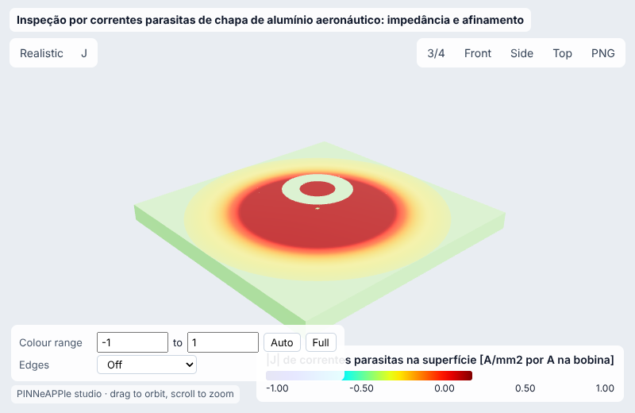
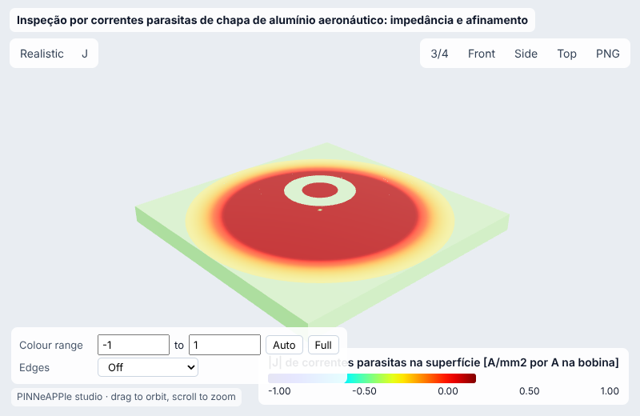
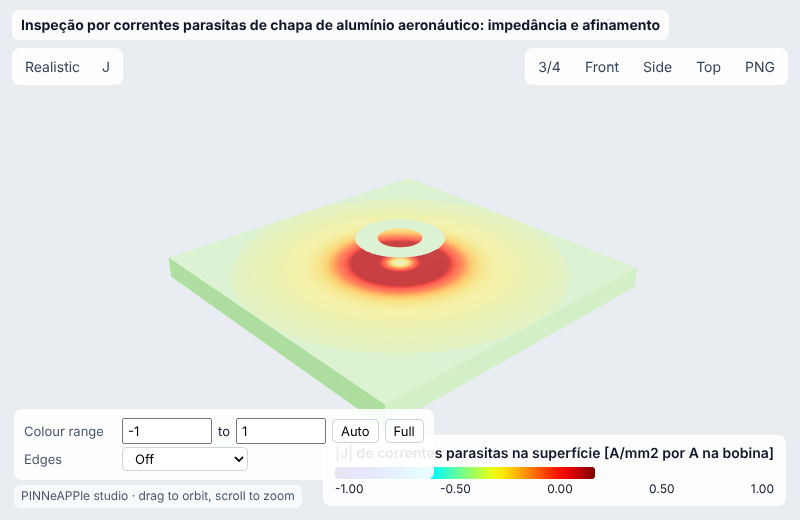
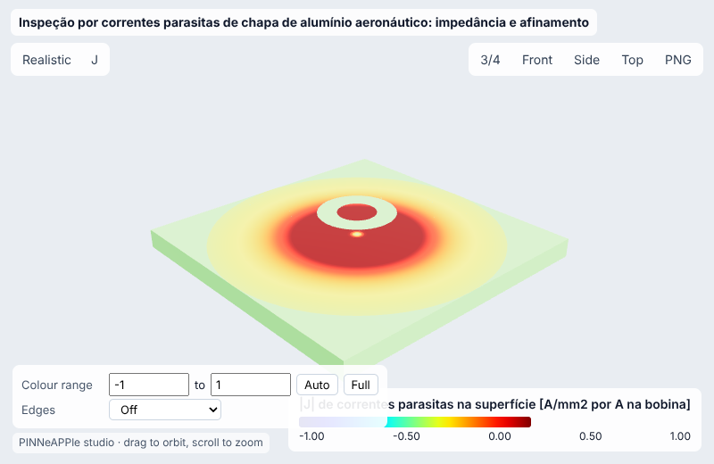
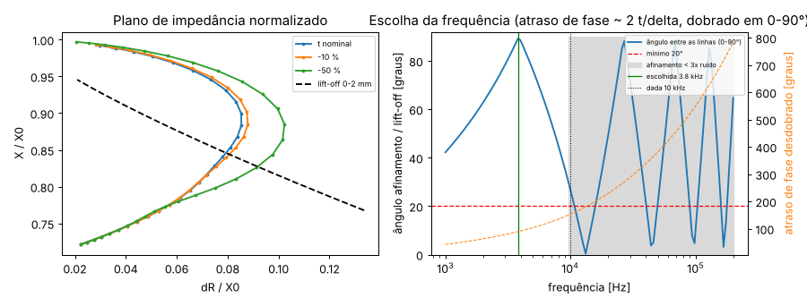
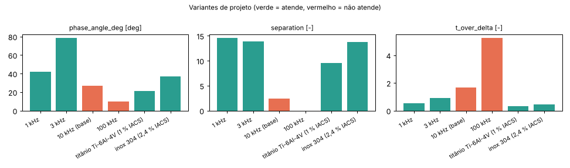
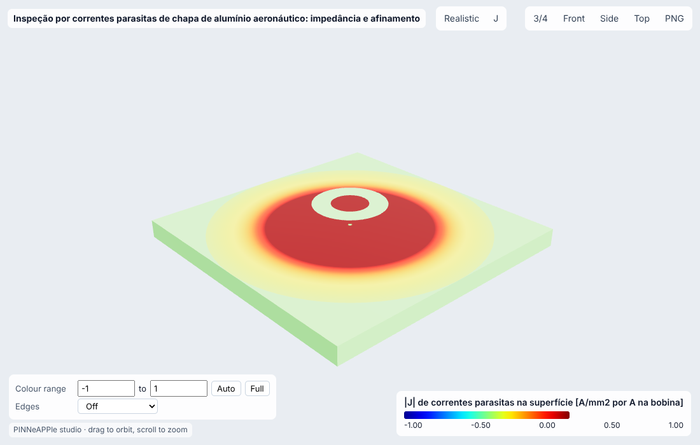

# Inspeção por correntes parasitas de chapa de alumínio aeronáutico: impedância e afinamento

**Setor:** Eletromagnetismo / ensaios não destrutivos (aeronáutica, óleo e gás)  
**Preset:** `eddy_current_skin_inspection`

**Problema.** Sonda absoluta tipo pancake (bobina com núcleo de ar) sobre chapa de Al 2024-T3. Variação de impedância pela solução analítica de Dodd & Deeds, conferida pelo FDM axissimétrico da lib; profundidade de penetração; sensibilidade ao afinamento por corrosão frente ao lift-off.

**Pergunta de engenharia.** Nesta frequência a sonda distingue 10 % de perda de espessura da variação de lift-off do operador? Qual frequência de ensaio separa melhor os dois sinais, e quanto de espessura se lê de uma medição em várias frequências?

## Uso

```python
import pinneapple as pp

p = pp.presets.load("eddy_current_skin_inspection")
r = p.run()                      # valores padrão abaixo; troque qualquer entrada: p.run(nome=valor)
print(r)                         # saídas, decisão, trust report
p.validate()                     # casos de referência com o erro medido
```

CLI: `python -m pinneapple_presets run eddy_current_skin_inspection nome=valor`  
Flow Studio: nó `preset.run` com `preset = eddy_current_skin_inspection`.

## Entradas (SI) e fonte de cada valor padrão

| entrada | unidade | padrão | domínio | fonte |
|---|---|---|---|---|
| `f` | Hz | 1e+04 | 100 – 1e+06 | premissa: ensaio de corrosão em chapa fina, 1-100 kHz típico (ASM Handbook vol. 17) |
| `sigma` | S/m | 1.74e+07 | 5e+05 – 6e+07 | Al 2024-T3: ~30 % IACS (ASM / MIL-HDBK-5): 17,4 MS/m |
| `thickness` | m | 0.002 | 0.0002 – 0.02 | premissa: revestimento de fuselagem de 2,0 mm |
| `liftoff` | m | 0.0005 | 0 – 0.003 | premissa: 0,5 mm (camada de tinta + desgaste da face da sonda) |
| `r1` | m | 0.002 | 0.0002 – 0.02 | premissa: bobina pancake, raio interno 2 mm |
| `r2` | m | 0.004 | 0.0005 – 0.03 | raio externo 4 mm |
| `height` | m | 0.002 | 0.0002 – 0.02 | altura da bobina 2 mm |
| `turns` | - | 200 | 1 – 5000 | premissa: 200 espiras |
| `loss` | - | 0.1 | 0.01 – 0.5 | afinamento a detectar: 10 % da espessura (critério típico de corrosão) |
| `liftoff_noise` | m | 5e-05 | 1e-06 – 0.0005 | premissa: variação de lift-off do operador ±0,05 mm (define a direção do lift-off no plano de impedância) |
| `noise_frac` | - | 0.002 | 0.0001 – 0.05 | premissa: ruído do instrumento 0,2 % de |dZ| |
| `angle_min` | deg | 20 | 5 – 60 | premissa: separação de fase mínima entre afinamento e lift-off para girar o lift-off para a horizontal e ler o afinamento na vertical (prática de ajuste de fase) |

## Saídas (caso padrão, rodado aqui)

| saída | valor | unidade | significado |
|---|---|---|---|
| `dR` | 1.017 | ohm | variação de resistência da sonda |
| `dX` | -1.975 | ohm | variação de reatância |
| `R_norm` | 0.07937 | - | dR / X0 (plano de impedância normalizado) |
| `X_norm` | 0.8459 | - | (X0 + dX) / X0 |
| `delta` | 0.001207 | m | profundidade padrão de penetração |
| `t_over_delta` | 1.658 | - | espessura / delta |
| `signal_loss` | 0.02424 | ohm | |dZ| causado pelo afinamento |
| `signal_liftoff` | 0.09031 | ohm | |dZ| causado pelo ruído de lift-off |
| `phase_angle_deg` | 26.64 | deg | ângulo entre os sinais de afinamento e de lift-off no plano de impedância |
| `separation` | 2.446 | - | componente do sinal de afinamento perpendicular ao lift-off / ruído do instrumento |

**Decisão:** NOT OK

- delta = 1.21 mm, t/delta = 1.66
- sinal do afinamento de 10 %: 24.24 mohm, lift-off ±50 um: 90.31 mohm, ângulo de fase entre eles 27°
- componente perpendicular / ruído = 2.4 (mín. 3); ângulo 27° (mín. 20°)

**Trust report:** APPROVED (score 1, cobertura 1)

| checagem | status | valor | limite | fonte |
|---|---|---|---|---|
| passive load: dR >= 0 (eddy losses) | supports | 1.017 | 0 |  |
| conductor lowers the inductance: dX <= 0 | supports | -1.975 | 0 |  |
| coil geometry r2 > r1 | supports | None | None |  |
| quasi-static: probe much smaller than the wavelength | supports | 0.008 | 300 |  |
| inside the validity domain | supports | None | None | preset data sheet |

## Validação

| caso | saída | calculado | referência | erro relativo | tolerância | tipo | fonte |
|---|---|---|---|---|---|---|---|
| dZ da sonda: Dodd & Deeds vs FDM axissimétrico da lib (h = 0,1 mm) | `dZ` | 2.221 ohm | 2.212 ohm | 0.456 % | 2 % | independent_solver | solve_axisymmetric_eddy_current (diferenças finitas, A = 0 a 0,05 m); a analítica é Dodd & Deeds, J. Appl. Phys. 39(6):2829-2838 (1968), solução analítica bobina sobre placa |
| placa de 10 delta = semi-espaço | `dZ` | 2.181 ohm | 2.181 ohm | 3.51e-08 % | 0.0001 % | analytic | Dodd & Deeds, J. Appl. Phys. 39(6):2829-2838 (1968), solução analítica bobina sobre placa (limite c -> infinito) |
| indutância da bobina no ar: Dodd & Deeds vs Wheeler (multicamada) | `L0` | 0.0002039 H | 0.0002025 H | 0.716 % | 5 % | analytic | Wheeler, Proc. IRE 16 (1928): L = 0,8 a2 N2/(6a + 9b + 10c) uH em polegadas, ~1 % |

Convergência (passo h do FDM [m] = [0.0002, 0.0001]): variação relativa entre os dois últimos níveis 7.33e-02 (passa).

## Inversão

Espessura remanescente e lift-off a partir da impedância medida em 5 frequências (2 a 50 kHz), ruído de 0,5 % em cada componente. Verdade sintética: 1,70 mm (de 2,0) e lift-off de 0,6 mm.

- **true:** ['0.0017', '0.0006']
- **recovered:** ['0.001701', '0.0005995']
- **ci95:** ['[0.0016806934593528722, 0.0017222799659051906]', '[0.000595851626121388, 0.000603092902219174]']
- **rel_error:** 0.0008745
- **noise:** 0.5 %
- **how:** Gauss-Newton ponderado sobre Dodd & Deeds, covariância (J^T J)^-1

## Otimização

- **objective:** frequência de maior ângulo afinamento/lift-off com sinal perpendicular >= 3x ruído
- **f_best_hz:** 3803
- **angle_best_deg:** 89.2
- **separation_best:** 12.34
- **t_over_delta_best:** 1.022
- **angle_at_given_f:** 26.64
- **verified_ok:** True

## Variantes de projeto

| variante | parâmetros | phase_angle_deg | separation | t_over_delta | decisão |
|---|---|---|---|---|---|
| 1 kHz | `{'f': 1000.0}` | 42.23 | 14.55 | 0.5242 | OK |
| 3 kHz | `{'f': 3000.0}` | 78.37 | 13.85 | 0.9079 | OK |
| 10 kHz (base) | `{}` | 26.64 | 2.446 | 1.658 | NOT OK |
| 100 kHz | `{'f': 100000.0}` | 10.11 | 0.002137 | 5.242 | NOT OK |
| titânio Ti-6Al-4V (1 % IACS) | `{'sigma': 603200.0}` | 21.24 | 9.523 | 0.3086 | OK |
| inox 304 (2,4 % IACS) | `{'sigma': 1392000.0}` | 36.9 | 13.73 | 0.4688 | OK |

     

## Figuras





Visualizador 3-D interativo (arquivo único, abre do disco): regenere com `python -m pinneapple_presets report eddy_current_skin_inspection` → `results/3d/eddy_current_skin_inspection_viewer.html`.

## Capacidades

| capacidade | tem? | por quê não |
|---|---|---|
| visualização 3-D | sim |  |
| surrogate | não | a solução analítica leva ~10 ms; um surrogate não economiza tempo |
| inversão | sim |  |
| otimização | sim |  |
| variação de projeto | sim |  |
| cadeia de porquês | não | não há caso de ensaio não destrutivo no pinneapple_reason |

## Pipeline

1. geometria: bobina retangular (r1, r2, altura, lift-off), chapa de espessura c
1. modelo: potencial vetor A_theta, regime harmônico, sigma da liga (% IACS)
1. solver: coil_impedance (Dodd & Deeds, quadratura de Gauss em log alpha); FDM axissimétrico para conferir
1. pós: plano de impedância, delta, sinal de afinamento vs lift-off
1. decisão: ângulo entre afinamento e lift-off >= mínimo e componente perpendicular >= 3x ruído

**Domínio de validade.** Bobina de núcleo de ar, chapa plana infinita não magnética (mu_r = 1) com ar abaixo, regime harmônico quase estático (f << ressonância da bobina), sem trincas (um defeito localizado precisa do FDM ou de um modelo 3-D).

**Limitações.**

- O ângulo entre afinamento e lift-off é o ângulo entre duas linhas, dobrado em 0-90°. O sinal do afinamento gira cerca de 2 t/delta rad atrás do lift-off conforme a frequência sobe (atraso de fase da parede de fundo), então o ângulo dobrado sobe e desce em dente de serra acima de ~4 kHz. Isso é físico: o atraso desdobrado é suave e linear em t/delta (figura, eixo da direita). Acima de ~12 kHz o sinal de afinamento cai abaixo de 3x o ruído e essas frequências não servem (faixa cinza).

## Proveniência

Rodado em 2026-10-24T17:01:36Z · solver 0.0717 s · relatório completo 143 s · Intel(R) Xeon(R) Processor @ 2.10GHz (4 núcleos) · python 3.13.17, pinneapple 0.7.0, numpy 2.5.3, scipy 1.18.1, torch 2.14.1
