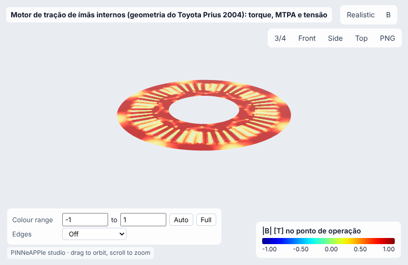
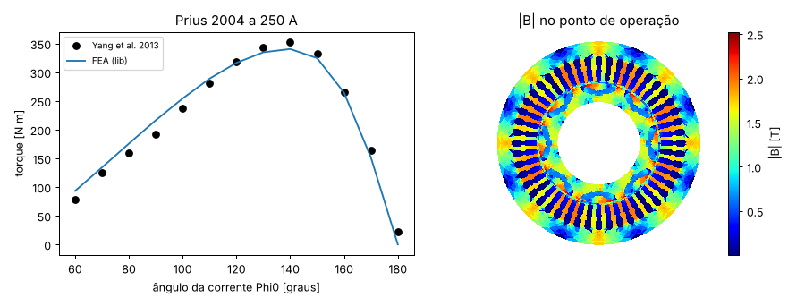
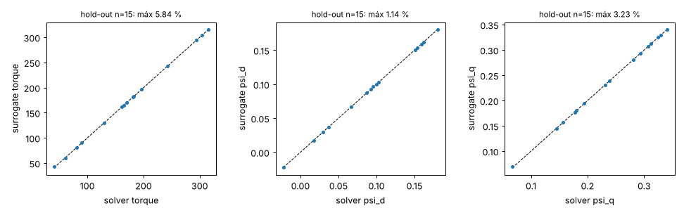
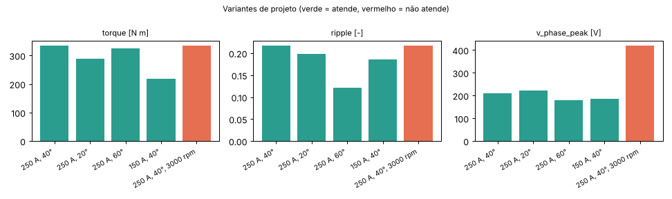
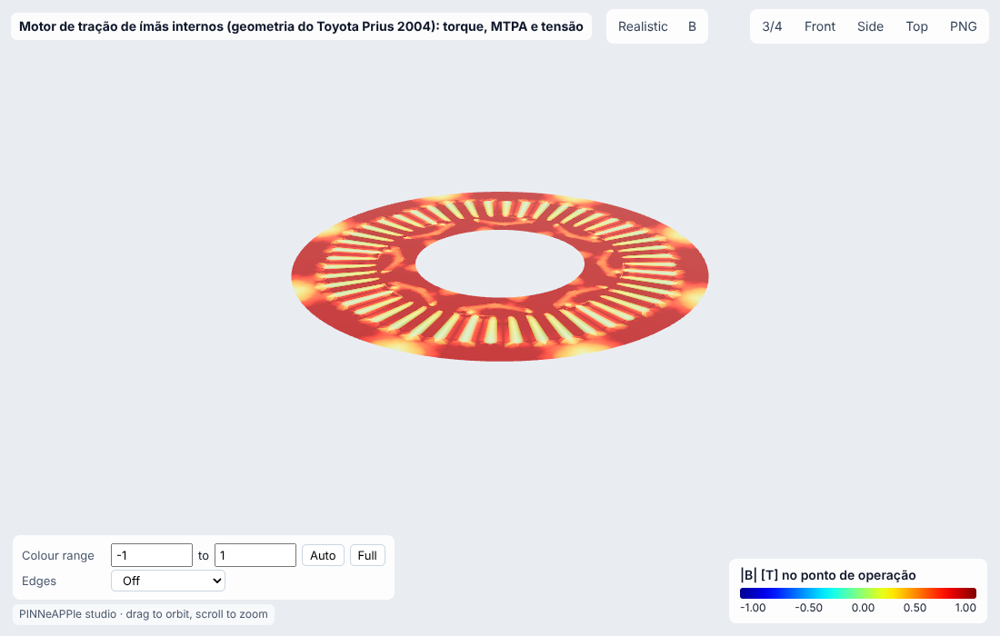

# Motor de tração de ímãs internos (geometria do Toyota Prius 2004): torque, MTPA e tensão

**Setor:** Eletromagnetismo / mobilidade elétrica  
**Preset:** `ipm_traction_motor`

**Problema.** Motor síncrono de ímãs internos em V (8 polos, 48 ranhuras) com a geometria publicada do Prius 2004. FEM magnetostático não linear por posição de rotor com correntes senoidais fixas no referencial dq: torque médio (Arkkio), ondulação, fluxos dq, ângulo de máximo torque por ampère (MTPA) e a tensão de fase na rotação pedida contra o limite do inversor.

**Pergunta de engenharia.** Que torque o motor dá nesta corrente e neste ângulo, quanto falta para o MTPA, e a tensão nesta rotação cabe no barramento CC (ou é preciso enfraquecimento de campo)?

## Uso

```python
import pinneapple as pp

p = pp.presets.load("ipm_traction_motor")
r = p.run()                      # valores padrão abaixo; troque qualquer entrada: p.run(nome=valor)
print(r)                         # saídas, decisão, trust report
p.validate()                     # casos de referência com o erro medido
p.run(fidelity="surrogate")     # surrogate treinado (com desvio-padrão e aviso fora do domínio)
```

CLI: `python -m pinneapple_presets run ipm_traction_motor nome=valor`  
Flow Studio: nó `preset.run` com `preset = ipm_traction_motor`.

## Entradas (SI) e fonte de cada valor padrão

| entrada | unidade | padrão | domínio | fonte |
|---|---|---|---|---|
| `I_peak` | A | 250 | 10 – 300 | 250 A de pico, o ponto publicado de Yang et al. (2013) |
| `gamma_deg` | deg | 40 | 0 – 85 | ângulo da corrente a partir do eixo q (0 = só i_q) |
| `rpm` | rpm | 1500 | 0 – 6000 | premissa: rotação de base em torno de 1200-1500 rpm (Staunton et al., ORNL/TM-2004/247, 'Evaluation of the 2004 Toyota Prius hybrid electric drive system' (2005)) |
| `v_dc` | V | 500 | 100 – 800 | barramento CC do Prius 2004 com o conversor elevador: até 500 V (Staunton et al., ORNL/TM-2004/247, 'Evaluation of the 2004 Toyota Prius hybrid electric drive system' (2005)) |
| `n_positions` | - | 6 | 3 – 24 | posições do rotor por média de torque |
| `n_gap` | - | 480 | 480, 960 | nós no entreferro (malha); 960 na verificação de convergência |

## Saídas (caso padrão, rodado aqui)

| saída | valor | unidade | significado |
|---|---|---|---|
| `torque` | 334.9 | N m | torque médio (tensor de Maxwell, Arkkio) |
| `torque_dq` | 338.7 | N m | torque pelos fluxos dq: 1,5 p (psi_d i_q - psi_q i_d) |
| `ripple` | 0.2173 | - | ondulação pico-a-pico / média |
| `psi_d` | 0.01471 | Wb | fluxo de eixo d |
| `psi_q` | 0.3338 | Wb | fluxo de eixo q |
| `v_phase_peak` | 209.9 | V | tensão de fase de pico (sem resistência) na rotação dada |
| `v_limit` | 288.7 | V | limite de tensão de fase com modulação senoidal: V_dc / sqrt(3) |

**Decisão:** OK

- torque 334.9 N m a 250 A, gamma 40°
- tensão de fase 210 V <= limite 289 V a 1500 rpm

**Trust report:** APPROVED (score 1, cobertura 1)

| checagem | status | valor | limite | fonte |
|---|---|---|---|---|
| Maxwell-stress torque = dq-flux torque (within 5 %) | supports | 0.01153 | 0.05 | two post-processings of the same fields |
| current within the 300 A inverter peak rating | supports | 250 | 300 | Staunton et al., ORNL/TM-2004/247, 'Evaluation of the 2004 Toyota Prius hybrid electric drive system' (2005) |
| inside the validity domain | supports | None | None | preset data sheet |

## Validação

| caso | saída | calculado | referência | erro relativo | tolerância | tipo | fonte |
|---|---|---|---|---|---|---|---|
| torque máximo da curva T(ângulo) a 250 A | `torque` | 340.6 N m | 353 N m | 3.51 % | 5 % | benchmark | Yang, Krishnamurthy & Brown, 'Electromagnetic and vibrational characteristic of IPM over full torque-speed range', IEEE IEMDC 2013, pp. 295-302 (Prius 2004, 250 A); valores tabulados na suíte de testes do pyleecan |
| curva T(ângulo) a 250 A, 13 pontos: erro médio / torque máximo | `torque` | 0.03377 - | 0 - | 3.38 % | 5 % | benchmark | Yang, Krishnamurthy & Brown, 'Electromagnetic and vibrational characteristic of IPM over full torque-speed range', IEEE IEMDC 2013, pp. 295-302 (Prius 2004, 250 A); valores tabulados na suíte de testes do pyleecan |
| ângulo de torque máximo (Phi0) | `phi0` | 140 deg | 140 deg | 0 % | 10 % | benchmark | Yang, Krishnamurthy & Brown, 'Electromagnetic and vibrational characteristic of IPM over full torque-speed range', IEEE IEMDC 2013, pp. 295-302 (Prius 2004, 250 A); valores tabulados na suíte de testes do pyleecan |
| torque: tensor de Maxwell vs co-energia (250 A, 50°) | `torque` | 357.3 N m | 360.8 N m | 0.988 % | 2 % | independent_solver | trabalho virtual dW'/dtheta (diferenças de 4a ordem) |

Convergência (nós no entreferro = [480, 960]): variação relativa entre os dois últimos níveis 1.31e-02 (passa).

## Surrogate

ARD Gaussian process (squared exponential), entradas ['I_peak', 'gamma_deg'] no domínio {'I_peak': [40.0, 250.0], 'gamma_deg': [0.0, 80.0]}; DOE Latin hypercube com 40 rodadas do solver para treino e 15 independentes para hold-out.

| saída | erro rel. máx (hold-out) | médio | R² | cobertura ±2σ |
|---|---|---|---|---|
| `torque` | 5.84 % | 0.478 % | 0.9999 | 93 % |
| `psi_d` | 1.14 % | 0.207 % | 1.0000 | 93 % |
| `psi_q` | 3.23 % | 0.318 % | 0.9999 | 100 % |

Fora do domínio de treino o resultado sai marcado (aviso + checagem do trust report em *contradicts*), nunca extrapolado em silêncio.

## Inversão

Erro de offset do resolver (ângulo de corrente injetado diferente do comandado) a partir de uma varredura de torque no dinamômetro a 150 A em 5 ângulos, ruído de 1 % no torquímetro. Verdade sintética: +5°.

- **true:** 5
- **recovered:** 5.077
- **ci95:** ['4.758', '5.395']
- **rel_error:** 0.01534
- **noise:** 1.0 %
- **how:** mínimos quadrados (Brent) sobre o FEA, IC pela sensibilidade

## Otimização

- **objective:** ângulo de máximo torque por ampère (MTPA) na corrente dada
- **gamma_mtpa_fea_deg:** 49.95
- **torque_mtpa_fea:** 340.6
- **torque_at_given_gamma:** 334.9
- **gamma_mtpa_surrogate_deg:** 48.5
- **torque_surrogate_pred:** 341.5
- **torque_fea_at_surrogate_gamma:** 340.8
- **surrogate_vs_fea_torque_rel:** 0.002194
- **torque_loss_vs_fea_mtpa:** -0.0005045

## Variantes de projeto

| variante | parâmetros | torque | ripple | v_phase_peak | decisão |
|---|---|---|---|---|---|
| 250 A, 40° | `{}` | 334.9 | 0.2173 | 209.9 | OK |
| 250 A, 20° | `{'gamma_deg': 20.0}` | 289 | 0.1984 | 223.1 | OK |
| 250 A, 60° | `{'gamma_deg': 60.0}` | 324.7 | 0.1207 | 180.6 | OK |
| 150 A, 40° | `{'I_peak': 150.0}` | 217.8 | 0.1859 | 185.8 | OK |
| 250 A, 40°, 3000 rpm | `{'rpm': 3000.0}` | 334.9 | 0.2173 | 419.8 | NOT OK |

    

## Figuras






Visualizador 3-D interativo (arquivo único, abre do disco): regenere com `python -m pinneapple_presets report ipm_traction_motor` → `results/3d/ipm_traction_motor_viewer.html`.

## Capacidades

| capacidade | tem? | por quê não |
|---|---|---|
| visualização 3-D | sim |  |
| surrogate | sim |  |
| inversão | sim |  |
| otimização | sim |  |
| variação de projeto | sim |  |
| cadeia de porquês | não | não há caso de máquina elétrica no pinneapple_reason |

## Pipeline

1. geometria: prius_2004() (estator de 48 ranhuras, ímãs em V)
1. modelo: magnetostática não linear, correntes dq senoidais
1. solver: IPMMachine.operating_point (média em posições de rotor), mtpa (seção áurea)
1. pós: torque, ondulação, psi_d, psi_q, tensão de fase omega_e |psi|
1. decisão: tensão <= V_dc / sqrt(3)

**Domínio de validade.** 2-D, magnetostático (sem correntes nos ímãs e laminações), aço do rotor/estator conforme a geometria da lib, 20 °C nos ímãs; perdas e temperatura não acopladas; a tensão desconsidera a queda resistiva e o efeito de extremidade.

## Proveniência

Rodado em 2026-10-24T10:23:13Z · solver 2.31 s · relatório completo 222 s · Intel(R) Xeon(R) Processor @ 2.10GHz (4 núcleos) · python 3.13.17, pinneapple 0.7.0, numpy 2.5.3, scipy 1.18.1, torch 2.14.1
