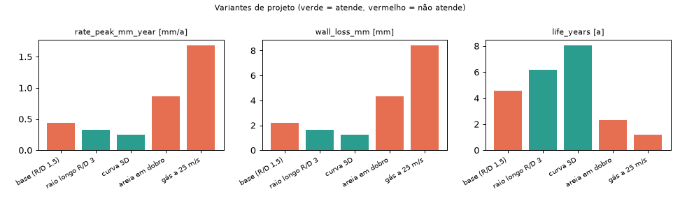

# Joelho de tubulação com areia: taxa de erosão, perda de parede e vida pelo DNV-RP-O501

**Setor:** Fluidos / integridade de tubulação (óleo e gás)  
**Preset:** `pipe_bend_erosion`

**Problema.** Joelho de 90° de uma linha de 3" de aço carbono por onde passa gás com areia (poço de gás). As partículas são rastreadas no escoamento do joelho, cada impacto entra no modelo de desgaste do DNV-RP-O501 (ER = K V^n F(α), Tabela 7-2) e a taxa por célula da parede dá o mapa de erosão, o pico, a perda de parede no período e a vida até a sobrespessura admissível. A triagem fechada da §8.4 é calculada junto como segunda rota do mesmo modelo.

**Pergunta de engenharia.** Qual a taxa de erosão de pico neste joelho, quanto da parede ele perde no período avaliado e quanto tempo resta até a sobrespessura admissível? Onde (arco e circunferência) fica o pico, e a triagem fechada da norma confirma a mesma ordem de grandeza?

## Uso

```python
import pinneapple as pp

p = pp.presets.load("pipe_bend_erosion")
r = p.run()                      # valores padrão abaixo; troque qualquer entrada: p.run(nome=valor)
print(r)                         # saídas, decisão, trust report
p.validate()                     # casos de referência com o erro medido
```

CLI: `python -m pinneapple_presets run pipe_bend_erosion nome=valor`  
Flow Studio: nó `preset.run` com `preset = pipe_bend_erosion`.

## Entradas (SI) e fonte de cada valor padrão

| entrada | unidade | padrão | domínio | fonte |
|---|---|---|---|---|
| `d_inner` | m | 0.08 | 0.025 – 0.5 | premissa: linha de 3" com diâmetro interno nominal de 80 mm (o NPS 3" Sch 40 da ASME B36.10M tem ID 77,9 mm e parede de 5,49 mm) |
| `r_over_d` | - | 1.5 | 1 – 6 | premissa: joelho de raio longo 1,5D, o padrão dos joelhos de 90° da ASME B16.9 |
| `u_gas` | m/s | 15 | 2 – 40 | premissa: velocidade média do gás na linha de produção do caso |
| `sand_rate` | kg/s | 0.0002315 | 1e-09 – 0.01 | premissa: 20 kg/dia de areia produzida (2,315e-4 kg/s); o piso da faixa é uma vazão desprezível, não o caso sem areia (sem areia não há erosão a medir) |
| `d_particle` | m | 0.00015 | 2e-05 – 0.001 | premissa: areia de 150 µm (a DNV cita 250-500 µm em poço sem gravel pack; a partícula fina é o caso que mais espalha o impacto pelo arco) |
| `rho_particle` | kg/m3 | 2650 | 1500 – 8000 | quartzo (SiO2), a areia de produção |
| `rho_gas` | kg/m3 | 50 | 0.5 – 400 | premissa: gás natural a ~65 bar e 40 °C: ρ = p M/(Z R T) = 65e5 × 0,0180 / (0,90 × 8,314 × 313) = 50 kg/m3 (entra na triagem pelo Re_D do fator G) |
| `mu_gas` | Pa s | 1.5e-05 | 8e-06 – 0.001 | premissa: gás natural a 40 °C e 65 bar, μ ≈ 1,5e-5 Pa s |
| `k_dnv` | (m/s)^-n | 2e-09 | 1e-10 – 1e-07 | DNV-RP-O501 Rev. 4.2 (2007), "Erosive wear in piping systems" Tabela 7-2 (aço carbono): K = 2,0e-9 (m/s)^-n |
| `n_dnv` | - | 2.6 | 2 – 4 | DNV-RP-O501 Rev. 4.2 (2007), "Erosive wear in piping systems" Tabela 7-2 (aço carbono): n = 2,6 |
| `rho_wall` | kg/m3 | 7800 | 1000 – 9000 | DNV-RP-O501 Rev. 4.2 (2007), "Erosive wear in piping systems" Tabela 7-2: ρ_t = 7800 kg/m3 (aço) |
| `t_wall` | m | 0.00549 | 0.002 – 0.03 | ASME B36.10M, NPS 3" Sch 40: parede de 5,49 mm |
| `t_allow` | m | 0.002 | 0 – 0.02 | premissa: sobrespessura de erosão admissível no período (2 mm; parcela da sobre-espessura de 3 mm usual em projeto de aço carbono) |
| `years` | a | 5 | 0.5 – 30 | premissa: período avaliado / intervalo de inspeção de 5 anos |
| `n_particles` | - | 50000 | 5000 – 500000 | premissa: 50 mil partículas; o gêmeo rodado usou 200 mil e o pico varia menos de 2 % entre os dois. O pico é o máximo do mapa, então amostra pequena o sobrestima (5 mil dão ~18 % acima de 50 mil): o piso de 5 mil é o mínimo em que a janela de 25 células ainda tem impactos |

## Saídas (caso padrão, rodado aqui)

| saída | valor | unidade | significado |
|---|---|---|---|
| `rate_peak_mm_year` | 0.4353 | mm/a | taxa de erosão de pico na parede do joelho |
| `wall_loss_mm` | 2.177 | mm | perda de parede no pico ao fim do período avaliado |
| `alpha_median_deg` | 30.8 | grau | ângulo de impacto mediano, entre a trajetória e a parede |
| `impact_fraction` | 1 | - | fração das partículas que impactam a parede dentro do joelho |
| `peak_arc_deg` | 57.82 | grau | posição do pico ao longo do arco (0° = entrada, 90° = saída) |
| `peak_theta_deg` | 5 | grau | posição circunferencial do pico (0° = extradorso) |
| `rate_dnv_mm_year` | 0.5272 | mm/a | triagem fechada do DNV-RP-O501 §8.4 na mesma condição |
| `life_years` | 4.594 | a | vida no pico até consumir a sobrespessura admissível |
| `remaining_wall_mm` | 3.313 | mm | parede remanescente no pico ao fim do período |
| `stokes` | 41.41 | - | número de Stokes das partículas no joelho (τ_p U / D) |
| `n_impacts` | 50000 | - | impactos medidos na parede (de n_particles lançadas) |

**Decisão:** NOT OK

- taxa de pico 0.435 mm/ano no arco 58° (θ = 5°, 0° = extradorso)
- perda de parede em 5 anos: 2.18 mm contra a sobrespessura admissível de 2.00 mm; parede remanescente 3.31 mm de 5.49 mm
- vida no pico até consumir a sobrespessura admissível: 4.6 anos
- a sobrespessura se esgota antes do período avaliado: antecipe a inspeção por ultrassom no extradorso (4.6 anos)
- não atende: a perda de parede no período passa da sobrespessura admissível

**Trust report:** APPROVED (score 1, cobertura 1)

| checagem | status | valor | limite | fonte |
|---|---|---|---|---|
| penetração na célula de pico = formulação do DNV-RP-O501 | supports | 2.011e-15 | 1e-09 | DNV-RP-O501 Rev. 4.2 (2007), "Erosive wear in piping systems" eq. 7.1-7.3 e Tabela 7-2 (aço: K = 2,0e-9, n = 2,6, ρ_t = 7800 kg/m3); PINNeAPPle-CFD, docs/anexos/erosao-tubulacoes.md §2.2 (F(α) e Tabela 7-2) e §5 (§8.4, curva): transcrição da norma; as constantes devem ser reconferidas na edição 2015/2025 |
| rastreamento x triagem fechada da DNV §8.4 (35 %) | supports | 0.8257 | 1.35 | DNV-RP-O501 Rev. 4.2 (2007), "Erosive wear in piping systems" §8.4 (α = arctan(1/√(2R/D)), G, C1 = 2,5, C_unit = 3,15e10); PINNeAPPle-CFD, docs/anexos/erosao-tubulacoes.md §2.2 (F(α) e Tabela 7-2) e §5 (§8.4, curva): transcrição da norma; as constantes devem ser reconferidas na edição 2015/2025 |
| conservação do número de partículas | supports | 50000 | 50000 | rastreamento lagrangiano: cada partícula termina na parede do joelho, atravessando o joelho sem tocar ou (no teto de passos) ainda dentro do tubo; nenhuma é criada ou perdida |
| areia inercial: praticamente toda partícula impacta (St >> 1) | supports | 1 | 0.99 | St = τ_p U / D com τ_p = ρ_p d_p²/(18 μ): com St >> 1 a partícula não acompanha a curva e não sobra uma fração que fuja do extradorso |
| ângulo de impacto dentro de (0°, 90°) | supports | 59.12 | 90 | geometria do joelho: α = arcsin(|v·n|/|v|) na parede do extradorso; 0° seria rasante e 90° normal à parede, e a partícula que entra com o fluido bate de esguelha |
| ângulo mediano de impacto = ângulo efetivo da DNV §8.4 (15 %) | supports | 30.8 | 34.5 | DNV-RP-O501 Rev. 4.2 (2007), "Erosive wear in piping systems" §8.4: α = arctan(1/√(2R/D)) é o ângulo de corte que a norma usa na curva; PINNeAPPle-CFD, docs/anexos/erosao-tubulacoes.md §2.2 (F(α) e Tabela 7-2) e §5 (§8.4, curva): transcrição da norma; as constantes devem ser reconferidas na edição 2015/2025 |
| taxa cresce com a velocidade como U^n (expoente da norma) | supports | 2.877 | 2.87 | DNV-RP-O501 Rev. 4.2 (2007), "Erosive wear in piping systems" eq. 7.1 (ER = K V^n F(α)): a massa removida por segundo é K V^n F(α) por massa de areia, então subir a velocidade por um fator s multiplica a taxa por s^n |
| pico na metade externa do joelho | supports | 5 | 45 | geometria do joelho: θ = 0 é o extradorso, para onde a areia é jogada ao virar a curva |
| posição do pico dentro do arco do joelho | supports | 57.82 | 90 | geometria do joelho: o arco corre de 0° (entrada) a 90° (saída) |
| pico do mapa amostrado (média 5 x 5 células) | supports | 1025 | 50 | estatística do pico: o valor lido é a média de uma janela de células, e uma janela com poucos impactos leria ruído de amostragem como erosão |
| inside the validity domain | supports | None | None | preset data sheet |

## Validação

| caso | saída | calculado | referência | erro relativo | tolerância | tipo | fonte |
|---|---|---|---|---|---|---|---|
| triagem fechada do DNV-RP-O501 §8.4 (R/D = 1.5, D = 80 mm, U = 15 m/s, 20 kg/dia de areia de 150 µm) | `rate_peak_mm_year` | 0.4353 mm/a | 0.5272 mm/a | 17.4 % | 35 % | standard | DNV-RP-O501 Rev. 4.2 (2007), "Erosive wear in piping systems" §8.4 (α = arctan(1/√(2R/D)), G, C1 = 2,5): é o modelo do código na forma fechada, não um ensaio; as duas rotas concordam dentro de 35 % porque a triagem troca a distribuição de ângulos de impacto por um ângulo efetivo único |

## Variantes de projeto

| variante | parâmetros | rate_peak_mm_year | wall_loss_mm | life_years | decisão |
|---|---|---|---|---|---|
| base (R/D 1,5) | `{}` | 0.4353 | 2.177 | 4.594 | NOT OK |
| raio longo R/D 3 | `{'r_over_d': 3.0}` | 0.3228 | 1.614 | 6.196 | OK |
| curva 5D | `{'r_over_d': 5.0}` | 0.2476 | 1.238 | 8.076 | OK |
| areia em dobro | `{'sand_rate': 0.000462962962962963}` | 0.8707 | 4.353 | 2.297 | NOT OK |
| gás a 25 m/s | `{'u_gas': 25.0}` | 1.689 | 8.443 | 1.184 | NOT OK |

## Figuras



Visualizador 3-D interativo (arquivo único, abre do disco): regenere com `python -m pinneapple_presets report pipe_bend_erosion` → `results/3d/pipe_bend_erosion_viewer.html`.

## Capacidades

| capacidade | tem? | por quê não |
|---|---|---|
| visualização 3-D | sim |  |
| surrogate | não | o rastreamento de 50 mil partículas custa segundos e a triagem fechada da norma responde na hora; uma varredura de engenharia usa a §8.4, não um substituto treinado |
| inversão | não | o caso não tem medição de campo; a inversão útil seria calibrar K e n contra espessuras medidas por UT ao longo dos anos, e o dado de inspeção não faz parte do preset |
| otimização | não | não há objetivo de custo declarado; o ganho vem de R/D, D e velocidade, que a triagem fechada da §8.4 responde sem rastreamento |
| variação de projeto | sim |  |
| cadeia de porquês | não |  |

## Pipeline

1. geometria: joelho de 90°, D x R/D (d_inner, r_over_d), malha da parede de 180 x 72 células
1. modelo: arrasto de Stokes (τ_p = ρ_p d_p²/18μ) no escoamento pistonado; desgaste ER = K V^n F(α) do DNV-RP-O501 com K, n e ρ_t da Tabela 7-2
1. solver: rastreamento lagrangiano até o impacto -> taxa por célula -> média móvel -> integração no período; triagem fechada da §8.4 na mesma condição
1. pós: pico e sua posição, ângulo mediano, fração de impactos, perda de parede, vida e parede remanescente
1. decisão: perda de parede no período <= sobrespessura admissível

**Domínio de validade.** Escoamento pistonado monofásico (não é um RANS): a física medida é a impactação inercial da areia e a taxa do modelo da norma. Areia diluída e sem ricochete (uma partícula, um impacto, sem interação entre partículas), St >> 1, joelho de 90° com R/D >= 1, gás a Mach < 0,3. O pico é uma média móvel de 5 x 5 células na malha de 180 x 72 da parede (0,5° no arco e 5° na circunferência). A triagem §8.4 usa uma única velocidade, a média da linha. Abaixo de St ~ 5 (areia fina, gás muito viscoso ou tubo grande) a areia acompanha parte da curva: as checagens de regime inercial não são executadas e o relatório diz por quê.

**Limitações.**

- Escoamento pistonado: sem RANS, sem camada limite e sem turbulência, então a velocidade de impacto segue a velocidade média do gás (um RANS com camada limite muda a distribuição dentro da seção).
- Sem ricochete, sem dispersão turbulenta e sem interação entre partículas (areia diluída): a taxa é a de um único impacto por partícula.
- K, n e A1..A8 vêm de transcrição secundária da norma (anexo do PINNeAPPle-CFD): reconferir na edição 2015/2025 antes de usar o número em contrato.
- O alisamento 5 x 5 do mapa e a malha de 180 x 72 fixam a resolução da posição do pico: um pico mais estreito que uma célula é lido como média da vizinhança.
- O pico é o máximo do mapa, e um máximo entre células com poucos impactos é sobrestimado pela amostragem: de 50 mil para 200 mil partículas ele cai ~2 %, e 5 mil dão ~18 % acima.

## Proveniência

Rodado em 2026-11-17T14:45:37Z · solver 1.03 s · relatório completo 9.8 s · arm (10 núcleos) · python 3.15.0, pinneapple 0.8.0, numpy 2.5.4, scipy 1.18.1, torch 2.15.0
