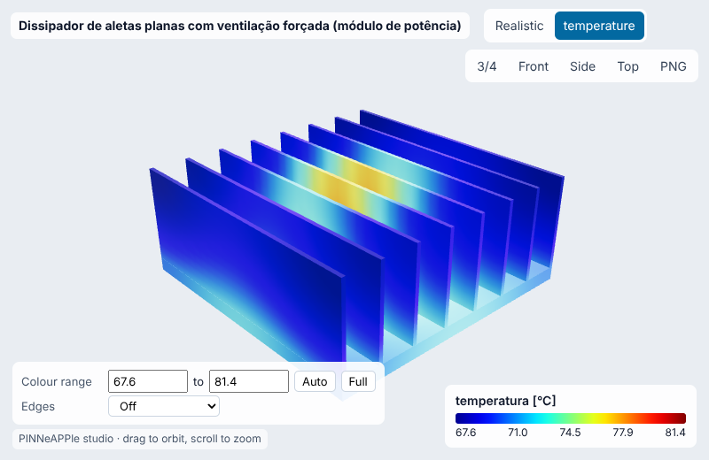
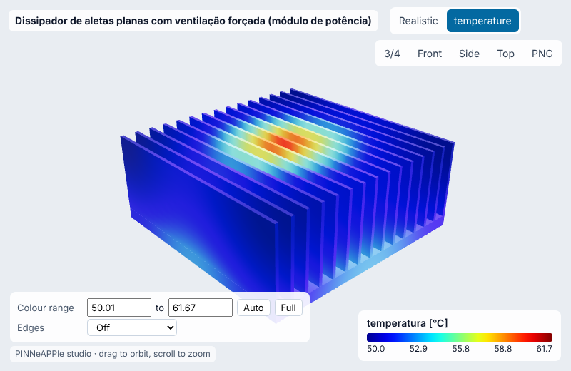
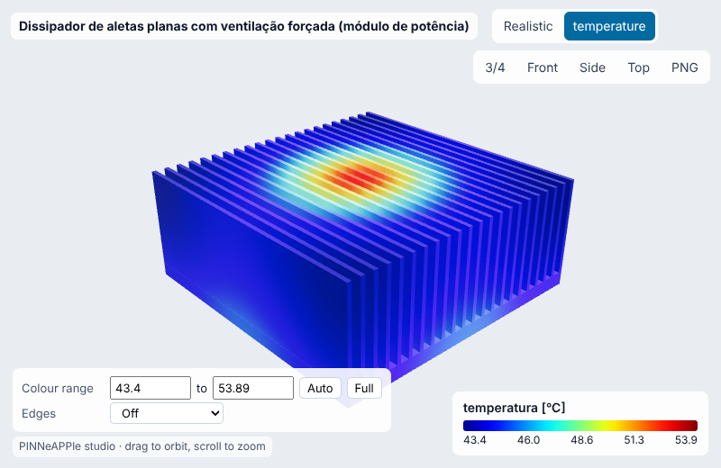
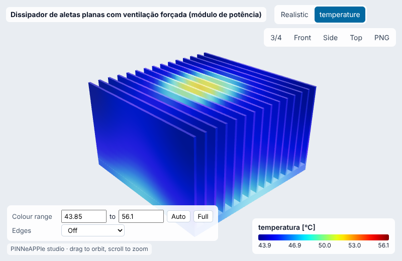
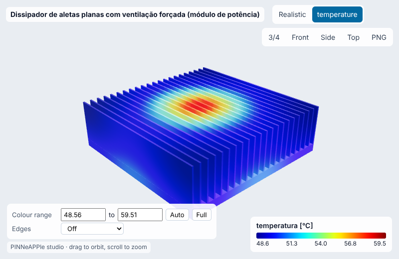
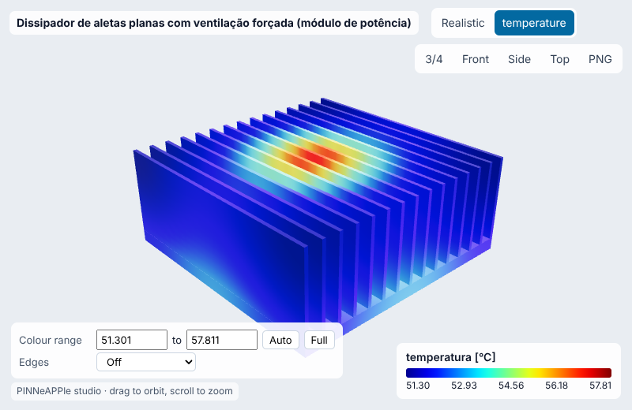
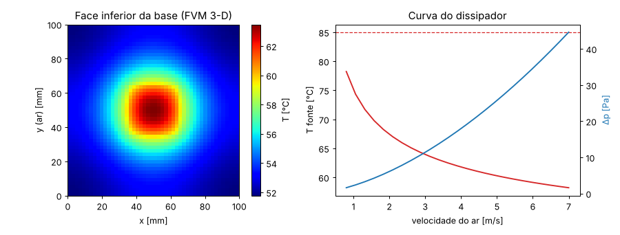
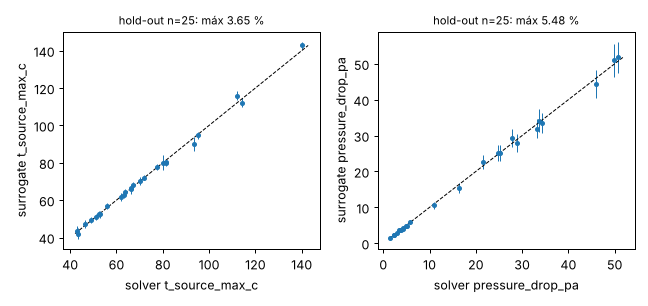
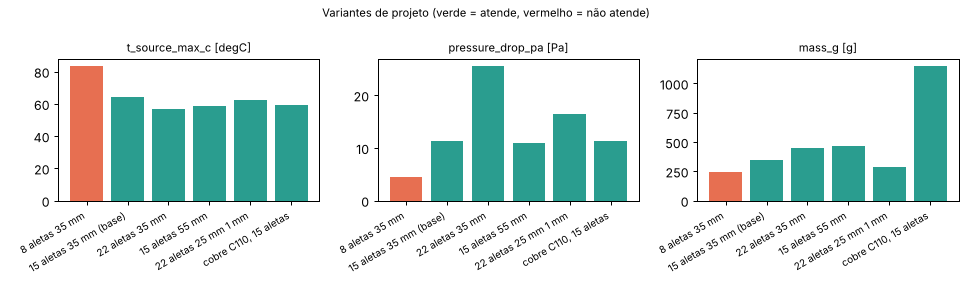
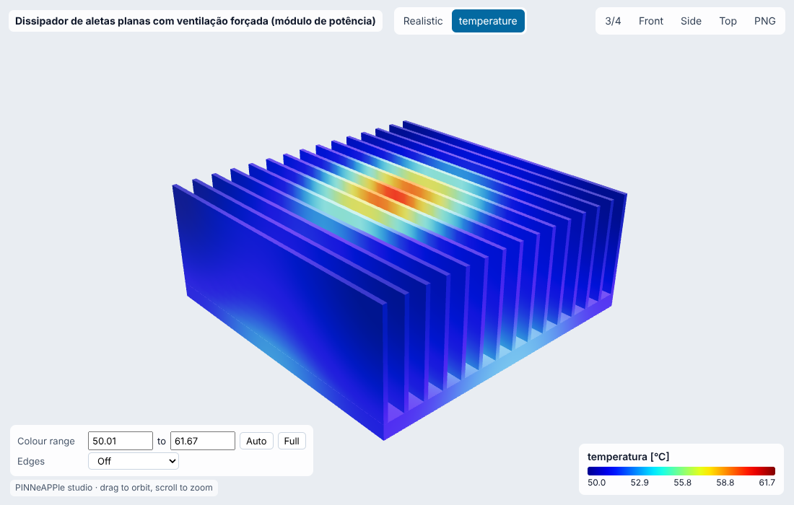

# Dissipador de aletas planas com ventilação forçada (módulo de potência)

**Setor:** Térmica / eletrônica de potência  
**Preset:** `plate_fin_heatsink_forced`

**Problema.** Dissipador de alumínio extrudado com aletas retas, ar forçado canalizado (shroud), fonte de calor concentrada (módulo/transistor 30 x 30 mm) no centro da base. Rede de resistências com correlações publicadas e base resolvida por volumes finitos 3-D.

**Pergunta de engenharia.** A temperatura da fonte fica abaixo do limite (85 °C) com a vazão de ar disponível? Qual o dissipador mais leve que atende, e quanto pesa a incerteza da correlação de convecção?

## Uso

```python
import pinneapple as pp

p = pp.presets.load("plate_fin_heatsink_forced")
r = p.run()                      # valores padrão abaixo; troque qualquer entrada: p.run(nome=valor)
print(r)                         # saídas, decisão, trust report
p.validate()                     # casos de referência com o erro medido
p.run(fidelity="surrogate")     # surrogate treinado (com desvio-padrão e aviso fora do domínio)
```

CLI: `python -m pinneapple_presets run plate_fin_heatsink_forced nome=valor`  
Flow Studio: nó `preset.run` com `preset = plate_fin_heatsink_forced`.

## Entradas (SI) e fonte de cada valor padrão

| entrada | unidade | padrão | domínio | fonte |
|---|---|---|---|---|
| `power` | W | 60 | 1 – 300 | premissa: perdas de um módulo MOSFET/IGBT de ~1 kW (eficiência ~94 %) |
| `t_ambient` | degC | 35 | -20 – 70 | premissa: ar interno de gabinete eletrônico (40 °C máx. típico de projeto) |
| `velocity` | m/s | 3 | 0.5 – 8 | premissa: ventilador axial de 80 mm canalizado (1-5 m/s típico) |
| `base_width` | m | 0.1 | 0.03 – 0.3 | perfil extrudado comercial 100 x 100 mm (premissa de catálogo) |
| `base_depth` | m | 0.1 | 0.03 – 0.3 | comprimento na direção do ar, 100 mm |
| `base_thickness` | m | 0.005 | 0.002 – 0.02 | base de 5 mm (perfis extrudados típicos 3-10 mm) |
| `n_fins` | - | 15 | 4 – 40 | 15 aletas (passo ~7 mm, típico de extrudado para ar forçado) |
| `fin_thickness` | m | 0.0015 | 0.0008 – 0.005 | 1,5 mm (limite prático de extrusão de Al ~1 mm) |
| `fin_height` | m | 0.035 | 0.01 – 0.08 | 35 mm |
| `material` | - | al6063 | al6063, al6061, al1050, cu110 | Al 6063-T5, k = 209 W/m K (Incropera Tabela A.1 / ASM) |
| `source_size` | m | 0.03 | 0.005 – 0.2 | encapsulamento de 30 x 30 mm (módulo de potência pequeno) |
| `tim` | K m2/W | 1e-05 | 1e-06 – 0.0001 | pasta térmica fina, R'' = 10 K mm2/W (5-20 típico) |
| `t_limit` | degC | 85 | 40 – 175 | premissa: limite de temperatura de case/base do componente |
| `h_scale` | - | 1 | 0.3 – 1.5 | multiplicador do h (1 = correlação; < 1 = desvio de ar pelo lado, sem shroud) |

## Saídas (caso padrão, rodado aqui)

| saída | valor | unidade | significado |
|---|---|---|---|
| `t_source_max_c` | 64.15 | degC | temperatura máxima na fonte (FVM 3-D da base + TIM) |
| `t_source_pessimistic_c` | 67.38 | degC | a mesma com h 15 % menor (incerteza típica da correlação) |
| `r_total_k_w` | 0.4858 | K/W | resistência fonte-ar |
| `pressure_drop_pa` | 11.39 | Pa | perda de carga do ar nas aletas |
| `h_w_m2k` | 28.87 | W/m2 K | coeficiente de convecção médio |
| `fin_efficiency` | 0.9283 | - | eficiência da aleta |
| `mass_g` | 347.6 | g | massa do dissipador |
| `air_rise_c` | 4.954 | K | aquecimento do ar (balanço de energia) |

**Decisão:** OK

- T fonte 64.1 °C (h -15 %: 67.4 °C) <= limite 85 °C
- perda de carga 11.4 Pa, massa 348 g

**Trust report:** APPROVED (score 1, cobertura 1)

| checagem | status | valor | limite | fonte |
|---|---|---|---|---|
| laminar channel flow (Re_Dh < 2300) | supports | 2124 | 2300 | Teertstra, Yovanovich & Culham, Analytical forced convection modeling of plate fin heat sinks, IEEE SEMI-THERM XV (1999) / J. Electronics Manufacturing 10(4) 2000 |
| Teertstra range 0.1 < Re* < 100 | supports | 68.09 | 100 | Teertstra, Yovanovich & Culham, Analytical forced convection modeling of plate fin heat sinks, IEEE SEMI-THERM XV (1999) / J. Electronics Manufacturing 10(4) 2000 |
| air outlet colder than the source (2nd law) | supports | 39.95 | 64.15 |  |
| engine: energy_balance | supports | 9.509e-14 | None | energy conservation |
| engine: spreading_methods_agree | supports | 0.02368 | None | conduction in the base |
| engine: grid_convergence | supports | 0.00114 | None | numerical accuracy |
| engine: correlation_in_range | supports | None | None | convection model validity |
| engine: temperature_above_ambient | supports | 28.48 | None | 2nd law |
| inside the validity domain | supports | None | None | preset data sheet |

## Validação

| caso | saída | calculado | referência | erro relativo | tolerância | tipo | fonte |
|---|---|---|---|---|---|---|---|
| R convecção das aletas a 1 m/s vs correlação independente | `r_fins` | 0.5065 K/W | 0.5361 K/W | 5.53 % | 8 % | independent_solver | Stephan (1959) Nusselt de entrada para placas paralelas + epsilon-NTU do aquecimento do ar (Shah & London) |
| R convecção das aletas a 3 m/s vs correlação independente | `r_fins` | 0.3228 K/W | 0.3488 K/W | 7.46 % | 8 % | independent_solver | Stephan (1959) Nusselt de entrada para placas paralelas + epsilon-NTU do aquecimento do ar (Shah & London) |
| R convecção das aletas a 6 m/s vs correlação independente | `r_fins` | 0.244 K/W | 0.2633 K/W | 7.35 % | 8 % | independent_solver | Stephan (1959) Nusselt de entrada para placas paralelas + epsilon-NTU do aquecimento do ar (Shah & London) |
| limite plenamente desenvolvido Nu = Re* Pr / 2 (Re* pequeno) | `nu_b` | 0.1398 - | 0.1399 - | 0.0996 % | 2 % | analytic | Teertstra, Yovanovich & Culham, Analytical forced convection modeling of plate fin heat sinks, IEEE SEMI-THERM XV (1999) / J. Electronics Manufacturing 10(4) 2000 |
| espalhamento + base: FVM 3-D vs teoria | `r_spreading` | 0.1519 K/W | 0.1484 K/W | 2.37 % | 5 % | analytic | Lee, Song, Au & Moran (1995), resistência de espalhamento |

Convergência (FVM grid n x n = [24, 36, 48, 64]): variação relativa entre os dois últimos níveis 9.29e-05 (passa).

## Surrogate

ARD Gaussian process (squared exponential), entradas ['velocity', 'n_fins', 'fin_height', 'power'] no domínio {'velocity': [1.0, 6.0], 'n_fins': [8, 26], 'fin_height': [0.02, 0.06], 'power': [20.0, 120.0]}; DOE Latin hypercube com 80 rodadas do solver para treino e 25 independentes para hold-out.

| saída | erro rel. máx (hold-out) | médio | R² | cobertura ±2σ |
|---|---|---|---|---|
| `t_source_max_c` | 3.65 % | 1.29 % | 0.9964 | 92 % |
| `pressure_drop_pa` | 5.48 % | 3.06 % | 0.9981 | 100 % |

Fora do domínio de treino o resultado sai marcado (aviso + checagem do trust report em *contradicts*), nunca extrapolado em silêncio.

## Inversão

Multiplicador efetivo do h (desvio de ar de um dissipador sem shroud) a partir de termopares na fonte em 4 potências (20-80 W). Medição sintética do solver com h_scale real = 0.72 e ruído de 0.3 K.

- **true:** 0.72
- **recovered:** 0.7181
- **ci95:** ['0.709', '0.7273']
- **rel_error:** 0.00261
- **noise:** 0.3 K (1 sigma)
- **how:** mínimos quadrados (Brent) sobre o modelo; IC 95 % pela sensibilidade dT/dh_scale

## Otimização

- **objective:** massa mínima com T(h -15 %) <= limite e perda de carga <= 25 Pa
- **search:** grade de 210 geometrias (n aletas x altura x espessura) na forma fechada (espalhamento de Lee); as mais leves são conferidas no solver (FVM 3-D) até uma passar
- **n_fins:** 16
- **fin_height_m:** 0.02
- **fin_thickness_m:** 0.001
- **mass_g:** 221.4
- **verified_t_pessimistic_c:** 80.14
- **verified_dp_pa:** 9.882
- **verified_ok:** True
- **closed_form_picks_rejected_by_solver:** 1
- **base_mass_g:** 347.6
- **surrogate_t_pred_c:** 77.83
- **solver_t_at_surrogate_choice_c:** 77.81
- **surrogate_vs_solver_diff_c:** 0.01834
- **surrogate_choice_ok_on_solver:** True

## Variantes de projeto

| variante | parâmetros | t_source_max_c | pressure_drop_pa | mass_g | decisão |
|---|---|---|---|---|---|
| 8 aletas 35 mm | `{'n_fins': 8}` | 83.6 | 4.394 | 248.4 | NOT OK |
| 15 aletas 35 mm (base) | `{}` | 64.15 | 11.39 | 347.6 | OK |
| 22 aletas 35 mm | `{'n_fins': 22}` | 56.51 | 25.6 | 446.9 | OK |
| 15 aletas 55 mm | `{'fin_height': 0.055}` | 58.57 | 11 | 469.1 | OK |
| 22 aletas 25 mm 1 mm | `{'n_fins': 22, 'fin_height': 0.025, 'fin_thickness': 0.001}` | 62.12 | 16.38 | 283.5 | OK |
| cobre C110, 15 aletas | `{'material': 'cu110'}` | 59.45 | 11.4 | 1151 | OK |

     

## Figuras






Visualizador 3-D interativo (arquivo único, abre do disco): regenere com `python -m pinneapple_presets report plate_fin_heatsink_forced` → `results/3d/plate_fin_heatsink_forced_viewer.html`.

## Capacidades

| capacidade | tem? | por quê não |
|---|---|---|
| visualização 3-D | sim |  |
| surrogate | sim |  |
| inversão | sim |  |
| otimização | sim |  |
| variação de projeto | sim |  |
| cadeia de porquês | sim |  |

## Pipeline

1. geometria: HeatSinkGeometry / DesignInput (perfil extrudado parametrizado)
1. modelo: correlação de Teertstra (h), eficiência de aleta (Incropera), espalhamento (Lee 1995)
1. solver: evaluate_design: rede de resistências + base por volumes finitos 3-D (malha 48 e 28)
1. pós: T máx da fonte com banda de ±15 % no h, perda de carga (Muzychka-Yovanovich), massa
1. decisão: T pessimista <= limite; otimização de massa com o solver

**Domínio de validade.** Escoamento laminar canalizado entre aletas (Re_Dh < 2300), aletas finas (t << b), base isotrópica, sem radiação (conservador), fonte retangular única. Correlações de Teertstra: 0,1 < Re* < 100.

**Limitações.**

- Sem dado experimental público acessível desta geometria: a validação usa os limites analíticos da correlação, uma correlação independente (Stephan + epsilon-NTU) e o FVM contra a teoria de espalhamento.
- Escoamento canalizado: sem shroud, o desvio lateral do ar reduz o desempenho em 20-50 % (use h_scale ou a inversão abaixo).

**Por que cada elemento do projeto existe:** `pinneapple_reason.run_case("power_board")`.

## Proveniência

Rodado em 2026-10-24T01:07:57Z · solver 0.178 s · relatório completo 39.2 s · Intel(R) Xeon(R) Processor @ 2.10GHz (4 núcleos) · python 3.13.17, pinneapple 0.7.0, numpy 2.5.3, scipy 1.18.1, torch 2.14.1
