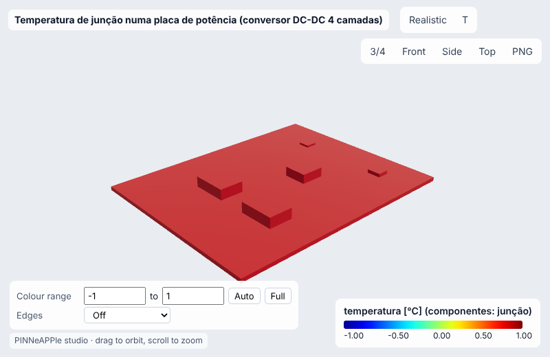
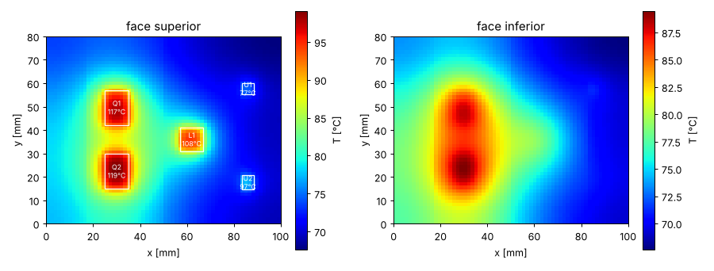
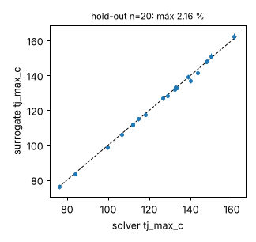
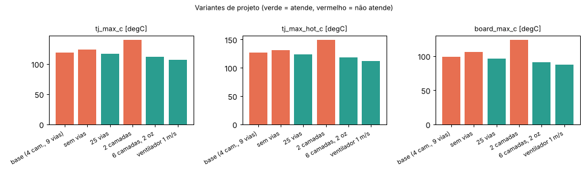
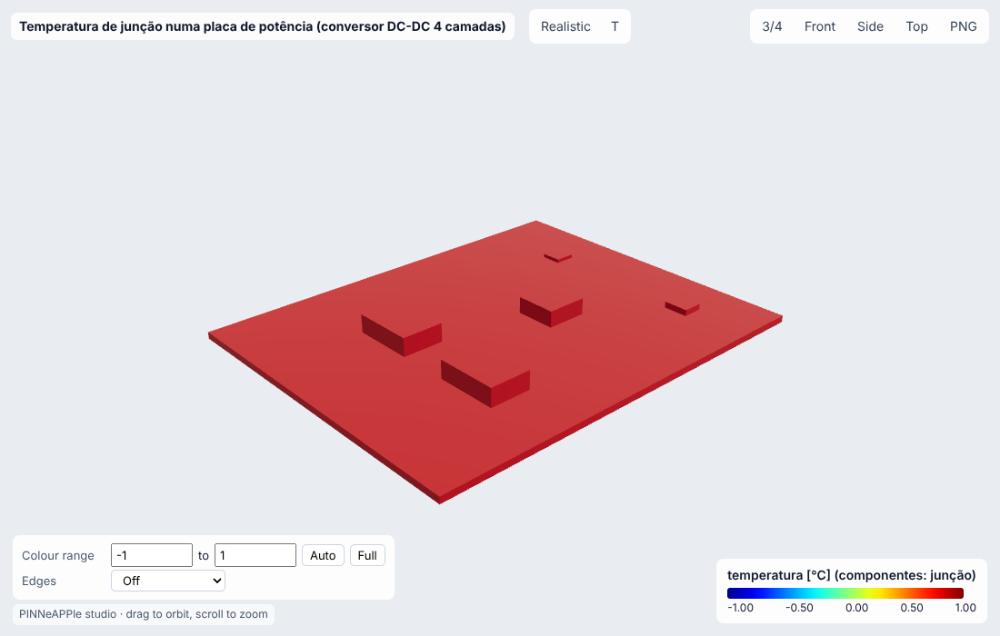

# Temperatura de junção numa placa de potência (conversor DC-DC 4 camadas)

**Setor:** Térmica / eletrônica  
**Preset:** `power_pcb_junction`

**Problema.** Placa de 4 camadas 100 x 80 mm, montada na vertical em gabinete sem ventilação, com dois MOSFETs D2PAK (meia-ponte), o indutor de saída, o controlador QFN e um regulador SOIC-8. Volumes finitos 3-D por camada de cobre/dielétrico, modelos de 2 resistências JEDEC, convecção natural + radiação.

**Pergunta de engenharia.** Todas as junções ficam abaixo do Tj máximo derrateado com 20 % de incerteza na convecção? Quantas vias térmicas sob os MOSFETs (ou que cobre) bastam, sem ventilador?

## Uso

```python
import pinneapple as pp

p = pp.presets.load("power_pcb_junction")
r = p.run()                      # valores padrão abaixo; troque qualquer entrada: p.run(nome=valor)
print(r)                         # saídas, decisão, trust report
p.validate()                     # casos de referência com o erro medido
p.run(fidelity="surrogate")     # surrogate treinado (com desvio-padrão e aviso fora do domínio)
```

CLI: `python -m pinneapple_presets run power_pcb_junction nome=valor`  
Flow Studio: nó `preset.run` com `preset = power_pcb_junction`.

## Entradas (SI) e fonte de cada valor padrão

| entrada | unidade | padrão | domínio | fonte |
|---|---|---|---|---|
| `p_mosfet` | W | 2 | 0.1 – 6 | premissa: perdas de condução + chaveamento por MOSFET de um buck de ~150 W |
| `p_inductor` | W | 1.2 | 0 – 4 | premissa: perdas no cobre + núcleo do indutor (~0,8 % de 150 W) |
| `p_controller` | W | 0.3 | 0 – 1.5 | premissa: controlador + drivers de gate |
| `p_ldo` | W | 0.25 | 0 – 1 | premissa: LDO 5 V -> 3,3 V a 75 mA |
| `t_ambient` | degC | 50 | -20 – 85 | premissa: ar interno de gabinete fechado (IEC 60068 classe industrial) |
| `velocity` | m/s | 0 | 0 – 5 | 0 = convecção natural (sem ventilador) |
| `n_copper` | - | 4 | 2, 4, 6, 8 | placa de 4 camadas (FR-4 1,6 mm) |
| `outer_oz` | oz | 1 | 0.5 – 3 | cobre externo 1 oz = 35 um (IPC-2221) |
| `vias` | - | 9 | 0 – 49 | premissa: 3 x 3 vias de 0,3 mm sob cada D2PAK |
| `tj_max` | degC | 125 | 80 – 175 | Tj 175 °C do datasheet derratado para 125 °C (prática de projeto) |
| `board_w` | m | 0.1 | 0.03 – 0.3 | placa 100 mm |
| `board_d` | m | 0.08 | 0.03 – 0.3 | placa 80 mm (altura, montada na vertical) |

## Saídas (caso padrão, rodado aqui)

| saída | valor | unidade | significado |
|---|---|---|---|
| `tj_max_c` | 118.9 | degC | maior temperatura de junção |
| `tj_max_hot_c` | 126.4 | degC | a mesma com convecção 20 % menor |
| `critical` | Q2 | - | componente crítico |
| `tj_mosfet_c` | 118.9 | degC | junção do MOSFET mais quente |
| `board_max_c` | 99.12 | degC | temperatura máxima da placa |
| `energy_balance` | 1.168e-13 | - | erro relativo do balanço de energia |

**Decisão:** NOT OK

- Tj máx 118.9 °C (Q2); com h -20 %: 126.4 °C > 125 °C
- placa até 99.1 °C

**Trust report:** APPROVED (score 1, cobertura 1)

| checagem | status | valor | limite | fonte |
|---|---|---|---|---|
| energy_balance | supports | 1.168e-13 | None | energy conservation |
| grid_convergence | supports | 0.0129 | None | numerical accuracy |
| surface_coefficients_converged | supports | None | None | nonlinear coupling |
| correlation_in_range | supports | None | None | surface heat-transfer model |
| temperatures_above_ambient | supports | 17.63 | None | 2nd law |
| inside the validity domain | supports | None | None | preset data sheet |

## Validação

| caso | saída | calculado | referência | erro relativo | tolerância | tipo | fonte |
|---|---|---|---|---|---|---|---|
| theta_JA TO-263 D2PAK na placa JEDEC 2s2p | `theta_ja` | 30.23 K/W | 30 K/W | 0.751 % | 8 % | standard (consistência) | JEDEC JESD51-7 (placa 2s2p) / JESD51-2 (ar parado); theta_JA mediano de datasheets publicados, tabela pinneapple_physics.closed_form.pcb_thermal.JEDEC_2S2P_THETA_JA. Atenção: os theta típicos dos encapsulamentos da lib foram calibrados para reproduzir esses valores; a linha confirma o modelo placa+convecção+encapsulamento, não é uma validação independente |
| theta_JA QFN-32 5x5 na placa JEDEC 2s2p | `theta_ja` | 33.19 K/W | 33 K/W | 0.578 % | 8 % | standard (consistência) | JEDEC JESD51-7 (placa 2s2p) / JESD51-2 (ar parado); theta_JA mediano de datasheets publicados, tabela pinneapple_physics.closed_form.pcb_thermal.JEDEC_2S2P_THETA_JA. Atenção: os theta típicos dos encapsulamentos da lib foram calibrados para reproduzir esses valores; a linha confirma o modelo placa+convecção+encapsulamento, não é uma validação independente |
| theta_JA SOIC-8 na placa JEDEC 2s2p | `theta_ja` | 120.1 K/W | 120 K/W | 0.0925 % | 8 % | standard (consistência) | JEDEC JESD51-7 (placa 2s2p) / JESD51-2 (ar parado); theta_JA mediano de datasheets publicados, tabela pinneapple_physics.closed_form.pcb_thermal.JEDEC_2S2P_THETA_JA. Atenção: os theta típicos dos encapsulamentos da lib foram calibrados para reproduzir esses valores; a linha confirma o modelo placa+convecção+encapsulamento, não é uma validação independente |

Convergência (células por lado = [24, 36, 48, 60, 80]): variação relativa entre os dois últimos níveis 9.62e-04 (passa).

## Surrogate

ARD Gaussian process (squared exponential), entradas ['p_mosfet', 't_ambient', 'vias'] no domínio {'p_mosfet': [0.5, 4.0], 't_ambient': [20.0, 70.0], 'vias': [0, 36]}; DOE Latin hypercube com 60 rodadas do solver para treino e 20 independentes para hold-out.

| saída | erro rel. máx (hold-out) | médio | R² | cobertura ±2σ |
|---|---|---|---|---|
| `tj_max_c` | 2.16 % | 0.472 % | 0.9980 | 90 % |

Fora do domínio de treino o resultado sai marcado (aviso + checagem do trust report em *contradicts*), nunca extrapolado em silêncio.

## Inversão

Fatores de convecção (h_scale) e de espalhamento no cobre (k_inplane_scale) a partir de 6 termopares na face superior e o sensor de junção de Q1, por Ensemble Kalman Inversion da lib. Medição sintética do solver com (0,75; 0,6) e ruído de 0.3 K.

- **true:** ['0.75', '0.6']
- **recovered:** ['0.7496', '0.5928']
- **ci95:** ['[0.7442306729256448, 0.75491903207931]', '[0.5742457902333614, 0.6119898139922775]']
- **rel_error:** 0.01197
- **noise:** 0.3 K (1 sigma)
- **how:** pinneapple_physics.pcb.engine.calibrate (EKI, 16 membros)

## Otimização

- **objective:** menor mudança que atende Tj(h -20 %) <= Tj máx (sem ventilador > menos vias > cobre 1 oz > menos camadas)
- **velocity:** 0
- **outer_oz:** 1
- **n_copper:** 4
- **vias:** 16
- **tj_max_hot_c:** 124.9
- **designs_tried:** 4
- **surrogate_question:** menos vias com Tj nominal <= Tj máx (sem a banda de h)
- **surrogate_vias_nominal:** 0
- **surrogate_tj_pred_c:** 120.2
- **solver_tj_at_surrogate_choice_c:** 123.9
- **surrogate_vs_solver_diff_c:** -3.78

## Variantes de projeto

| variante | parâmetros | tj_max_c | tj_max_hot_c | board_max_c | decisão |
|---|---|---|---|---|---|
| base (4 cam., 9 vias) | `{}` | 118.9 | 126.4 | 99.12 | NOT OK |
| sem vias | `{'vias': 0}` | 123.9 | 131.6 | 105.8 | NOT OK |
| 25 vias | `{'vias': 25}` | 116.4 | 123.9 | 96.05 | OK |
| 2 camadas | `{'n_copper': 2}` | 139.9 | 149.3 | 123.7 | NOT OK |
| 6 camadas, 2 oz | `{'n_copper': 6, 'outer_oz': 2.0}` | 111.5 | 118.7 | 90.73 | OK |
| ventilador 1 m/s | `{'velocity': 1.0}` | 107 | 112.1 | 87.56 | OK |

     

## Figuras






Visualizador 3-D interativo (arquivo único, abre do disco): regenere com `python -m pinneapple_presets report power_pcb_junction` → `results/3d/power_pcb_junction_viewer.html`.

## Capacidades

| capacidade | tem? | por quê não |
|---|---|---|
| visualização 3-D | sim |  |
| surrogate | sim |  |
| inversão | sim |  |
| otimização | sim |  |
| variação de projeto | sim |  |
| cadeia de porquês | sim |  |

## Pipeline

1. geometria: Board(stack-up) + Component(x, y, encapsulamento, vias)
1. modelo: condutividade anisotrópica do stack-up, vias como cobre paralelo, JEDEC 2R
1. solver: pinneapple_physics.pcb.engine.evaluate (FVM 3-D + ponto fixo convecção/radiação)
1. pós: Tj por componente com banda de ±20 % no h, mapas das faces
1. decisão: Tj(h -20 %) <= Tj máx; menor alteração de projeto que atende

**Domínio de validade.** Placa plana isolada no ar (sem gabinete radiante próximo), componentes como modelos de 2 resistências JEDEC (theta_JB, theta_JC), cobre como frações por camada, convecção natural (Churchill-Chu) ou forçada laminar de placa plana. theta dos encapsulamentos: valores típicos; para aprovação final use os do datasheet.

**Por que cada elemento do projeto existe:** `pinneapple_reason.run_case("power_board")`.

## Proveniência

Rodado em 2026-10-24T00:48:00Z · solver 2.81 s · relatório completo 88 s · Intel(R) Xeon(R) Processor @ 2.10GHz (4 núcleos) · python 3.13.17, pinneapple 0.7.0, numpy 2.5.3, scipy 1.18.1, torch 2.14.1
