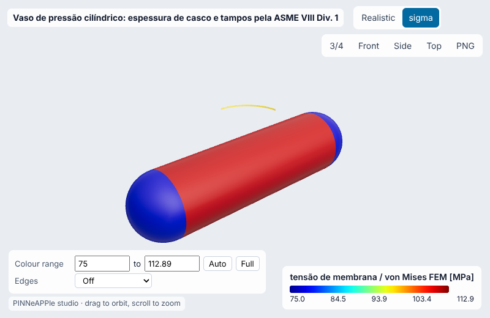
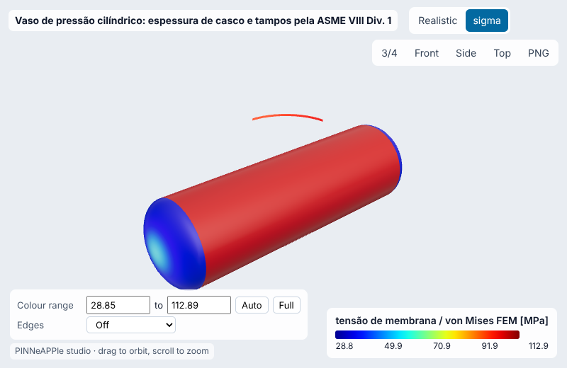
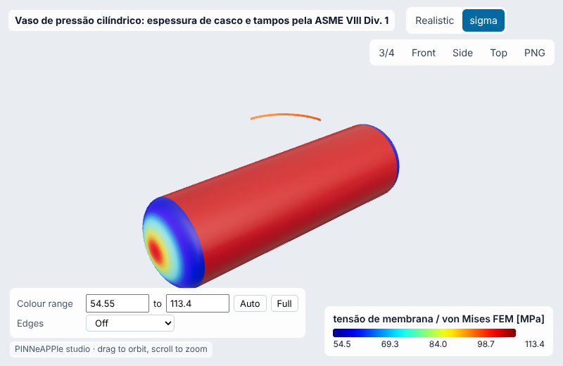
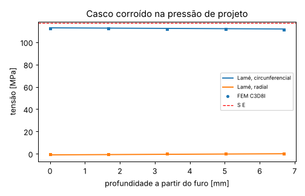
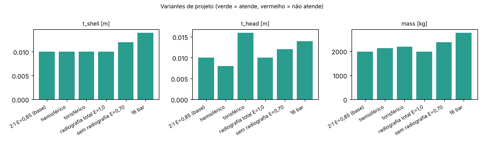
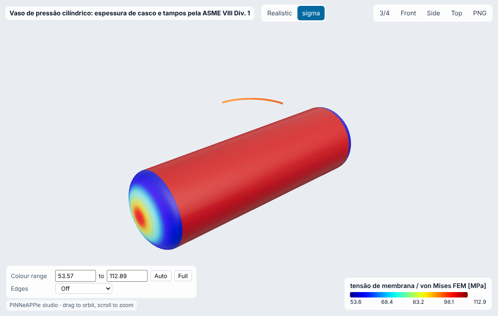

# Vaso de pressão cilíndrico: espessura de casco e tampos pela ASME VIII Div. 1

**Setor:** Estrutural / caldeiraria e processo  
**Preset:** `pressure_vessel_asme`

**Problema.** Vaso horizontal de aço carbono SA-516 Gr. 70 (reservatório de ar comprimido / vaso de processo), casco cilíndrico com tampos elípticos 2:1. Espessuras mínimas pela UG-27 e UG-32, chapa comercial, MAWP, pressão de teste hidrostático, conferidas pela solução de Lamé e por elementos finitos 3-D.

**Pergunta de engenharia.** Qual a espessura de chapa do casco e dos tampos para esta pressão de projeto, qual a MAWP resultante e a pressão de teste? A tensão real (Lamé/FEM) confirma a fórmula do código?

## Uso

```python
import pinneapple as pp

p = pp.presets.load("pressure_vessel_asme")
r = p.run()                      # valores padrão abaixo; troque qualquer entrada: p.run(nome=valor)
print(r)                         # saídas, decisão, trust report
p.validate()                     # casos de referência com o erro medido
```

CLI: `python -m pinneapple_presets run pressure_vessel_asme nome=valor`  
Flow Studio: nó `preset.run` com `preset = pressure_vessel_asme`.

## Entradas (SI) e fonte de cada valor padrão

| entrada | unidade | padrão | domínio | fonte |
|---|---|---|---|---|
| `p_design` | Pa | 1e+06 | 1e+05 – 2e+07 | premissa: 10 bar(g), compressor de ar industrial / vaso de processo |
| `d_inner` | m | 1.5 | 0.2 – 6 | premissa: diâmetro interno de 1500 mm |
| `length` | m | 4.5 | 0.5 – 30 | premissa: comprimento do casco entre linhas de tangência |
| `S` | Pa | 1.38e+08 | 5e+07 – 3e+08 | ASME BPVC Section VIII Div. 1 (2023) / BPVC II-D Tab. 1A: SA-516 Gr. 70, 20,0 ksi até 650 °F |
| `E_joint` | - | 0.85 | 0.45 – 1 | ASME BPVC Section VIII Div. 1 (2023) UW-12: solda de topo dupla com radiografia por amostragem (spot) |
| `ca` | m | 0.003 | 0 – 0.01 | premissa: sobre-espessura de corrosão de 3 mm (serviço de ar úmido) |
| `mill_tol` | m | 0.0003 | 0 – 0.002 | ASME BPVC Section VIII Div. 1 (2023) UG-16(c): tolerância de laminação até 0,3 mm (ou 6 %) dispensada |
| `E_steel` | Pa | 2e+11 | 1.5e+11 – 2.2e+11 | aço carbono, BPVC II-D Tab. TM-1 (~ 29,2e6 psi a 70 °F = 201 GPa) |
| `nu_steel` | - | 0.3 | 0.25 – 0.35 | aço carbono |
| `rho_steel` | kg/m3 | 7850 | 7700 – 8100 | aço carbono |
| `head` | - | ellipsoidal_2_1 | ellipsoidal_2_1, hemispherical, torispherical | tampo elíptico 2:1 (UG-32(d)) |
| `fem_nr` | - | 4 | 1 – 16 | elementos na espessura do anel FEM (C3D8I); convergência verificada 2-8 |

## Saídas (caso padrão, rodado aqui)

| saída | valor | unidade | significado |
|---|---|---|---|
| `t_shell_req` | 0.009452 | m | espessura mínima do casco (UG-27(c)(1)) + corrosão |
| `t_head_req` | 0.009425 | m | espessura mínima do tampo + corrosão |
| `t_shell` | 0.01 | m | chapa comercial do casco |
| `t_head` | 0.01 | m | chapa comercial do tampo |
| `mawp` | 1.038e+06 | Pa | pressão máxima de trabalho admissível (corroída) |
| `p_test` | 1.35e+06 | Pa | teste hidrostático UG-99(b): 1,3 x MAWP |
| `hoop_lame` | 1.129e+08 | Pa | tensão circunferencial máxima de Lamé (corroída, P de projeto) |
| `hoop_fem` | 1.125e+08 | Pa | a mesma pelo FEM 3-D |
| `mass` | 1976 | kg | massa de aço do casco + tampos |

**Decisão:** OK

- casco 10 mm (mín. 9.45 mm), tampo 10 mm (mín. 9.42 mm)
- MAWP 1.038 MPa, teste hidrostático 1.350 MPa
- tensão circunferencial (Lamé) 112.9 MPa vs S E = 117.3 MPa

**Trust report:** APPROVED (score 1, cobertura 1)

| checagem | status | valor | limite | fonte |
|---|---|---|---|---|
| UG-27 limits: t <= R/2 and P <= 0.385 S E | supports | 0.008525 | 0.385 | ASME BPVC Section VIII Div. 1 (2023) UG-27(c)(1) |
| FEM equilibrium: symmetry reaction = P r h | supports | 2.832e-12 | 1e-06 | SolidFEM reactions |
| FEM bore displacement = Lamé (plane strain) | supports | 8.384e-07 | 0.01 | Lamé (1852); Timoshenko & Goodier, Theory of Elasticity, 3a ed., sec. 28 |
| MAWP >= design pressure | supports | 1.038e+06 | 1e+06 |  |
| inside the validity domain | supports | None | None | preset data sheet |

## Validação

| caso | saída | calculado | referência | erro relativo | tolerância | tipo | fonte |
|---|---|---|---|---|---|---|---|
| tensão circunferencial no furo: FEM 3-D C3D8I vs Lamé | `hoop` | 1.125e+08 Pa | 1.129e+08 Pa | 0.383 % | 2 % | analytic | Lamé (1852); Timoshenko & Goodier, Theory of Elasticity, 3a ed., sec. 28 |
| deslocamento radial no furo: FEM vs Lamé (deformação plana) | `u_r` | 0.0003882 m | 0.0003882 m | 8.38e-05 % | 0.5 % | analytic | Lamé (1852); Timoshenko & Goodier, Theory of Elasticity, 3a ed., sec. 28 |
| fórmula UG-27(c)(1) vs tensão máxima de Lamé | `hoop` | 1.13e+08 Pa | 1.129e+08 Pa | 0.0866 % | 2 % | analytic | ASME BPVC Section VIII Div. 1 (2023) App. 1-1: a fórmula aproxima Lamé para t <= R/2 |
| caso espesso (t/R 0,26): UG-27 vs Lamé | `hoop` | 6.638e+07 Pa | 6.574e+07 Pa | 0.963 % | 3 % | analytic | ASME BPVC Section VIII Div. 1 (2023) UG-27 / Lamé |

Convergência (elementos na espessura = [1, 2, 4, 8]): variação relativa entre os dois últimos níveis 2.41e-04 (passa).

## Inversão

Espessura remanescente do casco a partir de extensômetros circunferenciais lidos no teste hidrostático (4 patamares até 1,3 MAWP). Verdade sintética: chapa nominal menos 2.5 mm de corrosão; ruído de 5.0 microdeformações.

- **true:** 0.0075
- **recovered:** 0.007481
- **ci95:** ['0.007388', '0.007574']
- **rel_error:** 0.002553
- **noise:** 5.0 microstrain
- **how:** mínimos quadrados (Brent) sobre Lamé com tampos fechados; IC por sensibilidade

## Otimização

- **objective:** massa mínima de aço (casco + tampos) com MAWP >= P de projeto
- **best_head:** ellipsoidal_2_1
- **best_E_joint:** 0.85
- **best_mass_kg:** 1976
- **base_mass_kg:** 1976

## Variantes de projeto

| variante | parâmetros | t_shell | t_head | mass | decisão |
|---|---|---|---|---|---|
| 2:1 E=0,85 (base) | `{}` | 0.01 | 0.01 | 1976 | OK |
| hemisférico | `{'head': 'hemispherical'}` | 0.01 | 0.008 | 2120 | OK |
| torisférico | `{'head': 'torispherical'}` | 0.01 | 0.016 | 2201 | OK |
| radiografia total E=1,0 | `{'E_joint': 1.0}` | 0.01 | 0.01 | 1976 | OK |
| sem radiografia E=0,70 | `{'E_joint': 0.7}` | 0.012 | 0.012 | 2374 | OK |
| 16 bar | `{'p_design': 1600000.0}` | 0.014 | 0.014 | 2773 | OK |

     

## Figuras





Visualizador 3-D interativo (arquivo único, abre do disco): regenere com `python -m pinneapple_presets report pressure_vessel_asme` → `results/3d/pressure_vessel_asme_viewer.html`.

## Capacidades

| capacidade | tem? | por quê não |
|---|---|---|
| visualização 3-D | sim |  |
| surrogate | não | as fórmulas do código são instantâneas; o FEM serve só para verificar |
| inversão | sim |  |
| otimização | sim |  |
| variação de projeto | sim |  |
| cadeia de porquês | não | não há caso de vaso de pressão no pinneapple_reason |

## Pipeline

1. geometria: casco D_i x L, tampos (2:1, hemisférico ou torisférico)
1. modelo: fórmulas ASME VIII UG-27 / UG-32 com eficiência de junta e corrosão
1. solver: espessura -> chapa comercial -> MAWP; Lamé (cilindro espesso); FEM 3-D C3D8I de um quarto de anel em deformação plana
1. pós: tensões, MAWP, pressão de teste, massa
1. decisão: chapas >= requisito; tensão de Lamé <= S E na pressão de projeto

**Domínio de validade.** Casco cilíndrico sob pressão interna com t <= R/2 e P <= 0,385 S E (UG-27(c)(1)); tampos sem aberturas; temperatura <= 343 °C (650 °F) para o S dado. Bocais, suportes (selas), vento, sismo e fadiga não verificados.

## Proveniência

Rodado em 2026-10-24T01:16:02Z · solver 0.0791 s · relatório completo 27.9 s · Intel(R) Xeon(R) Processor @ 2.10GHz (4 núcleos) · python 3.13.17, pinneapple 0.7.0, numpy 2.5.3, scipy 1.18.1, torch 2.14.1
