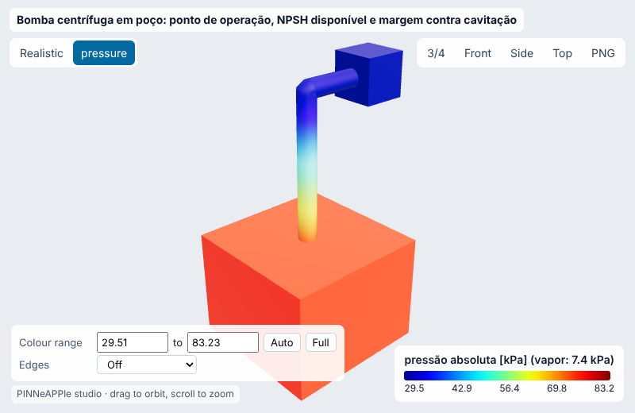
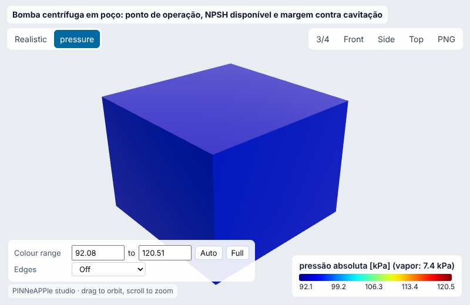
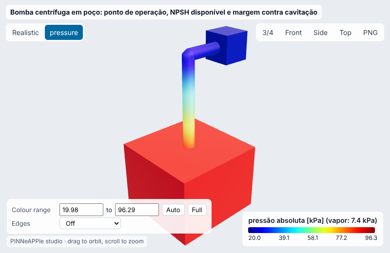
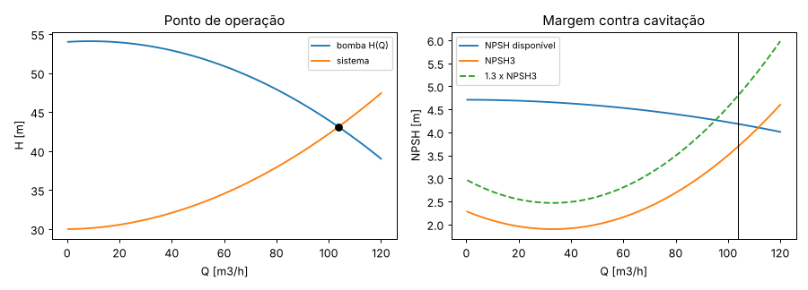
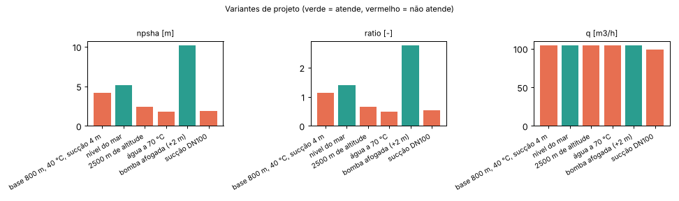
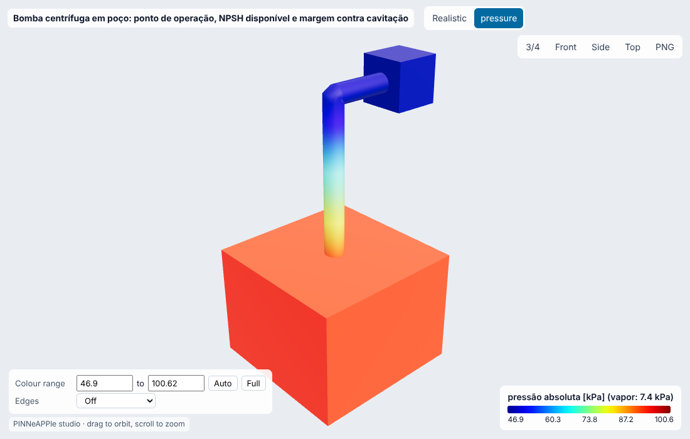

# Bomba centrífuga em poço: ponto de operação, NPSH disponível e margem contra cavitação

**Setor:** Fluidos / bombeamento (saneamento, processo, utilidades)  
**Preset:** `pump_npsh_cavitation`

**Problema.** Bomba centrífuga de sucção axial acima de um poço aberto (altura de sucção), recalcando para um reservatório. Ponto de operação pela interseção das curvas da bomba e do sistema, NPSH disponível com pressão de vapor IAPWS-IF97 e atmosfera ISO 2533, contra o NPSH3 da bomba com a margem da ANSI/HI.

**Pergunta de engenharia.** A bomba opera sem cavitar nesta instalação (altitude, temperatura, altura de sucção, tubulação)? Qual a maior altura de sucção ou temperatura admissível, e que diâmetro de sucção resolve?

## Uso

```python
import pinneapple as pp

p = pp.presets.load("pump_npsh_cavitation")
r = p.run()                      # valores padrão abaixo; troque qualquer entrada: p.run(nome=valor)
print(r)                         # saídas, decisão, trust report
p.validate()                     # casos de referência com o erro medido
```

CLI: `python -m pinneapple_presets run pump_npsh_cavitation nome=valor`  
Flow Studio: nó `preset.run` com `preset = pump_npsh_cavitation`.

## Entradas (SI) e fonte de cada valor padrão

| entrada | unidade | padrão | domínio | fonte |
|---|---|---|---|---|
| `altitude` | m | 800 | 0 – 4000 | premissa: estação de bombeamento a 800 m de altitude |
| `t_water` | degC | 40 | 1 – 120 | premissa: água de processo / retorno morno a 40 °C |
| `z_suction` | m | -4 | -9 – 30 | nível do poço 4 m abaixo do eixo da bomba (altura de sucção; + = afogada) |
| `h_static` | m | 30 | 0 – 50 | premissa: desnível geométrico até o reservatório de recalque |
| `d_suction` | m | 0.1541 | 0.04 – 0.6 | DN150 Sch 40, diâmetro interno 154,1 mm (ASME B36.10M) |
| `l_suction` | m | 12 | 1 – 200 | premissa: 12 m de tubo de sucção |
| `k_suction` | - | 3 | 0 – 20 | válvula de pé com crivo ~2,0-2,5 + curva 90° 0,3 + entrada 0,5 (Crane TP-410 ordem de grandeza) |
| `d_discharge` | m | 0.1281 | 0.04 – 0.6 | DN125 Sch 40, diâmetro interno 128,2 mm (ASME B36.10M) |
| `l_discharge` | m | 300 | 1 – 5000 | premissa: 300 m de linha de recalque |
| `k_discharge` | - | 10 | 0 – 60 | premissa: retenção + gaveta + curvas + saída |
| `roughness` | m | 4.5e-05 | 0 – 0.002 | aço comercial 0,045 mm (White, Fluid Mechanics, Tab. 6.1) |
| `npsh_ratio_min` | - | 1.3 | 1 – 2.5 | ANSI/HI 9.6.1-2017 (margem NPSHa/NPSH3 recomendada 1,1-2,5 conforme a aplicação); 1,3 premissa para água limpa em serviço contínuo |
| `curve_scale` | - | 1 | 0.6 – 1.2 | 1 = curva genérica de bomba 80-200 a 2900 rpm (pontos de catálogo da ficha); afinidade: Q ~ s, H ~ s^2, NPSH ~ s^2 |

## Saídas (caso padrão, rodado aqui)

| saída | valor | unidade | significado |
|---|---|---|---|
| `q` | 103.7 | m3/h | vazão no ponto de operação |
| `head` | 43.11 | m | altura manométrica no ponto |
| `npsha` | 4.185 | m | NPSH disponível |
| `npsh3` | 3.683 | m | NPSH3 da bomba no ponto |
| `ratio` | 1.136 | - | NPSHa / NPSH3 |
| `margin` | 0.5014 | m | NPSHa - NPSH3 |
| `v_suction` | 1.545 | m/s | velocidade na sucção |
| `max_lift` | 3.396 | m | maior altura de sucção com a margem exigida |
| `max_temp` | None | degC | maior temperatura da água com a margem exigida |

**Decisão:** NOT OK

- Q = 103.7 m3/h, H = 43.1 m
- NPSHa 4.18 m / NPSH3 3.68 m = 1.14 < 1.3
- altura de sucção máxima 3.40 m; temperatura máxima nenhuma (a margem falta mesmo com água a 1 °C)

**Trust report:** APPROVED (score 1, cobertura 1)

| checagem | status | valor | limite | fonte |
|---|---|---|---|---|
| duty point: pump head = static + losses | supports | 7.105e-15 | 1e-06 |  |
| duty point inside the catalogue curve (no extrapolation) | supports | 103.7 | 120 | catalogue points of the data sheet |
| suction velocity <= 2.4 m/s (HI 9.6.6 guidance range) | supports | 1.545 | 2.4 | ANSI/HI 9.6.6 |
| liquid below boiling at the sump (p_v < p_atm) | supports | 7384 | 9.208e+04 |  |
| inside the validity domain | supports | None | None | preset data sheet |

## Validação

| caso | saída | calculado | referência | erro relativo | tolerância | tipo | fonte |
|---|---|---|---|---|---|---|---|
| pressão de saturação a 300 K | `p_sat` | 0.003537 MPa | 0.003537 MPa | 8.52e-08 % | 1e-06 % | standard | IAPWS R7-97(2012), IF97 eq. 30 e Tabela 35 (valores de verificação) |
| pressão de saturação a 500 K | `p_sat` | 2.639 MPa | 2.639 MPa | 1.41e-07 % | 1e-06 % | standard | IAPWS R7-97(2012), IF97 eq. 30 e Tabela 35 (valores de verificação) |
| pressão de saturação a 600 K | `p_sat` | 12.34 MPa | 12.34 MPa | 1.75e-07 % | 1e-06 % | standard | IAPWS R7-97(2012), IF97 eq. 30 e Tabela 35 (valores de verificação) |
| pressão atmosférica a 1000 m | `p_atm` | 8.987e+04 Pa | 8.987e+04 Pa | 4.4e-05 % | 0.001 % | standard | ISO 2533:1975 / ICAO Doc 7488 (atmosfera padrão), tabela |
| pressão atmosférica a 2000 m | `p_atm` | 7.95e+04 Pa | 7.95e+04 Pa | 3.23e-06 % | 0.001 % | standard | ISO 2533:1975 / ICAO Doc 7488 (atmosfera padrão), tabela |
| perda na sucção: Colebrook vs Haaland | `h_suction_loss` | 0.5228 m | 0.5213 m | 0.282 % | 2 % | independent_solver | Haaland (1983), explícita, ±2 % de Colebrook |

## Inversão

Coeficiente de perda da sucção (crivo entupindo) a partir do manômetro no flange de sucção em 4 aberturas da válvula de recalque (vazão por medidor magnético). Verdade sintética K = 9.0 (limpo: 3); ruído de 1.0 kPa.

- **true:** 9
- **recovered:** 8.717
- **ci95:** ['7.293', '10.14']
- **rel_error:** 0.03146
- **noise:** 1.0 kPa
- **how:** mínimos quadrados lineares (p é afim em K), IC exato

## Otimização

- **objective:** menor diâmetro de sucção (Sch 40) com NPSHa/NPSH3 >= razão mínima; se nenhum basta, baixar a bomba até a altura de sucção que deixa a margem
- **smallest_ok_suction:** None
- **pump_lowered_to_lift_m:** 3.346
- **verified_ratio:** 1.314
- **verified_ok:** True

## Variantes de projeto

| variante | parâmetros | npsha | ratio | q | decisão |
|---|---|---|---|---|---|
| base 800 m, 40 °C, sucção 4 m | `{}` | 4.185 | 1.136 | 103.7 | NOT OK |
| nível do mar | `{'altitude': 0.0}` | 5.136 | 1.394 | 103.7 | OK |
| 2500 m de altitude | `{'altitude': 2500.0}` | 2.396 | 0.6506 | 103.7 | NOT OK |
| água a 70 °C | `{'t_water': 70.0}` | 1.827 | 0.4918 | 104.3 | NOT OK |
| bomba afogada (+2 m) | `{'z_suction': 2.0}` | 10.18 | 2.765 | 103.7 | OK |
| sucção DN100 | `{'d_suction': 0.1023}` | 1.862 | 0.542 | 98.63 | NOT OK |

     

## Figuras





Visualizador 3-D interativo (arquivo único, abre do disco): regenere com `python -m pinneapple_presets report pump_npsh_cavitation` → `results/3d/pump_npsh_cavitation_viewer.html`.

## Capacidades

| capacidade | tem? | por quê não |
|---|---|---|
| visualização 3-D | sim |  |
| surrogate | não | forma fechada (< 1 ms por avaliação): um surrogate não economiza tempo |
| inversão | sim |  |
| otimização | sim |  |
| variação de projeto | sim |  |
| cadeia de porquês | sim |  |

## Pipeline

1. geometria: poço, tubo de sucção, bomba, linha de recalque
1. modelo: curvas H(Q) e NPSH3(Q) por mínimos quadrados dos pontos de catálogo; perdas Darcy-Colebrook
1. solver: duty_point (bisseção) e npsh_available (IAPWS-IF97, ISO 2533)
1. pós: NPSHa, NPSH3, razão e margem; maior altura de sucção e temperatura admissíveis
1. decisão: NPSHa / NPSH3 >= razão mínima da ANSI/HI 9.6.1

**Domínio de validade.** Água limpa, regime permanente, curvas da bomba interpoladas entre 0 e 120 m3/h (extrapolação acusada), sem vórtice na sucção (submergência suficiente, ANSI/HI 9.8), pressão atmosférica padrão.

**Por que cada elemento do projeto existe:** `pinneapple_reason.run_case("pumped_main")`.

## Proveniência

Rodado em 2026-10-24T01:17:51Z · solver 0.00519 s · relatório completo 25.6 s · Intel(R) Xeon(R) Processor @ 2.10GHz (4 núcleos) · python 3.13.17, pinneapple 0.7.0, numpy 2.5.3, scipy 1.18.1, torch 2.14.1
