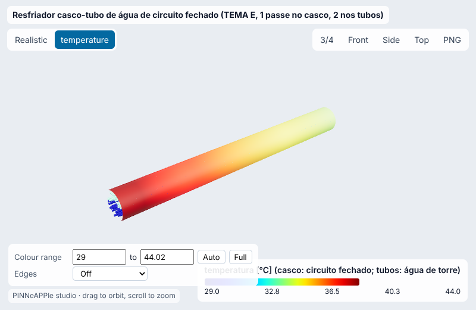
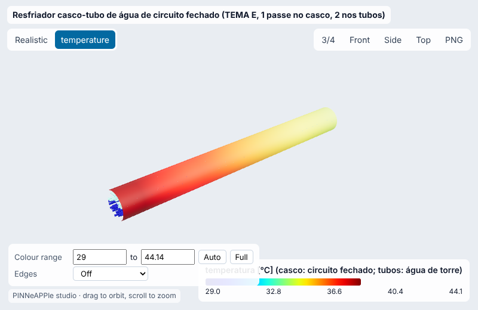
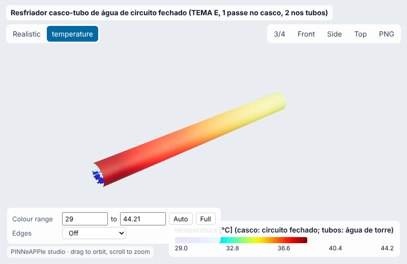
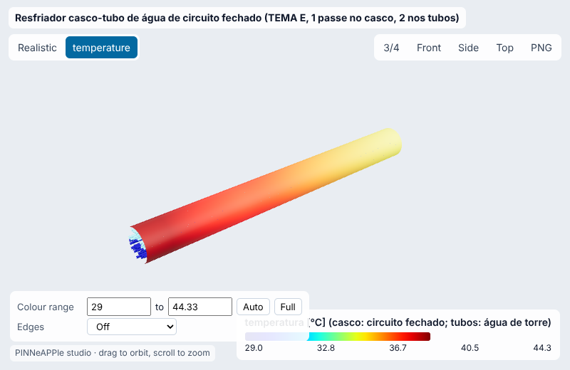
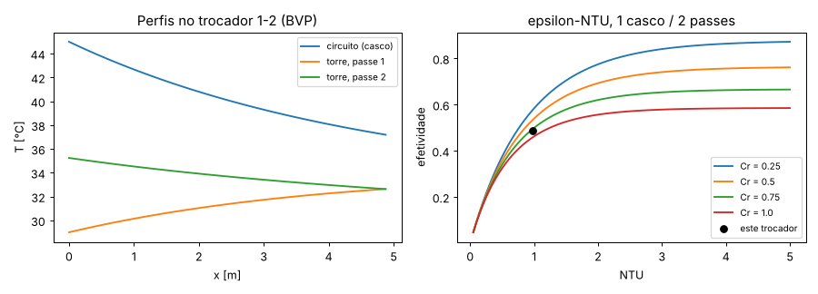
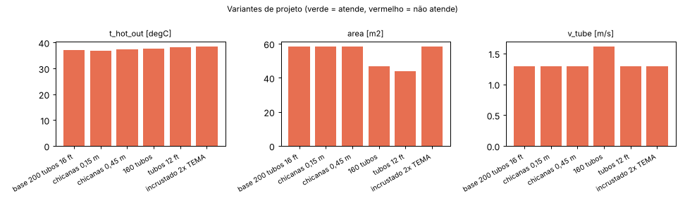
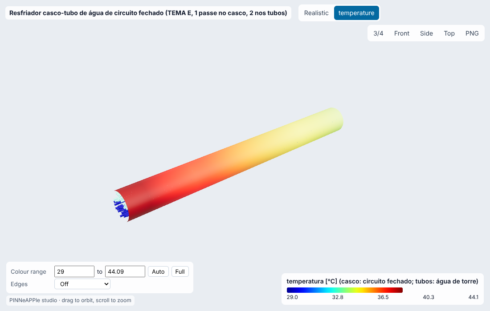

# Resfriador casco-tubo de água de circuito fechado (TEMA E, 1 passe no casco, 2 nos tubos)

**Setor:** Térmica / processo e energia  
**Preset:** `shell_tube_cooler`

**Problema.** Água desmineralizada de um circuito fechado de resfriamento (mancais, inversores, moldes) no casco, água de torre nos tubos. Coeficientes por Kern (casco) e Gnielinski (tubos), incrustação TEMA, parede de aço carbono; desempenho por epsilon-NTU do trocador 1-2.

**Pergunta de engenharia.** O trocador leva a água do circuito à temperatura de retorno exigida com a água de torre disponível, com velocidade de tubo na faixa recomendada? Quanta incrustação ele tolera, e qual o menor trocador que atende?

## Uso

```python
import pinneapple as pp

p = pp.presets.load("shell_tube_cooler")
r = p.run()                      # valores padrão abaixo; troque qualquer entrada: p.run(nome=valor)
print(r)                         # saídas, decisão, trust report
p.validate()                     # casos de referência com o erro medido
```

CLI: `python -m pinneapple_presets run shell_tube_cooler nome=valor`  
Flow Studio: nó `preset.run` com `preset = shell_tube_cooler`.

## Entradas (SI) e fonte de cada valor padrão

| entrada | unidade | padrão | domínio | fonte |
|---|---|---|---|---|
| `m_hot` | kg/s | 20 | 1 – 200 | premissa: circuito fechado de ~840 kW de carga térmica |
| `t_hot_in` | degC | 45 | 30 – 95 | premissa: retorno quente do circuito fechado |
| `m_cold` | kg/s | 25 | 1 – 300 | premissa: vazão de água de torre alocada ao trocador |
| `t_cold_in` | degC | 29 | 5 – 40 | água de torre no verão (projeto típico 29-32 °C) |
| `cp_hot` | J/kg K | 4179 | 4170 – 4200 | Incropera et al., Fundamentals of Heat and Mass Transfer, 6a ed. Tab. A.6, água a 315 K |
| `mu_hot` | Pa s | 0.000631 | 0.00028 – 0.0018 | Incropera et al., Fundamentals of Heat and Mass Transfer, 6a ed. Tab. A.6, água a 315 K |
| `k_hot` | W/m K | 0.634 | 0.55 – 0.68 | Incropera et al., Fundamentals of Heat and Mass Transfer, 6a ed. Tab. A.6, água a 315 K |
| `cp_cold` | J/kg K | 4178 | 4170 – 4220 | Incropera et al., Fundamentals of Heat and Mass Transfer, 6a ed. Tab. A.6, água a 305 K |
| `mu_cold` | Pa s | 0.000769 | 0.0003 – 0.0018 | Incropera et al., Fundamentals of Heat and Mass Transfer, 6a ed. Tab. A.6, água a 305 K |
| `k_cold` | W/m K | 0.62 | 0.55 – 0.68 | Incropera et al., Fundamentals of Heat and Mass Transfer, 6a ed. Tab. A.6, água a 305 K |
| `n_tubes` | - | 200 | 10 – 2000 | premissa: 200 tubos (2 passes de 100) |
| `tube_od` | m | 0.01905 | 0.00635 – 0.0508 | tubo de 3/4" (TEMA, diâmetro externo padrão) |
| `tube_wall` | m | 0.00165 | 0.0005 – 0.005 | 16 BWG = 1,65 mm (TEMA Tabela D-7) |
| `tube_length` | m | 4.877 | 1 – 12 | 16 ft (comprimento padrão TEMA) |
| `pitch` | m | 0.02381 | 0.008 – 0.08 | passo triangular de 15/16" (1,25 x OD, TEMA RCB-2.5) |
| `shell_id` | m | 0.489 | 0.1 – 2.5 | casco de 19,25" para ~200 tubos de 3/4" em 15/16" triangular, 2 passes (ordem de grandeza da contagem de tubos de Kern, Process Heat Transfer, Tab. 9) |
| `baffle_spacing` | m | 0.3 | 0.05 – 2 | premissa: ~0,6 x diâmetro do casco (TEMA mínimo = ID/5) |
| `k_wall` | W/m K | 50 | 10 – 400 | aço carbono (Incropera Tab. A.1: AISI 1010 63,9, aço-carbono ao Mn ~50) |
| `rf_hot` | m2 K/W | 8.8e-05 | 0 – 0.002 | TEMA Standards 10a ed. (2019), RGP-T-2.4 (resistências de incrustação): água desmineralizada/destilada, 0,0005 h ft2 F/Btu |
| `rf_cold` | m2 K/W | 0.000176 | 0 – 0.002 | TEMA Standards 10a ed. (2019), RGP-T-2.4 (resistências de incrustação): água de torre tratada, < 50 °C, 0,001 h ft2 F/Btu |
| `t_hot_target` | degC | 36 | 15 – 90 | premissa: alimentação fria do circuito a 36 °C |

## Saídas (caso padrão, rodado aqui)

| saída | valor | unidade | significado |
|---|---|---|---|
| `q` | 6.524e+05 | W | calor trocado |
| `t_hot_out` | 37.19 | degC | saída do circuito fechado (casco) |
| `t_cold_out` | 35.25 | degC | saída da água de torre |
| `U` | 1405 | W/m2 K | coeficiente global (área externa) |
| `area` | 58.38 | m2 | área externa dos tubos |
| `ntu` | 0.9814 | - | NTU |
| `effectiveness` | 0.4879 | - | efetividade |
| `F` | 0.8885 | - | fator de correção da LMTD |
| `h_shell` | 5258 | W/m2 K | coeficiente do casco (Kern) |
| `h_tube` | 6560 | W/m2 K | coeficiente dos tubos (Gnielinski) |
| `v_tube` | 1.29 | m/s | velocidade da água nos tubos |
| `dp_tube` | 1.665e+04 | Pa | perda de carga nos tubos (atrito + 2,5 cargas cinéticas por passe) |
| `re_shell` | 1.488e+04 | - | Reynolds do casco |

**Decisão:** NOT OK

- circuito sai a 37.2 °C > alvo 36 °C (Q = 652.4 kW, U = 1405 W/m2K)
- velocidade nos tubos 1.29 m/s dentro de 1-2,5 m/s (incrustação abaixo, erosão acima)
- perda de carga nos tubos 16.6 kPa <= 70 kPa (Sinnott, Coulson & Richardson vol. 6, sec. 12.8: 35-70 kPa típico para líquidos)

**Trust report:** APPROVED (score 1, cobertura 1)

| checagem | status | valor | limite | fonte |
|---|---|---|---|---|
| epsilon-NTU = U A F LMTD (two independent routes) | supports | 5.353e-16 | 1e-06 | Incropera et al., Fundamentals of Heat and Mass Transfer, 6a ed. sec. 11.3-11.4 |
| energy balance: hot side = cold side | supports | None | None | by construction of Q |
| 2nd law: hot out > cold in, cold out < hot in | supports | None | None |  |
| Kern range 2e3 < Re_shell < 1e6 | supports | 1.488e+04 | 2000 | Kern (1950) eq. 7.3 |
| Gnielinski range Re_tube >= 3000 | supports | 2.628e+04 | 3000 | Gnielinski (1976) |
| LMTD factor F >= 0.75 (1-2 shell usable) | supports | 0.8885 | 0.75 | Kern (1950) ch. 7: below F ~ 0.75 use more shells |
| inside the validity domain | supports | None | None | preset data sheet |

## Validação

| caso | saída | calculado | referência | erro relativo | tolerância | tipo | fonte |
|---|---|---|---|---|---|---|---|
| epsilon 1-2 (NTU 0.98, Cr 0.80): eq. 11.30a vs BVP direto | `effectiveness` | 0.4879 - | 0.4879 - | 3.28e-12 % | 0.0001 % | independent_solver | integração direta das 3 equações de energia do trocador 1-2 (scipy solve_bvp) |
| epsilon 1-2 (NTU 0.50, Cr 0.30): eq. 11.30a vs BVP direto | `effectiveness` | 0.371 - | 0.371 - | 4.19e-12 % | 0.0001 % | independent_solver | integração direta das 3 equações de energia do trocador 1-2 (scipy solve_bvp) |
| epsilon 1-2 (NTU 3.00, Cr 1.00): eq. 11.30a vs BVP direto | `effectiveness` | 0.5788 - | 0.5788 - | 9.4e-13 % | 0.0001 % | independent_solver | integração direta das 3 equações de energia do trocador 1-2 (scipy solve_bvp) |
| Cr -> 0: epsilon = 1 - exp(-NTU) | `effectiveness` | 0.8173 - | 0.8173 - | 0 % | 1e-10 % | analytic | Incropera et al., Fundamentals of Heat and Mass Transfer, 6a ed. eq. 11.35a |
| h tubos: Gnielinski vs Dittus-Boelter | `h_tube` | 6560 W/m2 K | 6003 W/m2 K | 9.28 % | 25 % | independent_solver | Dittus & Boelter (1930), incerteza ±25 % (Incropera sec. 8.5) |

## Inversão

Incrustação total a partir das duas temperaturas de saída em 3 cargas (monitoramento de desempenho). Medição sintética com Rf real = 7,0e-4 m2K/W e ruído de 0.2 K nos RTDs.

- **true:** 0.0007
- **recovered:** 0.0006996
- **ci95:** ['0.0006471', '0.000752']
- **rel_error:** 0.0006206
- **noise:** 0.2 K
- **how:** mínimos quadrados (Brent), IC por sensibilidade

## Otimização

- **objective:** menor área de tubos com T_quente <= alvo, 1 <= v <= 2,5 m/s, dp_tubos <= 70 kPa, F >= 0,75 e chicanas de 0,3-1 x D_casco (sem modelo de perda de carga do casco)
- **designs_scanned:** 2730
- **n_tubes:** 228
- **tube_length:** 6.096
- **shell_id:** 0.5221
- **baffle_spacing:** 0.1566
- **area_m2:** 83.18
- **base_area_m2:** 58.38
- **verified_t_hot_out:** 35.98
- **verified_ok:** True

## Variantes de projeto

| variante | parâmetros | t_hot_out | area | v_tube | decisão |
|---|---|---|---|---|---|
| base 200 tubos 16 ft | `{}` | 37.19 | 58.38 | 1.29 | NOT OK |
| chicanas 0,15 m | `{'baffle_spacing': 0.15}` | 36.9 | 58.38 | 1.29 | NOT OK |
| chicanas 0,45 m | `{'baffle_spacing': 0.45}` | 37.42 | 58.38 | 1.29 | NOT OK |
| 160 tubos | `{'n_tubes': 160, 'shell_id': 0.4374}` | 37.75 | 46.7 | 1.612 | NOT OK |
| tubos 12 ft | `{'tube_length': 3.658}` | 38.21 | 43.78 | 1.29 | NOT OK |
| incrustado 2x TEMA | `{'rf_hot': 0.000176, 'rf_cold': 0.000352}` | 38.45 | 58.38 | 1.29 | NOT OK |

     

## Figuras





Visualizador 3-D interativo (arquivo único, abre do disco): regenere com `python -m pinneapple_presets report shell_tube_cooler` → `results/3d/shell_tube_cooler_viewer.html`.

## Capacidades

| capacidade | tem? | por quê não |
|---|---|---|
| visualização 3-D | sim |  |
| surrogate | não | o modelo é de forma fechada (< 1 ms por avaliação); um surrogate não economiza tempo |
| inversão | sim |  |
| otimização | sim |  |
| variação de projeto | sim |  |
| cadeia de porquês | não | não há caso de trocador no pinneapple_reason |

## Pipeline

1. geometria: feixe (n tubos, OD, parede, passo triangular), casco, chicanas
1. modelo: Kern (casco), Gnielinski (tubos), parede e incrustação TEMA -> U
1. solver: effectiveness(NTU, Cr, 'shell_tube') (Incropera eq. 11.30a); perfis pelo BVP do 1-2
1. pós: Q, temperaturas de saída, F da LMTD, velocidades
1. decisão: T saída quente <= alvo, 1 <= v_tubo <= 2,5 m/s, perda de carga nos tubos <= 70 kPa

**Domínio de validade.** Kern: 2e3 < Re_casco < 1e6, chicanas segmentais de 25 %, sem vazamentos/bypass (Bell-Delaware dá h menor, tipicamente 60-80 % do de Kern). Gnielinski: 3000 <= Re <= 5e6. Propriedades constantes na temperatura média; sem correção de viscosidade na parede.

**Limitações.**

- Perda de carga do casco não calculada (Kern/Bell-Delaware não implementados): o espaçamento de chicanas fica restrito a 0,3-1 x D_casco.

## Proveniência

Rodado em 2026-10-24T01:16:34Z · solver 0.0068 s · relatório completo 42.2 s · Intel(R) Xeon(R) Processor @ 2.10GHz (4 núcleos) · python 3.13.17, pinneapple 0.7.0, numpy 2.5.3, scipy 1.18.1, torch 2.14.1
