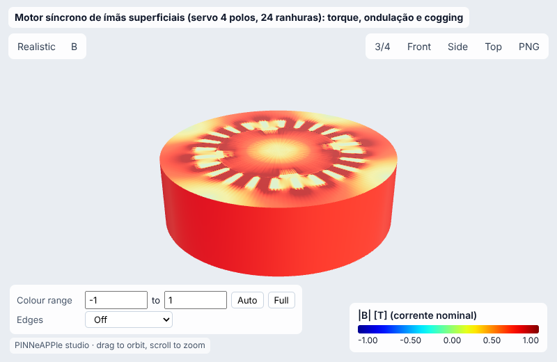
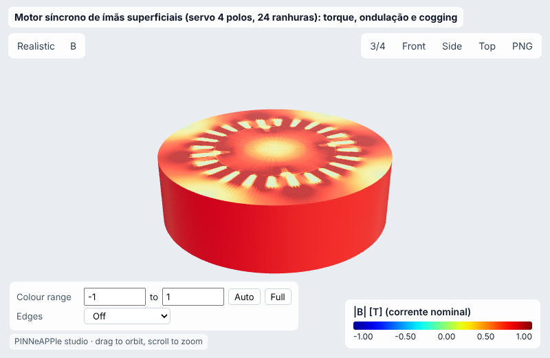
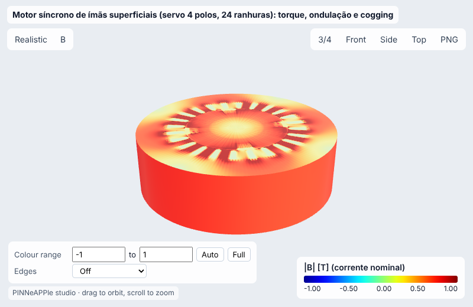
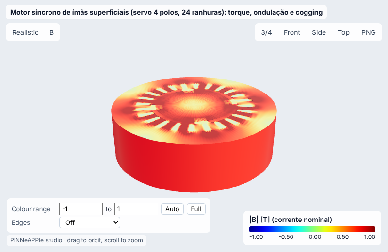
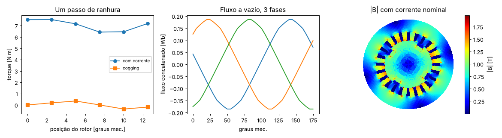
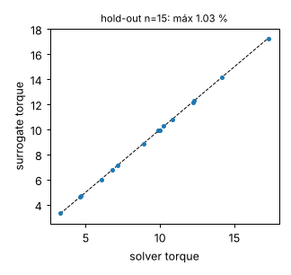
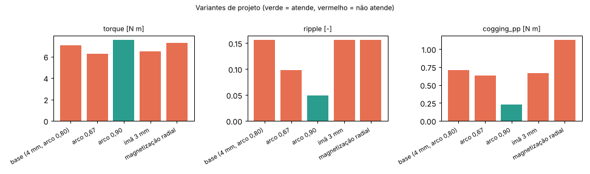
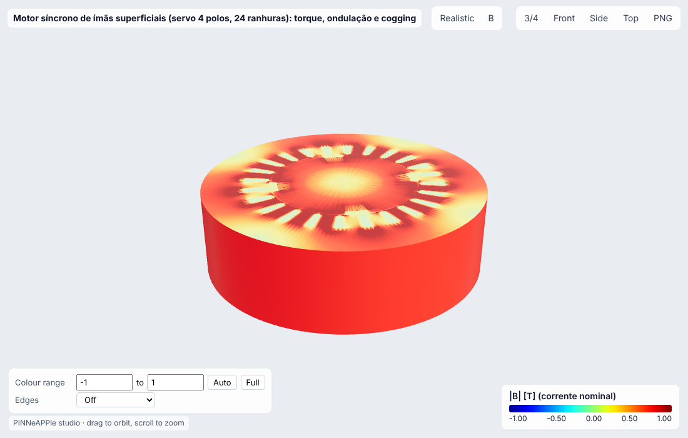

# Motor síncrono de ímãs superficiais (servo 4 polos, 24 ranhuras): torque, ondulação e cogging

**Setor:** Eletromagnetismo / máquinas elétricas  
**Preset:** `spm_servo_motor`

**Problema.** Servo-motor de ímãs de NdFeB na superfície do rotor, 4 polos, 24 ranhuras, enrolamento distribuído trifásico, ferro não linear (curva BH). FEM magnetostático 2-D com banda deslizante, torque por tensor de Maxwell e por co-energia, fluxo concatenado e força contra-eletromotriz.

**Pergunta de engenharia.** Que torque o motor entrega na corrente nominal (limite térmico de densidade de corrente), com quanta ondulação e cogging? Qual a menor espessura de ímã que mantém o torque?

## Uso

```python
import pinneapple as pp

p = pp.presets.load("spm_servo_motor")
r = p.run()                      # valores padrão abaixo; troque qualquer entrada: p.run(nome=valor)
print(r)                         # saídas, decisão, trust report
p.validate()                     # casos de referência com o erro medido
p.run(fidelity="surrogate")     # surrogate treinado (com desvio-padrão e aviso fora do domínio)
```

CLI: `python -m pinneapple_presets run spm_servo_motor nome=valor`  
Flow Studio: nó `preset.run` com `preset = spm_servo_motor`.

## Entradas (SI) e fonte de cada valor padrão

| entrada | unidade | padrão | domínio | fonte |
|---|---|---|---|---|
| `I_peak` | A | 13.4 | 1 – 60 | corrente nominal: J_rms = 6 A/mm2 na área de cobre da ranhura (fator de enchimento 0,45, 20 espiras); J típico de motor TEFC 3-6,5 A/mm2 (Pyrhönen, Jokinen & Hrabovcová, Design of Rotating Electrical Machines, 2a ed. (2014), Tab. 6.2) |
| `magnet_thickness` | m | 0.004 | 0.0015 – 0.008 | ímã de 4 mm (servo-motores pequenos 3-6 mm) |
| `magnet_arc` | - | 0.8 | 0.5 – 0.98 | arco do ímã = 80 % do passo polar |
| `Br` | T | 1.2 | 0.9 – 1.45 | NdFeB N38-N42 a 20 °C, Br 1,2-1,3 T (catálogos de ímãs sinterizados) |
| `magnetization` | - | parallel | parallel, radial | magnetização paralela (bloco) |
| `slot_opening` | - | 0.1333 | 0.05 – 0.5 | abertura da ranhura = 2/15 do passo de ranhura |
| `rpm` | rpm | 3000 | 100 – 12000 | rotação nominal de servo-motor |
| `n_positions` | - | 6 | 3 – 24 | posições do rotor por passo de ranhura (ondulação, cogging) |
| `n_theta` | - | 360 | 360, 720 | divisões angulares da malha: 15 por passo de ranhura, para que a abertura de 2/15 caia em nós (com 240 ou 480 a geometria da abertura muda com a malha); convergência 360 -> 720 |

## Saídas (caso padrão, rodado aqui)

| saída | valor | unidade | significado |
|---|---|---|---|
| `torque` | 7.045 | N m | torque médio na corrente nominal (eixo q) |
| `ripple` | 0.1565 | - | ondulação pico-a-pico / média |
| `cogging_pp` | 0.7074 | N m | cogging pico-a-pico (sem corrente) |
| `kt` | 0.5258 | N m/A | constante de torque (por A de pico) |
| `ke` | 0.3267 | V s/rad | constante de FEM (fase, pico, por rad/s mecânico) |
| `emf_peak` | 102.6 | V | FEM de fase de pico na rotação dada |
| `p_copper` | 62.83 | W | perdas no cobre (3 fases, 20 °C) |

**Decisão:** NOT OK

- torque médio 7.05 N m a 13.4 A de pico (kt 0.526 N m/A)
- ondulação 15.7 % > 5 %, cogging 0.707 N m p-p

**Trust report:** APPROVED (score 1, cobertura 1)

| checagem | status | valor | limite | fonte |
|---|---|---|---|---|
| Maxwell stress = co-energy torque | supports | 0.0001534 | 0.01 | two independent torque integrations |
| power balance T - T_cog = i.e / w | supports | 0.0209 | 0.03 | flux linkage derivative vs field torque |
| cogging has zero mean over a slot pitch | supports | 0.002805 | 0.05 |  |
| current density within the TEFC range (<= 6.5 A/mm2) | supports | 5.958 | 6.5 | Pyrhönen, Jokinen & Hrabovcová, Design of Rotating Electrical Machines, 2a ed. (2014) |
| inside the validity domain | supports | None | None | preset data sheet |

## Validação

| caso | saída | calculado | referência | erro relativo | tolerância | tipo | fonte |
|---|---|---|---|---|---|---|---|
| torque: tensor de Maxwell vs co-energia | `torque` | 7.527 N m | 7.526 N m | 0.0153 % | 1 % | independent_solver | duas integrações independentes do mesmo campo (lib, tests/test_motor_magnetics.py mede 0,09 %) |
| torque - cogging vs i.e/w (balanço de potência) | `torque` | 7.473 N m | 7.633 N m | 2.09 % | 3 % | analytic | conservação de energia: P_mec = sum i_k e_k |
| kt (FEM) vs 3/2 ke1 (fundamental da FEM, máquina senoidal) | `kt` | 0.5258 N m/A | 0.541 N m/A | 2.82 % | 5 % | analytic | Pyrhönen, Jokinen & Hrabovcová, Design of Rotating Electrical Machines, 2a ed. (2014), eq. de torque da máquina síncrona de ímãs |

Convergência (n_theta (12 posições por passo de ranhura) = [360, 720]): variação relativa entre os dois últimos níveis 3.10e-03 (passa).

## Surrogate

ARD Gaussian process (squared exponential), entradas ['I_peak', 'magnet_thickness', 'magnet_arc'] no domínio {'I_peak': [5.0, 30.0], 'magnet_thickness': [0.0025, 0.006], 'magnet_arc': [0.65, 0.92]}; DOE Latin hypercube com 40 rodadas do solver para treino e 15 independentes para hold-out.

| saída | erro rel. máx (hold-out) | médio | R² | cobertura ±2σ |
|---|---|---|---|---|
| `torque` | 1.03 % | 0.34 % | 0.9999 | 100 % |

Fora do domínio de treino o resultado sai marcado (aviso + checagem do trust report em *contradicts*), nunca extrapolado em silêncio.

## Inversão

Remanência dos ímãs (aquecidos ou parcialmente desmagnetizados) a partir da FEM a vazio medida na rotação nominal (4 leituras, ruído de 0,5 %). Verdade sintética Br = 1.12 T.

- **true:** 1.12
- **recovered:** 1.121
- **ci95:** ['1.115', '1.127']
- **rel_error:** 0.0009726
- **noise:** 0.5 %
- **how:** bisseção sobre o FEM (FEM a vazio é monótona em Br), IC pela sensibilidade dE/dBr

## Otimização

- **objective:** menor volume de ímã (espessura x arco) com torque >= base (surrogate, conferido no FEM) e cogging <= 2 % do torque (FEM: o surrogate de cogging foi descartado)
- **magnet_thickness_m:** 0.00325
- **magnet_arc:** 0.8955
- **magnet_volume_vs_base:** 0.9094
- **surrogate_torque:** 7.126
- **fem_torque:** 7.089
- **surrogate_vs_fem_torque_rel:** 0.005317
- **fem_cogging:** 0.08948
- **verified_ok:** True
- **fem_checks:** 2

## Variantes de projeto

| variante | parâmetros | torque | ripple | cogging_pp | decisão |
|---|---|---|---|---|---|
| base (4 mm, arco 0,80) | `{}` | 7.045 | 0.1565 | 0.7074 | NOT OK |
| arco 0,67 | `{'magnet_arc': 0.67}` | 6.262 | 0.09746 | 0.6294 | NOT OK |
| arco 0,90 | `{'magnet_arc': 0.9}` | 7.579 | 0.04936 | 0.2307 | OK |
| ímã 3 mm | `{'magnet_thickness': 0.003}` | 6.482 | 0.1566 | 0.6675 | NOT OK |
| magnetização radial | `{'magnetization': 'radial'}` | 7.304 | 0.1566 | 1.131 | NOT OK |

    

## Figuras






Visualizador 3-D interativo (arquivo único, abre do disco): regenere com `python -m pinneapple_presets report spm_servo_motor` → `results/3d/spm_servo_motor_viewer.html`.

## Capacidades

| capacidade | tem? | por quê não |
|---|---|---|
| visualização 3-D | sim |  |
| surrogate | sim |  |
| inversão | sim |  |
| otimização | sim |  |
| variação de projeto | sim |  |
| cadeia de porquês | não | não há caso de máquina elétrica no pinneapple_reason |

## Pipeline

1. geometria: SPMMachine (rotor, ímãs, entreferro, 24 ranhuras, banda deslizante)
1. modelo: magnetostática não linear em A_z, ímãs por Br e mu_r
1. solver: SPMMachine.solve por posição (Newton); torque por tensor de Maxwell e por co-energia
1. pós: torque médio e ondulação num passo de ranhura, cogging, fluxo concatenado e FEM
1. decisão: torque >= alvo e ondulação <= 5 %

**Domínio de validade.** 2-D (sem efeitos de extremidade nem skew), magnetostática (sem correntes induzidas nos ímãs), ferro com a curva BH ilustrativa da lib, enrolamento de camada única distribuído. Desmagnetização não verificada.

**Limitações.**

- Sem referência experimental pública desta geometria ilustrativa: a validação é interna (dois métodos de torque, balanço de potência, periodicidade, convergência de malha); a verificação contra a solução exata de subdomínio da máquina sem ranhuras está em tests/test_motor_magnetics.py.

## Proveniência

Rodado em 2026-10-24T11:05:23Z · solver 37.7 s · relatório completo 1.14e+03 s · Intel(R) Xeon(R) Processor @ 2.10GHz (4 núcleos) · python 3.13.17, pinneapple 0.7.0, numpy 2.5.3, scipy 1.18.1, torch 2.14.1
