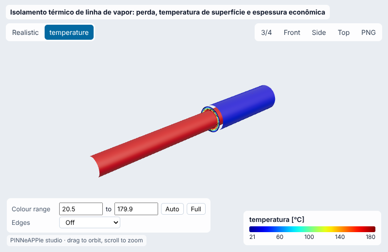
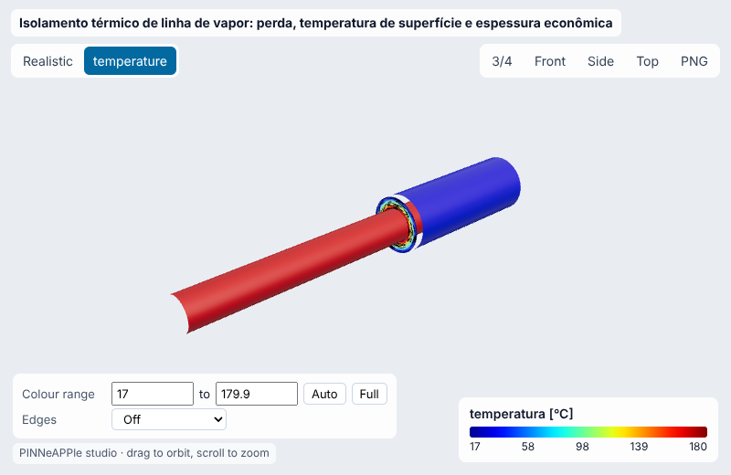
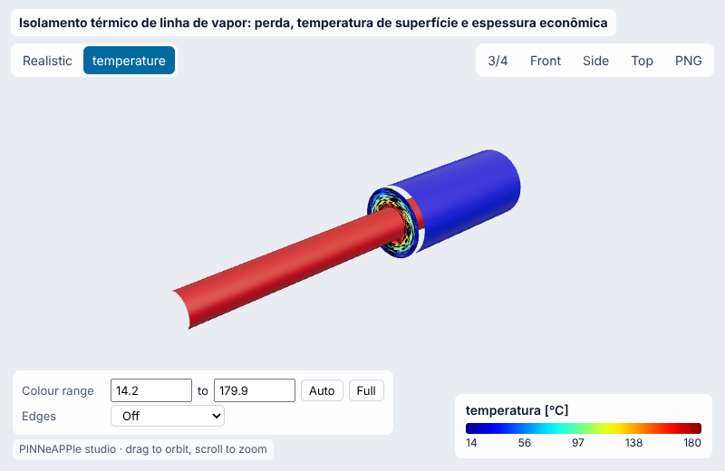
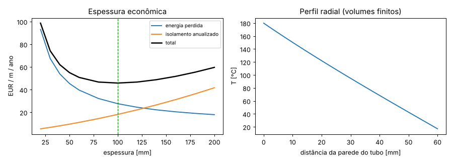
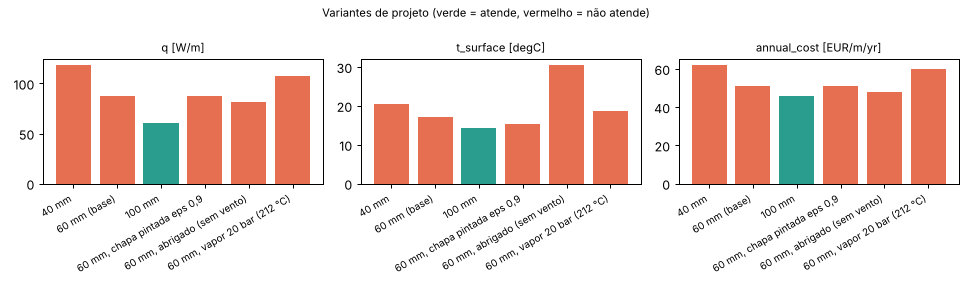
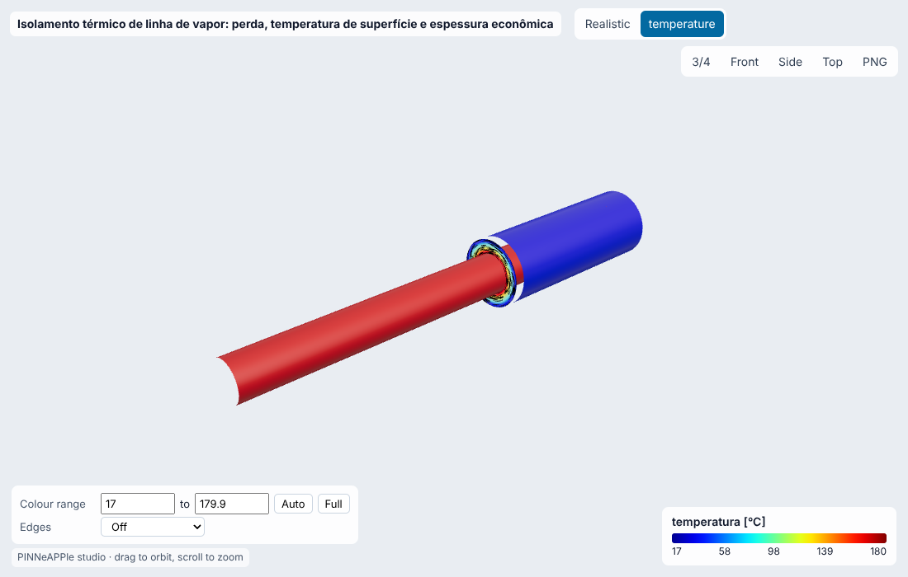

# Isolamento térmico de linha de vapor: perda, temperatura de superfície e espessura econômica

**Setor:** Processo e energia / utilidades  
**Preset:** `steam_pipe_insulation`

**Problema.** Linha de vapor saturado de 10 bar(a) em tubo DN150 ao ar livre, isolada com lã de rocha e revestida de alumínio. Perda de calor por metro, temperatura da superfície e a espessura que minimiza o custo anual (energia perdida + isolamento instalado anualizado).

**Pergunta de engenharia.** Qual espessura de isolamento minimiza o custo anual por metro, e qual a menor que mantém a superfície abaixo de 60 °C (proteção pessoal)? Quanto se perde sem isolamento?

## Uso

```python
import pinneapple as pp

p = pp.presets.load("steam_pipe_insulation")
r = p.run()                      # valores padrão abaixo; troque qualquer entrada: p.run(nome=valor)
print(r)                         # saídas, decisão, trust report
p.validate()                     # casos de referência com o erro medido
```

CLI: `python -m pinneapple_presets run steam_pipe_insulation nome=valor`  
Flow Studio: nó `preset.run` com `preset = steam_pipe_insulation`.

## Entradas (SI) e fonte de cada valor padrão

| entrada | unidade | padrão | domínio | fonte |
|---|---|---|---|---|
| `d_pipe` | m | 0.1683 | 0.02 – 1.2 | DN150 (6"), diâmetro externo 168,3 mm (ASME B36.10M / EN 10220) |
| `t_fluid` | degC | 179.9 | 40 – 600 | vapor saturado a 10 bar(a) (IAPWS-IF97: 179,88 °C) |
| `t_amb` | degC | 10 | -30 – 45 | premissa: média anual do ar externo de clima temperado |
| `wind` | m/s | 3 | 0 – 20 | premissa: vento médio de 3 m/s ao ar livre |
| `thickness` | m | 0.06 | 0 – 0.3 | premissa: 60 mm, espessura comum em linhas de vapor de média pressão |
| `k0` | W/m K | 0.036 | 0.015 – 0.1 | lã de rocha: lambda(T) = k0 + k1 T; ordem dos valores declarados de seções de lã de rocha (EN 14303): ~0,041 a 50 °C, ~0,046 a 100 °C, ~0,056 a 200 °C |
| `k1` | W/m K2 | 0.0001 | 0 – 0.0005 | inclinação da mesma curva lambda(T) |
| `eps` | - | 0.05 | 0.03 – 0.95 | alumínio brilhante: emissividade 0,05 (ISO 12241 Tab. 4) |
| `hours` | h/yr | 8000 | 500 – 8760 | premissa: operação contínua com paradas de manutenção |
| `energy_price` | EUR/kWh | 0.05 | 0.005 – 0.5 | premissa: gás natural industrial, ordem de grandeza Eurostat nrg_pc_203 (consumidores não-residenciais) 2023-2024 |
| `efficiency` | - | 0.88 | 0.5 – 1 | premissa: caldeira + distribuição, 88 % |
| `cost_per_m3` | EUR/m3 | 900 | 100 – 5000 | premissa: lã de rocha instalada (material + mão de obra) por m3 |
| `cost_per_m2` | EUR/m2 | 40 | 0 – 300 | premissa: revestimento de alumínio instalado por m2 |
| `rate` | - | 0.08 | 0 – 0.3 | premissa: custo de capital 8 % ao ano (VDI 2055-1 sec. 6) |
| `years` | yr | 10 | 1 – 40 | premissa: vida econômica do isolamento 10 anos |
| `t_surface_max` | degC | 60 | 40 – 80 | premissa usual de especificação para proteção pessoal (ISO 13732-1: limiar de queimadura de metal ~60 °C para contato de ~5 s) |

## Saídas (caso padrão, rodado aqui)

| saída | valor | unidade | significado |
|---|---|---|---|
| `q` | 87.16 | W/m | perda de calor por metro com a espessura dada |
| `t_surface` | 17.05 | degC | temperatura da superfície do revestimento |
| `q_bare` | 2402 | W/m | perda do tubo nu (pintado, eps 0,9) |
| `saving` | 0.9637 | - | fração da perda evitada |
| `annual_cost` | 50.79 | EUR/m/yr | custo anual por metro com a espessura dada |
| `t_economic` | 0.1 | m | espessura econômica (entre as espessuras comerciais) |
| `t_safe` | 0.02 | m | menor espessura com superfície <= limite |

**Decisão:** NOT OK

- perda 87.2 W/m (nu: 2402 W/m, 96.4 % evitado), superfície 17.0 °C
- espessura econômica 100 mm; menor segura (<= 60 °C) 20 mm; dada 60 mm

**Trust report:** APPROVED (score 1, cobertura 1)

| checagem | status | valor | limite | fonte |
|---|---|---|---|---|
| Kirchhoff closed form = finite volumes with k(T) | supports | 1.621e-07 | 0.0001 | radial_fd (Picard, 400 volumes) |
| FV energy balance: inner flow = outer flow | supports | 3.471e-13 | 1e-08 |  |
| surface between ambient and fluid | supports | None | None |  |
| Churchill-Bernstein range Re Pr > 0.2 | supports | 5.882e+04 | None | Incropera eq. 7.54 |
| insulation thicker than the critical radius (adds resistance) | supports | 87.16 | 2402 |  |
| inside the validity domain | supports | None | None | preset data sheet |

## Validação

| caso | saída | calculado | referência | erro relativo | tolerância | tipo | fonte |
|---|---|---|---|---|---|---|---|
| perda com 30 mm: Kirchhoff vs volumes finitos com k(T) | `q` | 148.5 W/m | 148.5 W/m | 4.96e-06 % | 0.01 % | independent_solver | radial_fd: equação de calor radial com k(T) resolvida numericamente |
| perda com 60 mm: Kirchhoff vs volumes finitos com k(T) | `q` | 87.16 W/m | 87.16 W/m | 1.62e-05 % | 0.01 % | independent_solver | radial_fd: equação de calor radial com k(T) resolvida numericamente |
| perda com 120 mm: Kirchhoff vs volumes finitos com k(T) | `q` | 53.89 W/m | 53.89 W/m | 4.96e-05 % | 0.01 % | independent_solver | radial_fd: equação de calor radial com k(T) resolvida numericamente |
| k constante: resistências em série (Incropera eq. 3.27) | `q` | 85.61 W/m | 85.61 W/m | 1.66e-14 % | 0.0001 % | analytic | Incropera et al., Fundamentals of Heat and Mass Transfer, eq. 3.27 |
| h forçado (Re 55000): Churchill-Bernstein misto vs Hilpert | `h_cv` | 13.4 W/m2 K | 14.29 W/m2 K | 6.21 % | 15 % | independent_solver | Hilpert (1933) com as constantes da Tabela 7.2 de Incropera (incerteza ~±20 %) |
| h natural (sem vento): Churchill-Chu vs McAdams 1,32 (dT/D)^0,25 | `h_cv` | 4.551 W/m2 K | 4.216 W/m2 K | 7.96 % | 15 % | independent_solver | McAdams, Heat Transmission (1954): cilindro horizontal laminar em ar |

Convergência (volumes radiais = [25, 50, 100, 200]): variação relativa entre os dois últimos níveis 1.95e-06 (passa).

## Inversão

Fator de condutividade efetiva do isolamento envelhecido/úmido a partir de termografia da superfície (5 leituras, ventos de 0,5 a 8 m/s). Medição sintética com fator real 1.6 e ruído de 0.5 K.

- **true:** 1.6
- **recovered:** 1.605
- **ci95:** ['1.548', '1.662']
- **rel_error:** 0.003162
- **noise:** 0.5 K
- **how:** mínimos quadrados (Brent) sobre o modelo de perda, IC por sensibilidade

## Otimização

- **objective:** custo anual mínimo por metro (energia + isolamento anualizado), superfície <= limite
- **economic_thickness_m:** 0.1
- **economic_annual_cost:** 45.82
- **recommended_thickness_m:** 0.1
- **verified_t_surface:** 14.19
- **verified_annual_cost:** 45.82
- **base_annual_cost:** 50.79
- **bare_annual_energy_cost:** 678.5
- **payback_years_vs_bare:** 0.1877

## Variantes de projeto

| variante | parâmetros | q | t_surface | annual_cost | decisão |
|---|---|---|---|---|---|
| 40 mm | `{'thickness': 0.04}` | 118.5 | 20.54 | 62.02 | NOT OK |
| 60 mm (base) | `{}` | 87.16 | 17.05 | 50.79 | NOT OK |
| 100 mm | `{'thickness': 0.1}` | 60.76 | 14.19 | 45.82 | OK |
| 60 mm, chapa pintada eps 0,9 | `{'eps': 0.9}` | 87.9 | 15.35 | 51.13 | NOT OK |
| 60 mm, abrigado (sem vento) | `{'wind': 0.0}` | 81.13 | 30.49 | 48.05 | NOT OK |
| 60 mm, vapor 20 bar (212 °C) | `{'t_fluid': 212.4}` | 107.5 | 18.69 | 60.05 | NOT OK |

     

## Figuras





Visualizador 3-D interativo (arquivo único, abre do disco): regenere com `python -m pinneapple_presets report steam_pipe_insulation` → `results/3d/steam_pipe_insulation_viewer.html`.

## Capacidades

| capacidade | tem? | por quê não |
|---|---|---|
| visualização 3-D | sim |  |
| surrogate | não | forma fechada (< 1 ms por avaliação): um surrogate não economiza tempo |
| inversão | sim |  |
| otimização | sim |  |
| variação de projeto | sim |  |
| cadeia de porquês | não | o caso do telhado (roof) cobre isolamento de forro, não de tubulação |

## Pipeline

1. geometria: tubo DN, camada de isolamento, revestimento
1. modelo: condução radial com lambda(T) (transformada de Kirchhoff), radiação + convecção mista (Churchill-Chu e Churchill-Bernstein)
1. solver: heat_loss (bisseção da temperatura de superfície); radial_fd (volumes finitos) para checar
1. pós: perda W/m, temperatura de superfície, custo anual por espessura comercial
1. decisão: espessura >= max(econômica, segura)

**Domínio de validade.** Regime permanente, tubo horizontal, isolamento homogêneo e seco com lambda linear em T, sem pontes térmicas (suportes, flanges e válvulas acrescentam tipicamente 10-25 %, VDI 2055), resistência da parede e do filme interno desprezadas (lado seguro).

## Proveniência

Rodado em 2026-10-24T01:17:20Z · solver 0.0732 s · relatório completo 26.9 s · Intel(R) Xeon(R) Processor @ 2.10GHz (4 núcleos) · python 3.13.17, pinneapple 0.7.0, numpy 2.5.3, scipy 1.18.1, torch 2.14.1
