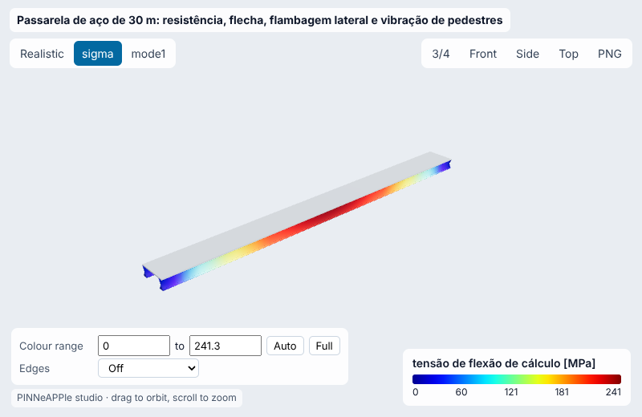
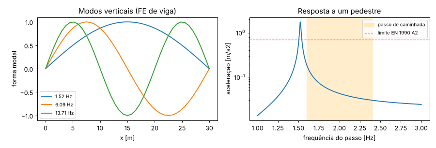
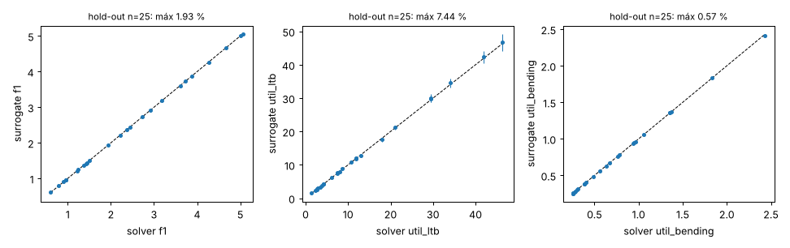
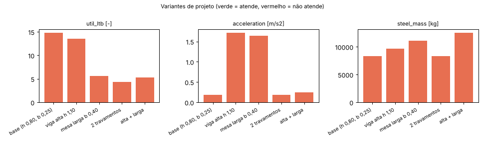
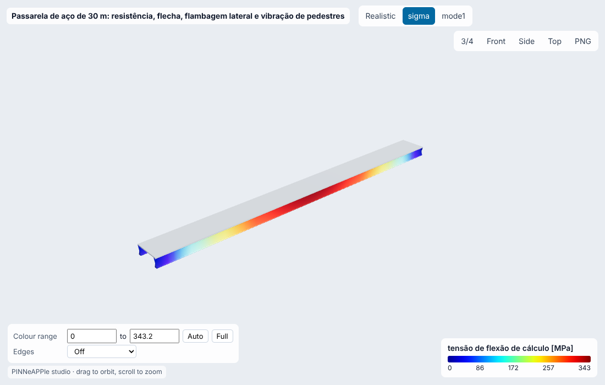
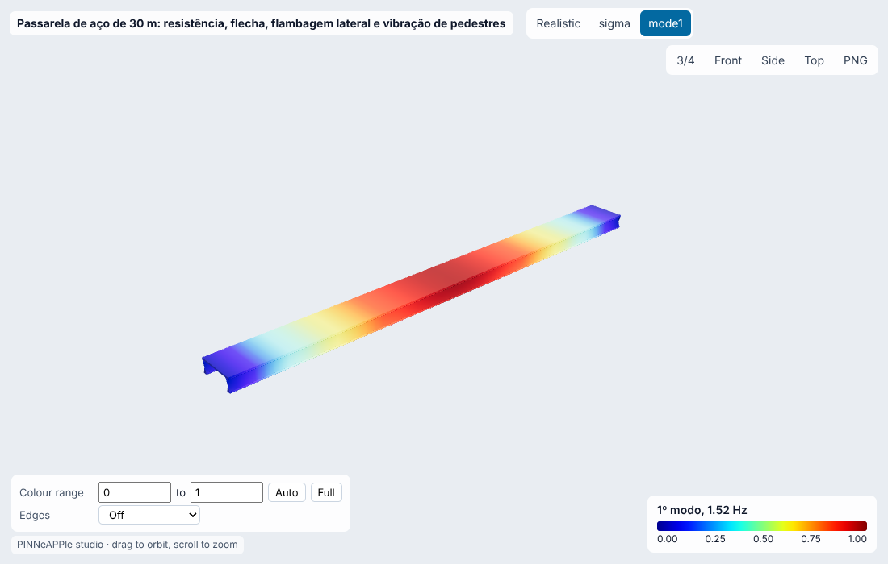

# Passarela de aço de 30 m: resistência, flecha, flambagem lateral e vibração de pedestres

**Setor:** Estrutural / construção  
**Preset:** `steel_footbridge_pedestrian`

**Problema.** Passarela biapoiada de 30 m com duas vigas I soldadas e tabuleiro de 2,5 m (placas pré-moldadas). Verifica ELU de flexão sob multidão (EN 1991-2), flecha L/360, flambagem lateral com torção (EN 1993-1-1) e conforto à vibração por pedestres (EN 1990 A2, Bachmann & Ammann).

**Pergunta de engenharia.** A seção das vigas atende os quatro modos de falha? Qual a seção soldada mais leve que atende? O primeiro modo vertical cai na faixa de passo de caminhada (1,6-2,4 Hz)?

## Uso

```python
import pinneapple as pp

p = pp.presets.load("steel_footbridge_pedestrian")
r = p.run()                      # valores padrão abaixo; troque qualquer entrada: p.run(nome=valor)
print(r)                         # saídas, decisão, trust report
p.validate()                     # casos de referência com o erro medido
p.run(fidelity="surrogate")     # surrogate treinado (com desvio-padrão e aviso fora do domínio)
```

CLI: `python -m pinneapple_presets run steel_footbridge_pedestrian nome=valor`  
Flow Studio: nó `preset.run` com `preset = steel_footbridge_pedestrian`.

## Entradas (SI) e fonte de cada valor padrão

| entrada | unidade | padrão | domínio | fonte |
|---|---|---|---|---|
| `span` | m | 30 | 8 – 60 | premissa: travessia típica de 30 m (via ou rio pequeno) |
| `deck_width` | m | 2.5 | 1.5 – 6 | largura útil de 2,5 m (passarela de pedestres e bicicletas) |
| `deck_dead_load` | Pa | 3000 | 500 – 8000 | placas de concreto de 100 mm (25 kN/m3, EN 1991-1-1 Tab. A.1) + 0,5 kN/m2 de acabamentos |
| `girder_h` | m | 0.8 | 0.3 – 2 | premissa: L/37 (viga dimensionada só pela resistência) |
| `girder_b` | m | 0.25 | 0.1 – 0.8 | mesa de 250 mm |
| `girder_tf` | m | 0.02 | 0.008 – 0.06 | mesa de 20 mm (S355, t <= 40 mm) |
| `girder_tw` | m | 0.01 | 0.006 – 0.03 | alma de 10 mm |
| `fy` | Pa | 3.55e+08 | 2.35e+08 – 4.6e+08 | EN 10025-2 S355, t <= 16 mm |
| `lateral_braces` | - | 0 | 0 – 10 | sem travamento lateral intermediário |
| `damping_ratio` | - | 0.005 | 0.002 – 0.05 | aço soldado: 0,5 % (Sétra 2006 / HiVoSS 2008, valor mínimo) |
| `pedestrian_weight` | N | 700 | 500 – 1000 | Bachmann & Ammann (1987) |
| `acc_max` | m/s2 | 0.7 | 0.2 – 2.5 | EN 1990:2002 Anexo A2, A2.4.3.2: aceleração vertical <= 0,7 m/s2 (recomendado) |
| `deflection_ratio` | - | 360 | 200 – 1000 | AASHTO LRFD Pedestrian Bridges (2009) sec. 5: L/360 sob carga de pedestres |

## Saídas (caso padrão, rodado aqui)

| saída | valor | unidade | significado |
|---|---|---|---|
| `f1` | 1.523 | Hz | 1ª frequência vertical |
| `acceleration` | 0.1895 | m/s2 | aceleração de pico, um pedestre em ressonância |
| `deflection` | 0.1331 | m | flecha sob a multidão |
| `util_bending` | 0.9667 | - | M_Ed / M_Rd |
| `util_ltb` | 14.8 | - | M_Ed / M_b,Rd (flambagem lateral) |
| `M_cr` | 1.33e+05 | N m | momento crítico elástico |
| `steel_mass` | 8290 | kg | massa de aço das vigas |

**Decisão:** NOT OK

- f1 = 1.52 Hz, aceleração 0.19 m/s2 (limite 0.7)
- utilização flambagem lateral 14.80
- utilização flexão 0.97; flecha 133 mm (limite 83 mm)
- não atende: flecha (ELS), flambagem lateral

**Trust report:** APPROVED (score 1, cobertura 1)

| checagem | status | valor | limite | fonte |
|---|---|---|---|---|
| solver vs closed form: FD beam deflection | supports | 5.066e-06 | 0.01 | pinneapple_simulation.numerical_solvers.beam_bvp_fdm.solve_euler_bernoulli_beam_1d (4th-order FD) |
| equilibrium: FD support reactions = applied load | supports | 0.0075 | 0.01 | pinneapple_simulation.numerical_solvers.beam_bvp_fdm.solve_euler_bernoulli_beam_1d (4th-order FD) |
| solver vs closed form: Rayleigh frequency from FD deflection | supports | 0.0007096 | 0.005 | pinneapple_simulation.numerical_solvers.beam_bvp_fdm.solve_euler_bernoulli_beam_1d (4th-order FD) + Rayleigh's method (static deflection shape) |
| FE beam: 1st frequency = closed form | supports | 2.701e-08 | 0.001 | pinneapple_simulation.numerical_solvers.beam_fe (Hermite, massa consistente, 40 elementos) |
| FE beam: crowd deflection = closed form | supports | 3.202e-13 | 0.001 | pinneapple_simulation.numerical_solvers.beam_fe (Hermite, massa consistente, 40 elementos) |
| FE equilibrium: reactions = applied load | supports | 1.884e-12 | 1e-09 | pinneapple_simulation.numerical_solvers.beam_fe (Hermite, massa consistente, 40 elementos) |
| cross-section class <= 3 (the elastic checks above hold) | supports | 76 | 100.9 | EN 1993-1-1 Table 5.2 |
| EN 1990 A2 needs the comfort check (f1 < 5 Hz) | supports | 1.523 | 5 | EN 1990:2002 Anexo A2, A2.4.3.2: aceleração vertical <= 0,7 m/s2 (recomendado) |
| inside the validity domain | supports | None | None | preset data sheet |

## Validação

| caso | saída | calculado | referência | erro relativo | tolerância | tipo | fonte |
|---|---|---|---|---|---|---|---|
| 1ª frequência: fórmula fechada vs FE de viga | `f1` | 1.523 Hz | 1.523 Hz | 2.7e-06 % | 0.1 % | independent_solver | pinneapple_simulation.numerical_solvers.beam_fe (Hermite, massa consistente, 40 elementos) |
| flecha da multidão: 5qL^4/384EI vs FE de viga | `deflection` | 0.1331 m | 0.1331 m | 3.2e-11 % | 0.1 % | independent_solver | pinneapple_simulation.numerical_solvers.beam_fe (Hermite, massa consistente, 40 elementos) |
| 2ª frequência = 4 x f1 (Euler-Bernoulli biapoiada) | `f2` | 6.091 Hz | 6.091 Hz | 4.23e-05 % | 0.2 % | analytic | Clough & Penzien, Dynamics of Structures, eq. 18-21: f_n = n^2 f_1 |
| aceleração em ressonância exata (vão 24 m, f1 na faixa de passo) | `acceleration` | 2.241 m/s2 | 2.241 m/s2 | 1.98e-14 % | 0.0001 % | analytic | oscilador de 1 GL em ressonância: a = alpha G / (M_modal 2 xi), Bachmann & Ammann (1987) |

Convergência (elementos de viga = [4, 8, 16, 32]): variação relativa entre os dois últimos níveis 9.67e-07 (passa).

## Surrogate

ARD Gaussian process (squared exponential), entradas ['span', 'girder_h', 'girder_b'] no domínio {'span': [20.0, 45.0], 'girder_h': [0.6, 1.6], 'girder_b': [0.2, 0.5]}; DOE Latin hypercube com 70 rodadas do solver para treino e 25 independentes para hold-out.

| saída | erro rel. máx (hold-out) | médio | R² | cobertura ±2σ |
|---|---|---|---|---|
| `f1` | 1.93 % | 0.156 % | 1.0000 | 96 % |
| `util_ltb` | 7.44 % | 1.58 % | 0.9997 | 92 % |
| `util_bending` | 0.57 % | 0.0611 % | 1.0000 | 100 % |

Fora do domínio de treino o resultado sai marcado (aviso + checagem do trust report em *contradicts*), nunca extrapolado em silêncio.

## Inversão

Rigidez efetiva EI e massa por metro a partir de ensaio de vibração ambiente: f1 e f2 medidas com a passarela vazia e com 6 t de sacos de areia distribuídos. Verdade sintética: EI x1,25 (ação composta do tabuleiro), massa x1,10; ruído de 0.5 % nas frequências.

- **true:** ['1.25', '1.1']
- **recovered:** ['1.282', '1.128']
- **ci95:** ['[1.1215575738888741, 1.4429127799814927]', '[0.9763787940907289, 1.280430801795304]']
- **rel_error:** 0.02582
- **noise:** 0.5 % (1 sigma) nas frequências
- **how:** Gauss-Newton sobre o FE de viga (beam_modes), covariância sigma^2 (J^T J)^-1

## Otimização

- **objective:** massa mínima de aço (vigas + contraventamentos) com os 4 modos atendidos e seção classe <= 3
- **designs_scanned:** 24570
- **girder_h:** 1.2
- **girder_b:** 0.35
- **girder_tf:** 0.015
- **girder_tw:** 0.012
- **lateral_braces:** 5
- **steel_mass_kg:** 1.172e+04
- **girder_mass_kg:** 1.156e+04
- **base_girder_mass_kg:** 8290
- **verified_ok:** True
- **util_ltb:** 0.9017
- **util_bending:** 0.5434
- **acceleration:** 0.6891
- **surrogate_question:** seção (h, b) mais leve com util_ltb <= 1 e a <= limite, sem travamentos, tf e tw padrão
- **surrogate_choice:** nenhuma seção do domínio do surrogate atende sem travamentos

## Variantes de projeto

| variante | parâmetros | util_ltb | acceleration | steel_mass | decisão |
|---|---|---|---|---|---|
| base (h 0,80, b 0,25) | `{}` | 14.8 | 0.1895 | 8290 | NOT OK |
| viga alta h 1,10 | `{'girder_h': 1.1}` | 13.59 | 1.715 | 9703 | NOT OK |
| mesa larga b 0,40 | `{'girder_b': 0.4}` | 5.566 | 1.644 | 1.112e+04 | NOT OK |
| 2 travamentos | `{'lateral_braces': 2}` | 4.318 | 0.1895 | 8290 | NOT OK |
| alta + larga | `{'girder_h': 1.1, 'girder_b': 0.4}` | 5.28 | 0.2474 | 1.253e+04 | NOT OK |

    

## Figuras







Visualizador 3-D interativo (arquivo único, abre do disco): regenere com `python -m pinneapple_presets report steel_footbridge_pedestrian` → `results/3d/steel_footbridge_pedestrian_viewer.html`.

## Capacidades

| capacidade | tem? | por quê não |
|---|---|---|
| visualização 3-D | sim |  |
| surrogate | sim |  |
| inversão | sim |  |
| otimização | sim |  |
| variação de projeto | sim |  |
| cadeia de porquês | sim |  |

## Pipeline

1. geometria: i_section(h, b, tf, tw) das vigas + tabuleiro
1. modelo: cargas EN 1991-2 (multidão), combinações EN 1990 (1,35 G + 1,5 Q)
1. solver: modos de falha do pinneapple_reason (bending_strength, deflection, lateral_torsional_buckling, pedestrian_resonance) + FE de viga Hermite (modos e flecha)
1. pós: utilizações, f1, aceleração, M_cr
1. decisão: todas as utilizações <= 1 e a <= 0,7 m/s2; seção mais leve por varredura

**Domínio de validade.** Vigas biapoiadas de seção I duplamente simétrica, Euler-Bernoulli, carga no centro de cisalhamento, C1 = 1 (conservador para carga distribuída), tabuleiro sem ação composta e sem travar a mesa comprimida. Vibração: um pedestre em regime permanente (limite superior); multidões e modos laterais (lock-in) não modelados.

**Limitações.**

- M_cr pela fórmula fechada de Timoshenko & Gere com C1 = 1; sem verificação independente (FE de flambagem lateral não implementado).

**Por que cada elemento do projeto existe:** `pinneapple_reason.run_case("footbridge")`.

## Proveniência

Rodado em 2026-10-24T00:56:11Z · solver 0.0164 s · relatório completo 51.1 s · Intel(R) Xeon(R) Processor @ 2.10GHz (4 núcleos) · python 3.13.17, pinneapple 0.7.0, numpy 2.5.3, scipy 1.18.1, torch 2.14.1
