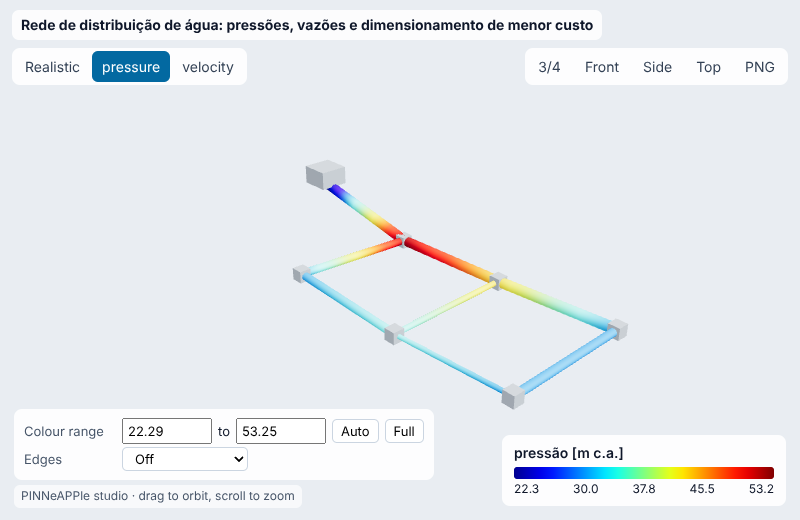
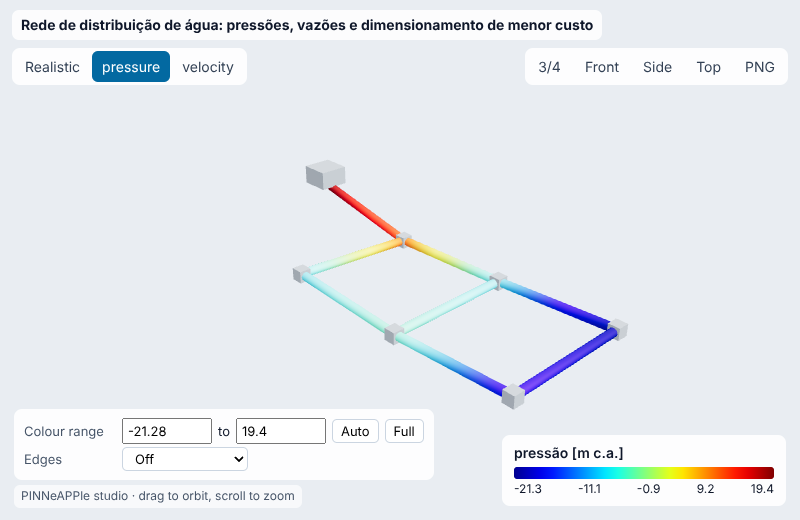
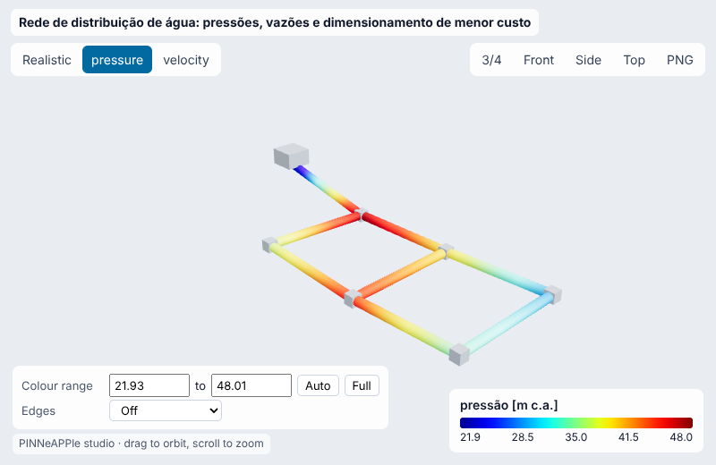
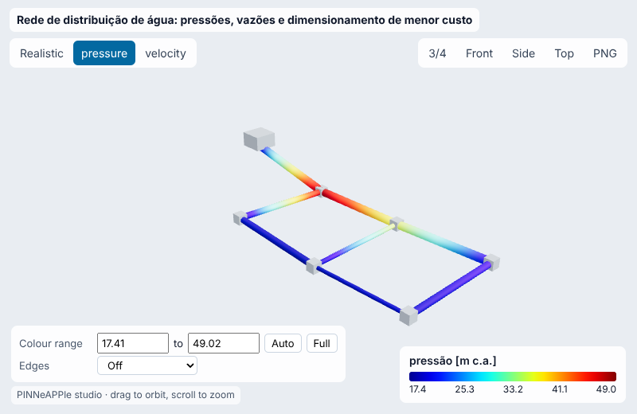
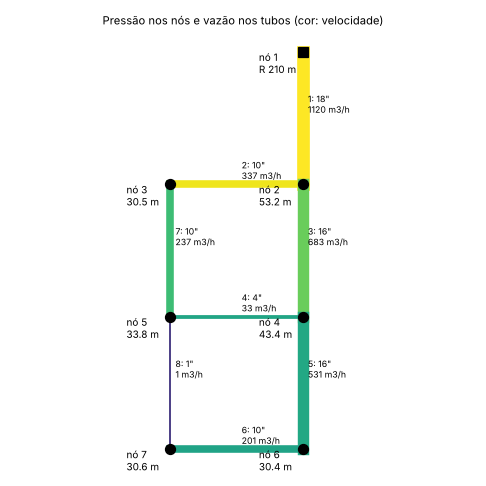
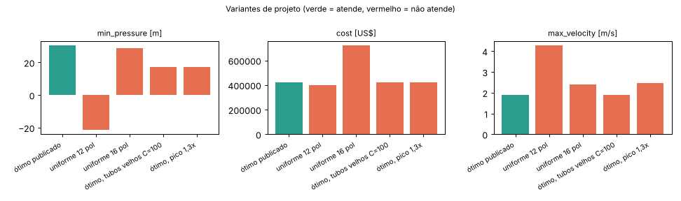
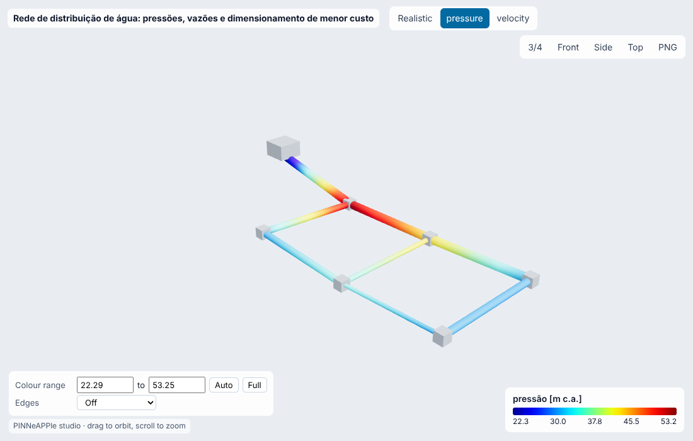
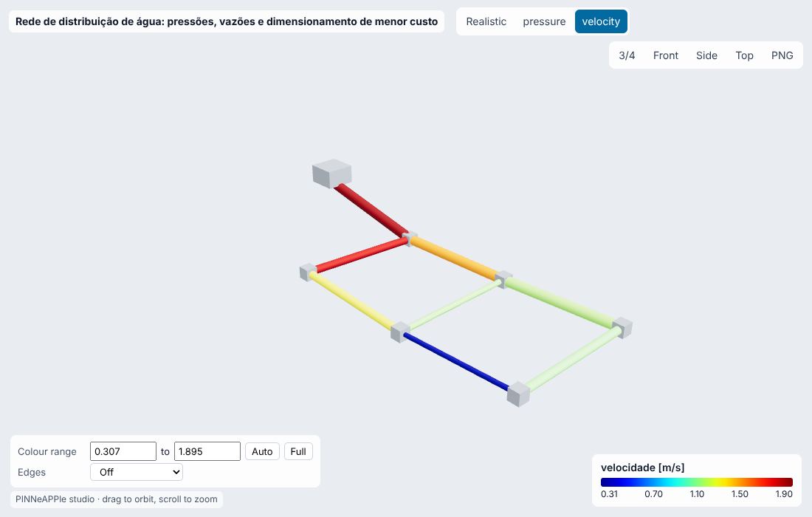

# Rede de distribuição de água: pressões, vazões e dimensionamento de menor custo

**Setor:** Fluidos / saneamento  
**Preset:** `water_distribution_network`

**Problema.** Rede malhada de distribuição (duas malhas, um reservatório, seis nós de consumo, oito tubos de 1 km; rede de referência de Alperovits & Shamir 1977). Resolve pressões e vazões em regime permanente (Hazen-Williams ou Darcy-Weisbach/Colebrook) e dimensiona os diâmetros de menor custo.

**Pergunta de engenharia.** Todos os nós têm pressão mínima de serviço (30 m) na demanda de projeto? Qual o conjunto de diâmetros comerciais de menor custo que garante isso?

## Uso

```python
import pinneapple as pp

p = pp.presets.load("water_distribution_network")
r = p.run()                      # valores padrão abaixo; troque qualquer entrada: p.run(nome=valor)
print(r)                         # saídas, decisão, trust report
p.validate()                     # casos de referência com o erro medido
```

CLI: `python -m pinneapple_presets run water_distribution_network nome=valor`  
Flow Studio: nó `preset.run` com `preset = water_distribution_network`.

## Entradas (SI) e fonte de cada valor padrão

| entrada | unidade | padrão | domínio | fonte |
|---|---|---|---|---|
| `reservoir_head` | m | 210 | 160 – 300 | Alperovits & Shamir (1977), Water Resources Research 13(6):885-900 (rede de duas malhas): nível do reservatório 210 m |
| `demand_factor` | - | 1 | 0.1 – 2.5 | 1,0 = demandas de projeto de Alperovits & Shamir (1977), Water Resources Research 13(6):885-900 (rede de duas malhas) (100-330 m3/h por nó) |
| `headloss` | - | HW | HW, DW | Hazen-Williams como em Alperovits & Shamir (1977), Water Resources Research 13(6):885-900 (rede de duas malhas); 'DW' = Darcy-Weisbach/Colebrook |
| `hw_c` | - | 130 | 60 – 150 | Alperovits & Shamir (1977), Water Resources Research 13(6):885-900 (rede de duas malhas): C = 130 (tubo novo) |
| `roughness_dw` | m | 0.00026 | 1e-06 – 0.005 | ferro fundido, e = 0,26 mm (White, Fluid Mechanics, Tabela 6.1) |
| `p_min` | m | 30 | 5 – 60 | Alperovits & Shamir (1977), Water Resources Research 13(6):885-900 (rede de duas malhas): pressão mínima de serviço 30 m |
| `d1` | m | 0.4572 | 0.0254 – 0.6096 | tubo 1: 18 pol, solução de menor custo de Savic & Walters (1997), J. Water Resour. Plann. Manage. 123(2):67-77: custo mínimo US$ 419.000 |
| `d2` | m | 0.254 | 0.0254 – 0.6096 | tubo 2: 10 pol, solução de menor custo de Savic & Walters (1997), J. Water Resour. Plann. Manage. 123(2):67-77: custo mínimo US$ 419.000 |
| `d3` | m | 0.4064 | 0.0254 – 0.6096 | tubo 3: 16 pol, solução de menor custo de Savic & Walters (1997), J. Water Resour. Plann. Manage. 123(2):67-77: custo mínimo US$ 419.000 |
| `d4` | m | 0.1016 | 0.0254 – 0.6096 | tubo 4: 4 pol, solução de menor custo de Savic & Walters (1997), J. Water Resour. Plann. Manage. 123(2):67-77: custo mínimo US$ 419.000 |
| `d5` | m | 0.4064 | 0.0254 – 0.6096 | tubo 5: 16 pol, solução de menor custo de Savic & Walters (1997), J. Water Resour. Plann. Manage. 123(2):67-77: custo mínimo US$ 419.000 |
| `d6` | m | 0.254 | 0.0254 – 0.6096 | tubo 6: 10 pol, solução de menor custo de Savic & Walters (1997), J. Water Resour. Plann. Manage. 123(2):67-77: custo mínimo US$ 419.000 |
| `d7` | m | 0.254 | 0.0254 – 0.6096 | tubo 7: 10 pol, solução de menor custo de Savic & Walters (1997), J. Water Resour. Plann. Manage. 123(2):67-77: custo mínimo US$ 419.000 |
| `d8` | m | 0.0254 | 0.0254 – 0.6096 | tubo 8: 1 pol, solução de menor custo de Savic & Walters (1997), J. Water Resour. Plann. Manage. 123(2):67-77: custo mínimo US$ 419.000 |

## Saídas (caso padrão, rodado aqui)

| saída | valor | unidade | significado |
|---|---|---|---|
| `min_pressure` | 30.44 | m | menor pressão nos nós |
| `critical_node` | 6 | - | nó com a menor pressão |
| `supply` | 0.3111 | m3/s | vazão fornecida pelo reservatório |
| `max_velocity` | 1.895 | m/s | maior velocidade nos tubos |
| `max_gradient` | 14.65 | m/km | maior perda de carga unitária |
| `cost` | 4.19e+05 | US$ | custo dos tubos (tabela de Alperovits & Shamir (1977), Water Resources Research 13(6):885-900 (rede de duas malhas)) |
| `p_node3` | 30.46 | m | pressão no nó 3 |
| `p_node6` | 30.44 | m | pressão no nó 6 |

**Decisão:** OK

- pressão mínima 30.44 m no nó 6 >= 30 m
- velocidade máxima 1.90 m/s <= 3 m/s
- custo dos tubos US$ 419,000

**Trust report:** APPROVED (score 1, cobertura 1)

| checagem | status | valor | limite | fonte |
|---|---|---|---|---|
| continuity at every junction (m3/s) | supports | 2.082e-17 | 1e-09 | solve_network |
| energy along every pipe (m) | supports | 2.842e-14 | 1e-06 | solve_network |
| supply = total demand (mass balance) | supports | 0.3111 | 0.3111 | global mass balance |
| Newton converged | supports | 11 | 100 |  |
| inside the validity domain | supports | None | None | preset data sheet |

## Validação

| caso | saída | calculado | referência | erro relativo | tolerância | tipo | fonte |
|---|---|---|---|---|---|---|---|
| pressão no nó 3, Hazen-Williams | `p_node3` | 30.46 m | 30.46 m | 0.0011 % | 0.01 % | independent_solver | EPANET 2.2 (Rossman et al. 2020) via WNTR 1.5.0, accuracy 1e-6, rodado nesta máquina |
| pressão no nó 6, Hazen-Williams | `p_node6` | 30.44 m | 30.45 m | 0.00086 % | 0.01 % | independent_solver | EPANET 2.2 (Rossman et al. 2020) via WNTR 1.5.0, accuracy 1e-6, rodado nesta máquina |
| pressão no nó 3, Darcy-Weisbach | `p_node3` | 28.92 m | 28.8 m | 0.423 % | 1 % | independent_solver | EPANET 2.2 (Rossman et al. 2020) via WNTR 1.5.0, accuracy 1e-6, rodado nesta máquina (EPANET usa Swamee-Jain e interpolação de Dunlop na transição; aqui Colebrook) |
| pressão no nó 6, Darcy-Weisbach | `p_node6` | 29.98 m | 29.89 m | 0.287 % | 1 % | independent_solver | EPANET 2.2 (Rossman et al. 2020) via WNTR 1.5.0, accuracy 1e-6, rodado nesta máquina (EPANET usa Swamee-Jain e interpolação de Dunlop na transição; aqui Colebrook) |
| custo da solução publicada | `cost` | 4.19e+05 US$ | 4.19e+05 US$ | 0 % | 1e-07 % | benchmark | Savic & Walters (1997), J. Water Resour. Plann. Manage. 123(2):67-77: custo mínimo US$ 419.000 |
| otimização por AG vs ótimo publicado | `cost` | 4.19e+05 US$ | 4.19e+05 US$ | 0 % | 0 % | benchmark | Savic & Walters (1997), J. Water Resour. Plann. Manage. 123(2):67-77: custo mínimo US$ 419.000 |

## Inversão

Calibração do C de Hazen-Williams de dois grupos de tubos (tronco 1-3-5 envelhecido e tubos das malhas) a partir de pressões registradas nos nós 3, 5 e 7 na demanda de projeto e a 1,5x (teste de vazão de incêndio). Medições sintéticas da própria rede com C real = (95, 120) e ruído de 0.05 m.

- **true:** ['95', '120']
- **recovered:** ['95.04', '119.9']
- **ci95:** ['[94.93646732717433, 95.13805362346967]', '[119.7966933409024, 120.09750341519815]']
- **rel_error:** 0.0004408
- **noise:** 0.05 m (1 sigma)
- **how:** Gauss-Newton sobre solve_network, covariância sigma^2 (J^T J)^-1

## Otimização

- **objective:** custo mínimo dos tubos com pressão >= p_min em todos os nós
- **method:** algoritmo genético (pop 100, torneio, cruzamento uniforme, mutação ±1/±2 classes)
- **cost_ga:** 4.19e+05
- **min_pressure_ga:** 30.44
- **feasible:** True
- **hydraulic_solves:** 6744
- **published_cost:** 4.19e+05
- **verified_min_pressure:** 30.44
- **verified_cost:** 4.19e+05

## Variantes de projeto

| variante | parâmetros | min_pressure | cost | max_velocity | decisão |
|---|---|---|---|---|---|
| ótimo publicado | `{}` | 30.44 | 4.19e+05 | 1.895 | OK |
| uniforme 12 pol | `{'d1': 0.30479999999999996, 'd2': 0.30479999999999996, 'd3': 0.30479999999999996, 'd4': 0.30479999999999996, 'd5': 0.30479999999999996, 'd6': 0.30479999999999996, 'd7': 0.30479999999999996, 'd8': 0.30479999999999996}` | -21.45 | 4e+05 | 4.264 | NOT OK |
| uniforme 16 pol | `{'d1': 0.4064, 'd2': 0.4064, 'd3': 0.4064, 'd4': 0.4064, 'd5': 0.4064, 'd6': 0.4064, 'd7': 0.4064, 'd8': 0.4064}` | 28.63 | 7.2e+05 | 2.398 | NOT OK |
| ótimo, tubos velhos C=100 | `{'hw_c': 100.0}` | 17.41 | 4.19e+05 | 1.895 | NOT OK |
| ótimo, pico 1,3x | `{'demand_factor': 1.3}` | 17.41 | 4.19e+05 | 2.464 | NOT OK |

    

## Figuras






Visualizador 3-D interativo (arquivo único, abre do disco): regenere com `python -m pinneapple_presets report water_distribution_network` → `results/3d/water_distribution_network_viewer.html`.

## Capacidades

| capacidade | tem? | por quê não |
|---|---|---|
| visualização 3-D | sim |  |
| surrogate | não | o solver leva ~5 ms por rede; um surrogate não economiza tempo e só acrescentaria erro |
| inversão | sim |  |
| otimização | sim |  |
| variação de projeto | sim |  |
| cadeia de porquês | não |  |

## Pipeline

1. topologia e cotas: two_loop_network(diâmetros, headloss)
1. modelo: perda de carga Hazen-Williams (constante EPANET 10,667) ou Darcy-Weisbach com Colebrook
1. solver: solve_network (algoritmo do gradiente global, Todini & Pilati 1988)
1. pós: pressões nos nós, velocidades, gradientes, custo
1. decisão: pressão mínima >= p_min; velocidade <= 3 m/s (faixa usual de projeto)
1. otimização: optimize_diameters (algoritmo genético, 14 diâmetros comerciais)

**Domínio de validade.** Regime permanente, escoamento incompressível, sem bombas nem válvulas, perdas localizadas desprezadas (tubos de 1 km). Hazen-Williams: água à temperatura ambiente, regime turbulento.

## Proveniência

Rodado em 2026-10-24T00:50:17Z · solver 0.000992 s · relatório completo 36.4 s · Intel(R) Xeon(R) Processor @ 2.10GHz (4 núcleos) · python 3.13.17, pinneapple 0.7.0, numpy 2.5.3, scipy 1.18.1, torch 2.14.1
