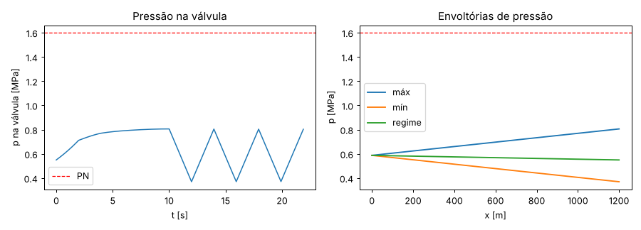
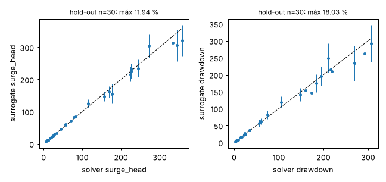
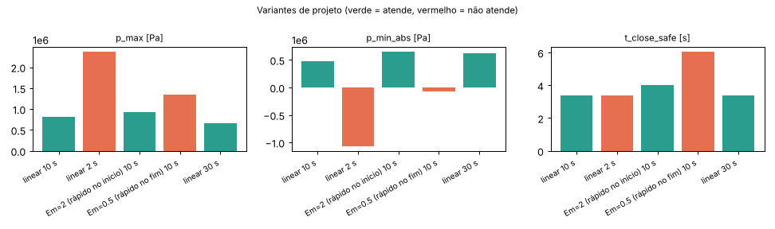
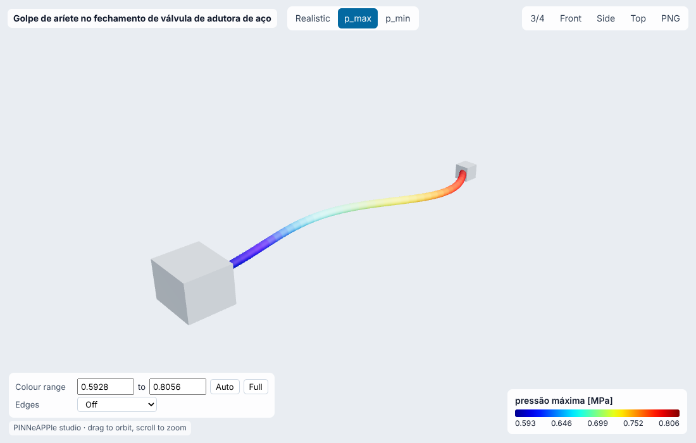
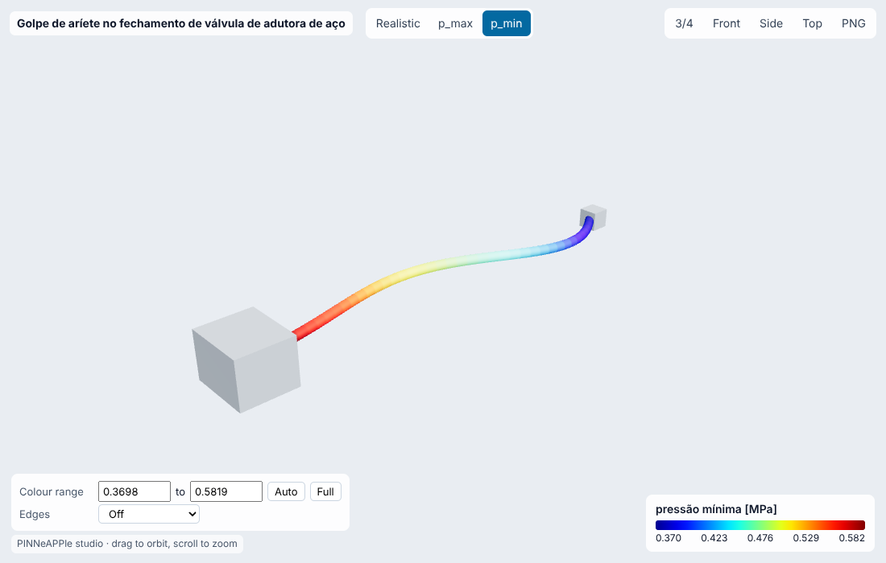

# Golpe de aríete no fechamento de válvula de adutora de aço

**Setor:** Fluidos / saneamento e óleo e gás  
**Preset:** `water_hammer_valve_closure`

**Problema.** Adutora de aço DN500 (reservatório a montante, válvula na ponta) fecha a válvula em t_c segundos. Calcula a sobrepressão e a subpressão ao longo da linha pelo método das características.

**Pergunta de engenharia.** Com este tempo de fechamento, a pressão máxima fica abaixo da classe PN da linha e a mínima acima da pressão de vapor (sem separação de coluna)? Qual o tempo mínimo de fechamento seguro?

## Uso

```python
import pinneapple as pp

p = pp.presets.load("water_hammer_valve_closure")
r = p.run()                      # valores padrão abaixo; troque qualquer entrada: p.run(nome=valor)
print(r)                         # saídas, decisão, trust report
p.validate()                     # casos de referência com o erro medido
p.run(fidelity="surrogate")     # surrogate treinado (com desvio-padrão e aviso fora do domínio)
```

CLI: `python -m pinneapple_presets run water_hammer_valve_closure nome=valor`  
Flow Studio: nó `preset.run` com `preset = water_hammer_valve_closure`.

## Entradas (SI) e fonte de cada valor padrão

| entrada | unidade | padrão | domínio | fonte |
|---|---|---|---|---|
| `length` | m | 1200 | 100 – 20000 | premissa: adutora típica de 1,2 km entre reservatório e válvula |
| `od` | m | 0.508 | 0.05 – 2 | ASME B36.10M, tubo NPS 20 (508 mm de diâmetro externo) |
| `wall` | m | 0.00953 | 0.002 – 0.05 | ASME B36.10M, NPS 20 parede STD (9,53 mm) |
| `velocity` | m/s | 1.5 | 0.2 – 4 | AWWA M11 (4a ed.) cap. 5: velocidades de projeto típicas 0,9-1,8 m/s |
| `h_reservoir` | m | 60 | 5 – 500 | premissa: nível do reservatório 60 m acima do eixo da válvula |
| `t_close` | s | 10 | 0 – 120 | premissa: atuador de válvula borboleta de 10 s |
| `closure_exponent` | - | 1 | 0.5 – 4 | lei de fechamento tau=(1-t/tc)^Em; Em=1 linear (Wylie & Streeter 1993) |
| `roughness` | m | 4.5e-05 | 0 – 0.003 | aço comercial, e = 0,045 mm (White, Fluid Mechanics, Tabela 6.1) |
| `friction` | - | colebrook | colebrook, none | atrito de Darcy por Colebrook; 'none' só para o caso de referência |
| `E_pipe` | Pa | 2.07e+11 | 1e+09 – 2.5e+11 | aço carbono, E = 207 GPa (ASME B31.3 Tabela C-6, temperatura ambiente) |
| `nu_pipe` | - | 0.3 | 0.2 – 0.5 | aço, coeficiente de Poisson 0,3 |
| `K_water` | Pa | 2.19e+09 | 1.5e+09 – 2.5e+09 | água a 20 °C, módulo volumétrico 2,19 GPa (Wylie & Streeter 1993, Tab. 2.1) |
| `rho` | kg/m3 | 998.2 | 950 – 1050 | água a 20 °C (Incropera, Tabela A.6) |
| `pn_rating` | Pa | 1.6e+06 | 4e+05 – 1e+07 | classe PN16 (EN 1092-1): 1,6 MPa manométrica |
| `p_vapour_abs` | Pa | 2339 | 600 – 1e+05 | pressão de vapor da água a 20 °C (Incropera, Tabela A.6) |
| `n_reaches` | - | 40 | 10 – 400 | malha do MOC (Courant 1); convergência verificada em 10-160 |

## Saídas (caso padrão, rodado aqui)

| saída | valor | unidade | significado |
|---|---|---|---|
| `wave_speed` | 1212 | m/s | celeridade da onda (Korteweg, tubo ancorado) |
| `period` | 1.98 | s | 2L/a |
| `max_head` | 82.29 | m | carga piezométrica máxima (envoltória) |
| `surge_head` | 26.16 | m | sobrepressão máxima acima da carga estática na válvula |
| `min_head` | 37.77 | m | carga mínima (envoltória) |
| `drawdown` | 18.36 | m | subpressão máxima abaixo da carga estática na válvula |
| `p_max` | 8.056e+05 | Pa | pressão manométrica máxima |
| `p_min_abs` | 4.711e+05 | Pa | pressão absoluta mínima |
| `joukowsky_head` | 185.4 | m | aV/g |
| `michaud_head` | 36.71 | m | estimativa de Michaud |
| `t_close_safe` | 3.37 | s | menor tempo de fechamento (lei atual) com p_max <= PN |

**Decisão:** OK

- p_max = 0.81 MPa <= PN 1.60 MPa
- p_min_abs = 471.1 kPa > p_vapour 2.34 kPa
- tempo de fechamento seguro (mesma lei) >= 3.4 s

**Trust report:** APPROVED (score 1, cobertura 1)

| checagem | status | valor | limite | fonte |
|---|---|---|---|---|
| Courant = 1 (MOC grid dt = dx/a) | supports | None | None | valve_closure_moc |
| thin wall D/e > 25 (Korteweg) | supports | 51.31 | 25 | Wylie & Streeter, Fluid Transients in Systems (1993) eq. 2.29 |
| surge does not exceed Joukowsky | supports | 26.16 | 185.4 | Joukowsky (1898): the largest surge of a single velocity change |
| no column separation (p_min > p_vapour) | supports | 4.711e+05 | 2339 |  |
| inside the validity domain | supports | None | None | preset data sheet |

## Validação

| caso | saída | calculado | referência | erro relativo | tolerância | tipo | fonte |
|---|---|---|---|---|---|---|---|
| fechamento instantâneo sem atrito = Joukowsky | `surge_head` | 185.4 m | 185.4 m | 1.53e-14 % | 0.5 % | analytic | Joukowsky (1898); Wylie & Streeter, Fluid Transients in Systems (1993) eq. 1.11: dH = a dV / g |
| fechamento lento (60 s = 30·2L/a) = teoria da coluna rígida | `surge_head` | 7.116 m | 7.115 m | 0.0124 % | 5 % | independent_solver | Wylie & Streeter, Fluid Transients in Systems (1993) sec. 1.3 (rigid-column theory), integrada com scipy solve_ivp |

Convergência (n_reaches = [10, 20, 40, 80, 160]): variação relativa entre os dois últimos níveis 2.13e-07 (passa).

## Surrogate

ARD Gaussian process (squared exponential), entradas ['t_close', 'velocity', 'length'] no domínio {'t_close': [0.5, 30.0], 'velocity': [0.5, 3.0], 'length': [300.0, 4000.0]}; DOE Latin hypercube com 120 rodadas do solver para treino e 30 independentes para hold-out.

| saída | erro rel. máx (hold-out) | médio | R² | cobertura ±2σ |
|---|---|---|---|---|
| `surge_head` | 11.9 % | 4.69 % | 0.9861 | 100 % |
| `drawdown` | 18 % | 6.37 % | 0.9825 | 100 % |

Fora do domínio de treino o resultado sai marcado (aviso + checagem do trust report em *contradicts*), nunca extrapolado em silêncio.

## Inversão

Celeridade efetiva da onda a partir do histórico de pressão medido na válvula (ar dissolvido ou parede degradada reduzem a). Medição sintética: MOC com a_real = 0.82 x a_projeto + ruído branco de 5.0 kPa.

- **true:** 993.7
- **recovered:** 993.7
- **ci95:** ['993.7', '993.7']
- **rel_error:** 1.459e-05
- **noise:** 5.0 kPa (1 sigma)
- **how:** mínimos quadrados sobre o MOC (varredura + Brent), IC 95 % por Gauss-Newton

## Otimização

- **objective:** menor tempo de fechamento (operação mais rápida) com p_max <= PN
- **t_close_opt_solver:** 3.37
- **p_max_at_opt_solver:** 1.6e+06
- **pn_rating:** 1.6e+06
- **t_close_opt_surrogate:** 3.261
- **p_max_at_surrogate_opt_solver:** 1.649e+06
- **surrogate_opt_rel_diff_t:** 0.03223
- **surrogate_opt_feasible_on_solver:** False

## Variantes de projeto

| variante | parâmetros | p_max | p_min_abs | t_close_safe | decisão |
|---|---|---|---|---|---|
| linear 10 s | `{'closure_exponent': 1.0, 't_close': 10.0}` | 8.056e+05 | 4.711e+05 | 3.37 | OK |
| linear 2 s | `{'closure_exponent': 1.0, 't_close': 2.0}` | 2.367e+06 | -1.065e+06 | 3.37 | NOT OK |
| Em=2 (rápido no início) 10 s | `{'closure_exponent': 2.0, 't_close': 10.0}` | 9.239e+05 | 6.508e+05 | 4.006 | OK |
| Em=0.5 (rápido no fim) 10 s | `{'closure_exponent': 0.5, 't_close': 10.0}` | 1.346e+06 | -6.527e+04 | 6.04 | NOT OK |
| linear 30 s | `{'closure_exponent': 1.0, 't_close': 30.0}` | 6.527e+05 | 6.236e+05 | 3.37 | OK |

## Figuras







Visualizador 3-D interativo (arquivo único, abre do disco): regenere com `python -m pinneapple_presets report water_hammer_valve_closure` → `results/3d/water_hammer_valve_closure_viewer.html`.

## Capacidades

| capacidade | tem? | por quê não |
|---|---|---|
| visualização 3-D | sim |  |
| surrogate | sim |  |
| inversão | sim |  |
| otimização | sim |  |
| variação de projeto | sim |  |
| cadeia de porquês | sim |  |

## Pipeline

1. geometria: D = od - 2 wall, A
1. modelo: wave_speed(K, rho, D, e, E, 1-nu^2) (Korteweg); f = colebrook(Re, e/D)
1. solver: valve_closure_moc(...) (MOC, Courant 1)
1. pós: envoltórias h_max/h_min, p = rho g h
1. decisão: p_max <= PN e p_min_abs > p_vapor; t_c seguro por bisseção do MOC

**Domínio de validade.** Escoamento 1-D, líquido levemente compressível, tubo elástico de parede fina (D/e > 25), atrito permanente. Sem modelo de cavitação: depois que a carga cai à pressão de vapor a história não é física (o preset avisa). Sem bolsões de ar nem ventosas.

**Limitações.**

- Atrito permanente: picos posteriores ficam pouco amortecidos (o primeiro pico, que dimensiona, não muda).

**Por que cada elemento do projeto existe:** `pinneapple_reason.run_case("pumped_main")`.

## Proveniência

Rodado em 2026-10-24T00:50:53Z · solver 0.251 s · relatório completo 11.7 s · Intel(R) Xeon(R) Processor @ 2.10GHz (4 núcleos) · python 3.13.17, pinneapple 0.7.0, numpy 2.5.3, scipy 1.18.1, torch 2.14.1
