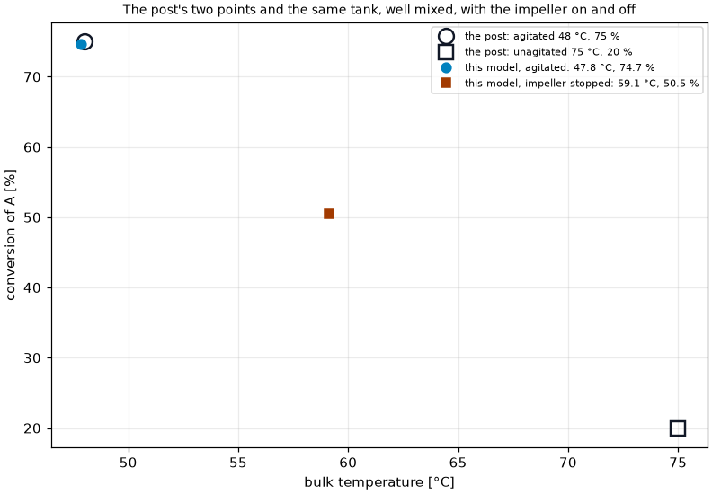
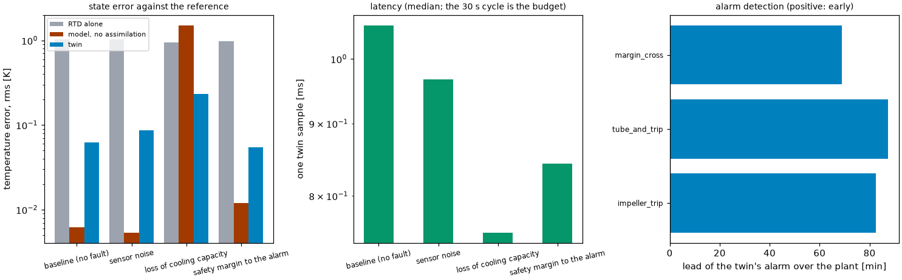
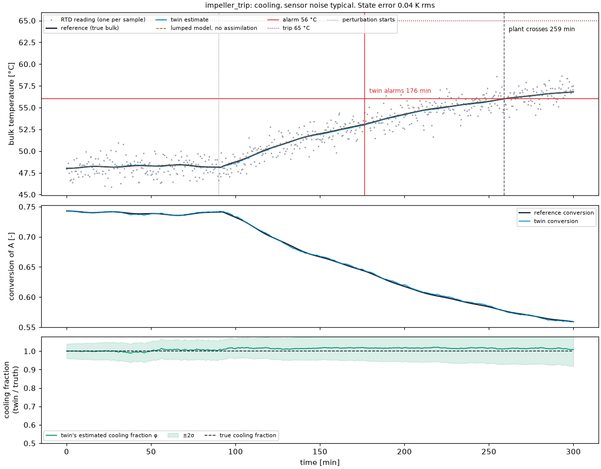
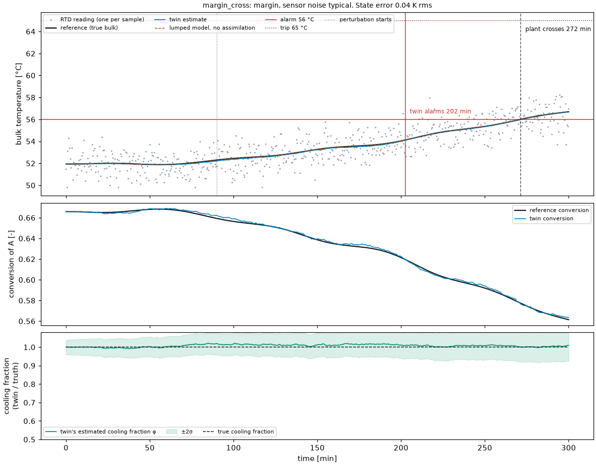

# Stirred exothermic reactor: a digital-twin benchmark case

Protocol: 11 controlled cases in 4 perturbation families, 5 h each at a 30 s sample period, alarm at 56 °C and interlock at 65 °C. Seed 0.

## The results table

| family | cases | state error: T rms [K] | conv. rms [pp] | open loop [K] | sensor [K] | latency [ms/sample] | % of the 30 s cycle | alarm: crossed / detected / false / missed | median lead [min] |
|---|---|---|---|---|---|---|---|---|---|
| baseline | 2 | 0.06 | 0.15 | 0.01 | 1.03 | 1.1 | 0.004 % | 0 / 0 / 0 / 0 | - |
| noise | 3 | 0.09 | 0.12 | 0.01 | 1.02 | 1.0 | 0.003 % | 0 / 0 / 0 / 0 | - |
| cooling | 3 | 0.24 | 0.28 | 1.51 | 0.94 | 0.8 | 0.003 % | 2 / 2 / 0 / 0 | 85 |
| margin | 3 | 0.05 | 0.14 | 0.01 | 0.97 | 0.8 | 0.003 % | 1 / 1 / 0 / 0 | 69 |
| overall | 11 | 0.07 | 0.14 | 0.01 | 1.00 | 1.0 | 0.003 % | 3 / 3 / 0 / 0 | 82 |

Columns: **state error** is the twin's rms error against the reference, next to the instrument it had to beat (the RTD alone) and the same lumped model with no assimilation; **latency** is one twin sample, filter plus the forecast that decides the alarm, and its share of the 30 s cycle; **alarm detection** counts the cases where the plant crossed the alarm, the ones the twin caught, the false alarms and the misses, with the median lead.

## Case by case

| case | perturbation | T error [K] | conv. error [pp] | phi (twin / truth) | latency [ms] | truth alarm at [min] | twin alarm at [min] | lead [min] | verdict |
|---|---|---|---|---|---|---|---|---|---|
| baseline_a | baseline / typical | 0.08 | 0.19 | 0.985 / 1.000 | 1.1 | - | - | - | quiet (the plant never crossed) |
| baseline_b | baseline / typical | 0.05 | 0.10 | 1.011 / 1.000 | 1.0 | - | - | - | quiet (the plant never crossed) |
| noise_tight | noise / tight | 0.03 | 0.07 | 0.999 / 1.000 | 1.1 | - | - | - | quiet (the plant never crossed) |
| noise_typical | noise / typical | 0.09 | 0.12 | 0.999 / 1.000 | 1.0 | - | - | - | quiet (the plant never crossed) |
| noise_poor | noise / poor | 0.12 | 0.29 | 1.000 / 1.000 | 0.9 | - | - | - | quiet (the plant never crossed) |
| tube_isolated | cooling / typical | 0.24 | 0.28 | 0.788 / 0.788 | 1.1 | - | - | - | quiet (the plant never crossed) |
| impeller_trip | cooling / typical | 0.04 | 0.12 | 1.008 / 1.000 | 0.8 | 259 | 176 | +82 | detected |
| tube_and_trip | cooling / typical | 0.45 | 0.54 | 0.671 / 0.581 | 0.7 | 222 | 134 | +88 | detected |
| margin_wide | margin / typical | 0.07 | 0.14 | 1.006 / 1.000 | 0.7 | - | - | - | quiet (the plant never crossed) |
| margin_close | margin / typical | 0.05 | 0.16 | 1.002 / 1.000 | 0.8 | - | - | - | quiet (the plant never crossed) |
| margin_cross | margin / typical | 0.04 | 0.13 | 1.010 / 1.000 | 1.0 | 272 | 202 | +69 | detected |

## What the reference is, and why it is trusted

The reference is **not** the post's two-dimensional CFD. It is the well-mixed model of `pinneapple_systems/digital_twin/stirred_reactor/plant.py`, integrated with a stiff solver at `rtol = 1e-12` and sampled where the twin is sampled. Three checks, run by this benchmark:

- **two routes to the stationary point**: the algebraic stationary solve gives 47.8424 °C; starting the transient 15 K away and marching 16 h gives 47.8422 °C — 0.18 mK apart.
- **tolerance convergence**: the same controlled run at `rtol = 1e-10` and at `rtol = 1e-12` differs by 5.5e-08 K over the whole history.
- **the first law**: over a case with a tube isolated and the impeller stopped, the heat generated (226 MJ) closes against the sensible change plus what the coolant and the wall removed to 1.9e-03 relative.

## The post's two numbers, measured

The reaction thermodynamics is derived from the post's own pair — dH = -85.6 kJ/mol and dS = -257 J/(mol K) — so agreeing with the agitated point is arithmetic, not evidence. The impeller-off point is a prediction of the same tank:

| | agitated | impeller stopped |
|---|---|---|
| the post | 48 °C, 75 % | 75 °C, 20 % |
| this model | 47.8 °C, 74.7 % | 59.1 °C, 50.5 % |
| cooling conductance | 1475 W/K | 149 W/K |

To sit at 75 °C with the impeller stopped, the same well-mixed tank needs a feed at 73.3 °C (its conversion there would be 20.0 %), against the 40 °C feed this case uses. Read as two energy-balance points of one feed, the pair is not reachable: 30 points of conversion at 16 K hotter is a transport limitation, and a well-mixed model cannot carry one.

## What is not measured, and why

- **the 2-D field with an immersed-boundary impeller**: the post's case is a two-dimensional Python/Numba CFD model; running one here would cost hours per operating point and would not be the same code, so it is not run and no number from it is quoted as if it had been. What is run is the well-mixed reduction in plant.py, and the difference it makes is the reason the unagitated point cannot be a bulk temperature.
- **a spatial hotspot**: a 0-D model carries one temperature for the whole tank. The post's 75 °C hotspot is a local maximum in an unmixed zone; here the bulk is what there is, and the numbers say so (59 °C with the impeller stopped, not 75 °C).
- **a conversion limited by mixing**: the well-mixed assumption removes by construction the mechanism that would stall conversion at a low value while the bulk is hot. If the post's 20 % is a segregation or bypass limit, no 0-D model can reproduce it, and the case does not pretend to.
- **the post's own numbers as an independent measurement**: the reaction thermodynamics is derived from the two numbers themselves (thermo_from_pair), so reproducing the agitated operating point is arithmetic, not evidence.

## Cost

11 cases took 19 s of wall clock on the machine that ran them; the twin's own compute over 55.0 h of modelled operation was 14.4 s, a real-time factor of 7.25e-05. The twin is not faster than this 0-D reference — it does not have to be, it runs on the sample it is given — and no speed-up against the post's 2-D model is claimed, because that model is not run here.

## Figures

