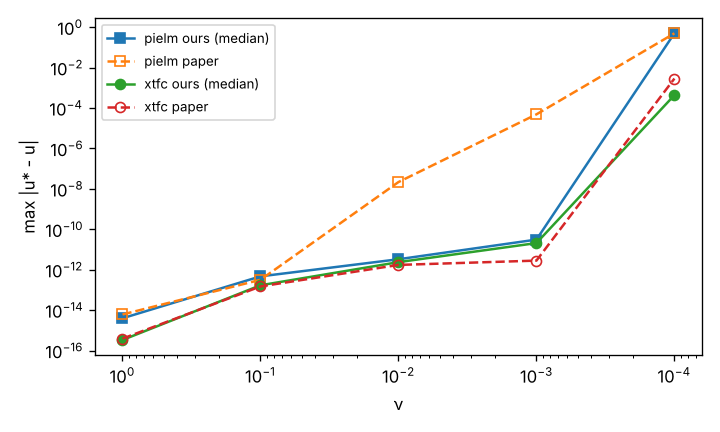

# De Florio et al. 2024 reproduction: measured results

Generated by `run_deflorio.py --part report` from runs/*. Machine: Linux-6.18.44-fc-v185-x86_64-with-glibc2.39, Python 3.13.17.

## PIELM and X-TFC (full scale)

| ν | Method | Neurons | Seeds | max: paper / ours median [min, max] | mean: paper / ours | ε_G: paper / ours | ε_T ours | solve | Status (max) |
|---|---|---|---|---|---|---|---|---|---|
| 1 | PIELM | 100 | 10 | 6.11e-15 / 3.96e-15 [1.8e-15, 7.5e-15] | 2.1e-15 / 1.53e-15 | 2.99e-15 / 1.61e-15 | 3.96e-14 | 0.1 s | **reproduced** |
| 1 | X-TFC | 100 | 10 | 3.89e-16 / 3.33e-16 [2.2e-16, 4.4e-16] | 1.17e-16 / 7.52e-17 | 1.57e-16 / 1e-16 | 4.93e-15 | 0.1 s | **reproduced** |
| 0.1 | PIELM | 100 | 10 | 3.18e-13 / 4.7e-13 [2.4e-13, 1.1e-12] | 1.64e-13 / 1.12e-13 | 1.9e-13 / 1.3e-13 | 1.1e-11 | 0.1 s | **reproduced** |
| 0.1 | X-TFC | 100 | 10 | 1.49e-13 / 1.7e-13 [1.3e-13, 3.8e-13] | 5.93e-14 / 3.52e-14 | 7.31e-14 / 4.44e-14 | 7.18e-12 | 0.1 s | **reproduced** |
| 0.01 | PIELM | 1000 | 10 | 2.18e-08 / 3.3e-12 [1.7e-12, 7.7e-12] | 2.18e-08 / 8.34e-13 | 2.16e-08 / 9.52e-13 | 1.27e-09 | 3.3 s | **partially reproduced** |
| 0.01 | X-TFC | 1000 | 10 | 1.73e-12 / 2.38e-12 [1.1e-12, 3.8e-12] | 9.45e-14 / 3.1e-13 | 6.7e-13 / 4.42e-13 | 1.15e-09 | 3.6 s | **reproduced** |
| 0.001 | PIELM | 10000 | 3 | 4.89e-05 / 3.1e-11 [1e-11, 6.2e-11] | 4.89e-05 / 1.1e-11 | 4.88e-05 / 1.11e-11 | 3.66e-08 | 110.1 s | **partially reproduced** |
| 0.001 | X-TFC | 10000 | 3 | 2.83e-12 / 2.09e-11 [8.1e-12, 2.5e-11] | 7.09e-13 / 2.37e-13 | 1.18e-12 / 7.68e-13 | 3.37e-08 | 122.0 s | **reproduced** |
| 0.0001 | PIELM | 10000 | 3 | 0.5 / 0.5 [0.5, 0.5] | 0.5 / 0.5 | 0.5 / 0.5 | 0.707 | 106.0 s | **reproduced** |
| 0.0001 | X-TFC | 10000 | 3 | 0.00289 / 0.000438 [0.00023, 0.00069] | 0.00139 / 7.09e-06 | 0.00174 / 1.71e-05 | 6.72 | 116.4 s | **partially reproduced** |

## PINN and Deep-TFC (reduced scale, TARGETS.md item 7 and Amendment 1)

| ν | Method | width x depth | Seeds | max after Adam: paper / ours | max after L-BFGS: paper / ours | learned? paper / ours | train time | Status |
|---|---|---|---|---|---|---|---|---|
| 1 | PINN | 20 x 10 | 3 | 3.15e-05 / 0.00248 | 9.97e-08 / 2.89e-06 | yes / yes | 116 s | reduced-scale |
| 1 | Deep-TFC | 20 x 10 | 3 | 1.04e-06 / 0.000202 | 1.62e-07 / 4.48e-06 | yes / yes | 124 s | reduced-scale |
| 0.1 | PINN | 20 x 10 | 3 | 5.75e-05 / 0.497 | 1.47e-05 / 3.26e-05 | yes / yes | 140 s | reduced-scale |
| 0.1 | Deep-TFC | 20 x 10 | 3 | 0.000103 / 0.00088 | 0.00011 / 0.000229 | yes / yes | 118 s | reduced-scale |
| 0.01 | PINN | 50 x 10 | 3 | 0.5 / 0.5 | 0.5 / 0.5 | no / no | 297 s | reduced-scale |
| 0.01 | Deep-TFC | 50 x 10 | 3 | 0.0259 / 0.944 | 6.18e-05 / 0.000738 | yes / yes | 461 s | reduced-scale |
| 0.001 | PINN | 50 x 10 | 3 | 0.5 / 0.5 | 0.5 / 0.5 | no / no | 293 s | reduced-scale |
| 0.001 | Deep-TFC | 50 x 10 | 3 | 0.958 / 0.992 | 0.958 / 0.992 | no / no | 313 s | reduced-scale |
| 0.0001 | PINN | 50 x 10 | 3 | 0.5 / 0.5 | 0.5 / 0.5 | no / no | 280 s | reduced-scale |
| 0.0001 | Deep-TFC | 50 x 10 | 3 | 0.958 / 0.999 | 0.958 / 0.999 | no / no | 290 s | reduced-scale |

## Baselines at equal budget

| ν | Method | max abs error (median) | Seeds |
|---|---|---|---|
| 1 | X-TFC, Gaussian, [9] weights (this reproduction) | 3.33e-16 | 10 |
| 1 | X-TFC, tanh, unif(-1, 1) weights | 1.61e-14 | 10 |
| 1 | Gated X-TFC (same basis count, gate search) | 3.92e-05 | 1 |
| 0.1 | X-TFC, Gaussian, [9] weights (this reproduction) | 1.7e-13 | 10 |
| 0.1 | X-TFC, tanh, unif(-1, 1) weights | 1.09e-07 | 10 |
| 0.1 | Gated X-TFC (same basis count, gate search) | 7.79e-05 | 1 |
| 0.01 | X-TFC, Gaussian, [9] weights (this reproduction) | 2.38e-12 | 10 |
| 0.01 | X-TFC, tanh, unif(-1, 1) weights | 0.617 | 10 |
| 0.01 | Gated X-TFC (same basis count, gate search) | 0.00114 | 1 |
| 0.001 | X-TFC, Gaussian, [9] weights (this reproduction) | 2.09e-11 | 3 |
| 0.001 | X-TFC, tanh, unif(-1, 1) weights | 0.615 | 3 |
| 0.0001 | X-TFC, Gaussian, [9] weights (this reproduction) | 0.000438 | 3 |
| 0.0001 | X-TFC, tanh, unif(-1, 1) weights | 0.607 | 3 |

