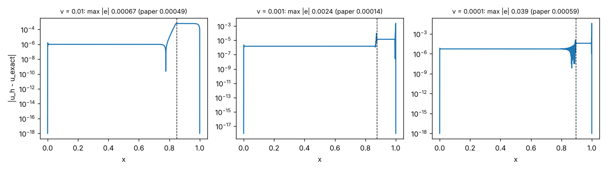

# Gated X-TFC (Dwivedi, Schiassi, Sigovan, Sixou): reproduction

**Source:** arXiv:2510.01039v1. The paper links no code.

**Order of work:**

1. Targets were quoted and frozen in [TARGETS.md](TARGETS.md) before any run.
2. The Bayesian-optimiser amendment was frozen before any run too.
3. Every number below was measured by `run_gated.py`.

Full tables are in [RESULTS.md](RESULTS.md); raw data is in `part_*.json`.

## Status

The status rule is `pinneapple_analysis.reproduction.status`, with a factor-2 band.

| Target | Paper | Ours | Seeds | Status |
|---|---|---|---|---|
| Forward ν = 1e-2 (Fig. 3) | 4.95e-4 | 6.7e-4 | deterministic | **reproduced** |
| Forward ν = 1e-3 (Fig. 3) | 1.40e-4 | 2.4e-3 | deterministic | not reproduced |
| Forward ν = 1e-4 (Fig. 3) | 5.86e-4 | 3.9e-2 | deterministic | not reproduced |
| Table 1: gated (2000) beats ungated (10000) at ν = 1e-4, ungated O(1e-3) | O(1e-4) < O(1e-3) | 3.9e-2 vs 3.6e-2 | deterministic | not reproduced |
| Inverse ν = 0.1, % error of ν̂ (Table 2) | 10.3 % | 41 % [1.8, 77] | 10 | not reproduced |
| Inverse ν = 0.01 | 4.9 % | 18 % [1.0, 66] | 10 | not reproduced |
| Inverse ν = 0.005 | 7.4 % | 46 % [6.8, 61] | 10 | not reproduced |
| Inverse ν = 0.001 | 17.0 % | 152 % [4.3, 685] | 10 | not reproduced |
| Twin boundary layer, ν = 1e-4 (Fig. 8) | 2.97e-3 | 5.0e-3 [2.3e-3, 0.18] | 10 | **reproduced** |

**Result: 2 of 9 targets reproduced, all at full scale.**



## What we know about the failures

### Forward, ν ≤ 1e-3

A **post-hoc** check (`posthoc_paper_gates.txt`; it does not change any status) runs our solver at the gate
values the paper itself reports in Fig. 3:

| ν | Our solver at the paper's gates | Paper |
|---|---|---|
| 1e-2 | 4.79e-4 | 4.95e-4 |
| 1e-3 | 1.24e-3 | 1.40e-4 |
| 1e-4 | 7.6e-3 | 5.86e-4 |

The ν = 1e-2 match shows the trial function, the operator rows and the layout are right. At smaller ν the gap
remains even at the paper's gates. So the difference lies in something the paper leaves open, not in our search:

- the Tikhonov λ: we used 1e-12;
- the exact solve: Cholesky or QR of the normal equations, where we used stacked `lstsq`;
- the validation "residual energy";
- the ε_phy appendix, which is missing from the PDF.

### Table 1

- Our ungated run uses 10 000 centres at x_s = 1/2, a configuration the paper does not specify.
- It gives 3.6e-2, not O(1e-3), and our gated result is no better.

### Inverse problem

- ν̂ varies widely with the noise seed.
- The paper's Table 2 reports one run per ν, with unknown noise and optimiser seeds.
- Our medians are 2-9× worse. Some single seeds do as well as the paper: 1.0 % at ν = 0.01 and 4.3 % at
  ν = 0.001.

## Physics checks

- Boundary values are exact (error 0) in every forward run.
- The fresh-point residual is recorded per run.
- Both are recorded in `experiment.json`.

## Baselines at equal budget (2000 points, 2000 basis functions)

| ν | Gated X-TFC | Ungated RBF X-TFC (x_s = 1/2) | tanh ELM X-TFC, unif(−10, 10) | tanh PIELM (BC rows) |
|---|---|---|---|---|
| 1e-2 | 6.7e-4 | 9.1e-4 | **9.0e-8** | 1.2e-6 |
| 1e-3 | **2.4e-3** | 1.4e-2 | 0.98 | 0.50 |
| 1e-4 | **3.9e-2** | 0.28 | 1.0 | 0.50 |

The tanh columns are medians over 10 seeds.

- At ν = 1e-2 a plain tanh X-TFC is 4 orders of magnitude better than the gated RBF basis.
- At ν ≤ 1e-3 only the RBF bases (gated or not) get anywhere near the solution, and the gate helps by about
  6×.

## Run it

```bash
for p in forward inverse baselines twin ungated report; do
  python examples/reproductions/gated_xtfc_dwivedi2025/run_gated.py --part $p
done
```

The full run takes about 3 hours on 4 CPU threads; the twin case (10 seeds × 60 evaluations) dominates.
