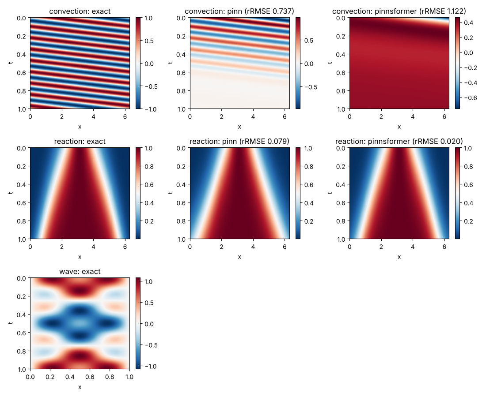

# PINNsFormer (Zhao, Ding & Prakash, ICLR 2024): measured results

Generated by `run_pinnsformer.py --report`. Scored against the exact solutions.

- **6 of 18 reproduced, 3 partially reproduced.**

| Problem | Model | Metric | Paper | Ours: median [min, max] | Seed 0 | Seeds | Status |
|---|---|---|---|---|---|---|---|
| convection | pinn | loss | 0.016 | 0.0108 [0.0108, 0.0108] | 0.0108 | 1 | **reproduced** |
| convection | pinn | rmae | 0.778 | 0.657 [0.657, 0.657] | 0.657 | 1 | **reproduced** |
| convection | pinn | rrmse | 0.84 | 0.737 [0.737, 0.737] | 0.737 | 1 | **reproduced** |
| convection | pinnsformer | loss | 3.7e-05 | 0.312 [0.312, 0.312] | 0.312 | 1 | **not reproduced** |
| convection | pinnsformer | rmae | 0.023 | 1.06 [1.06, 1.06] | 1.06 | 1 | **not reproduced** |
| convection | pinnsformer | rrmse | 0.027 | 1.12 [1.12, 1.12] | 1.12 | 1 | **not reproduced** |
| reaction | pinn | loss | 0.199 | 3.61e-05 [3.61e-05, 3.61e-05] | 3.61e-05 | 1 | **partially reproduced** |
| reaction | pinn | rmae | 0.982 | 0.0458 [0.0458, 0.0458] | 0.0458 | 1 | **partially reproduced** |
| reaction | pinn | rrmse | 0.981 | 0.0792 [0.0792, 0.0792] | 0.0792 | 1 | **partially reproduced** |
| reaction | pinnsformer | loss | 3e-06 | 3.95e-06 [3.95e-06, 3.95e-06] | 3.95e-06 | 1 | **reproduced** |
| reaction | pinnsformer | rmae | 0.015 | 0.0101 [0.0101, 0.0101] | 0.0101 | 1 | **reproduced** |
| reaction | pinnsformer | rrmse | 0.03 | 0.0202 [0.0202, 0.0202] | 0.0202 | 1 | **reproduced** |
| wave | pinn | loss | 0.0193 | - | - | 0 | not attempted |
| wave | pinn | rmae | 0.326 | - | - | 0 | not attempted |
| wave | pinn | rrmse | 0.335 | - | - | 0 | not attempted |
| wave | pinnsformer | loss | 0.0138 | - | - | 0 | not attempted |
| wave | pinnsformer | rmae | 0.27 | - | - | 0 | not attempted |
| wave | pinnsformer | rrmse | 0.283 | - | - | 0 | not attempted |

Cost per run (CPU, float32):

| Problem | Model | Minutes (median) | Loss evaluations | Parameters |
|---|---|---|---|---|
| convection | pinn | 267 | 10951 | 527361 |
| convection | pinnsformer | 272 | 5152 | 453561 |
| reaction | pinn | 82 | 6581 | 527361 |
| reaction | pinnsformer | 87 | 1979 | 453561 |

