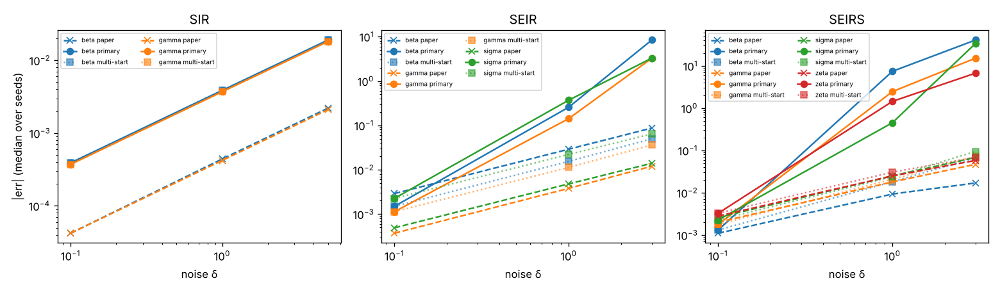

# X-TFC parameter discovery (Schiassi et al. 2020): measured results

Generated by `run_epi.py`. Machine: Linux-6.18.44-fc-v185-x86_64-with-glibc2.39.

- **Primary (frozen protocol): 14 of 36 scored targets reproduced.**
- Multi-start (post hoc, not the frozen protocol): 23 of 36.
- Oracle start is a diagnostic (it uses the true values) and is not scored.

- `primary`: the frozen protocol of TARGETS.md (data-driven start, eq. 9 stopping)
- `multistart`: post hoc: the data-driven start plus 8 random starts U(0, 2) per rate; lowest final loss kept
- `oracle_start`: post hoc diagnostic, not an estimator: Gauss-Newton started at the true parameters

| Model | δ | Parameter | Paper \|err\| | Primary: median [min, max] | Status | Multi-start (post hoc) | Status (post hoc) | Oracle start | Shooting baseline |
|---|---|---|---|---|---|---|---|---|---|
| SIR | 0 | beta | 0 | 2.9e-12 [2.9e-12, 2.9e-12] | **reproduced** | 2.9e-12 [2.9e-12, 2.9e-12] | reproduced | 2.9e-12 | 1.5e-12 |
| SIR | 0.1 | beta | 4.2e-05 | 0.00039 [9.5e-05, 0.00097] | **not reproduced** | 0.00039 [9.5e-05, 0.00097] | not reproduced | 0.00039 | 0.00015 |
| SIR | 1 | beta | 0.00044 | 0.0039 [0.00083, 0.0097] | **not reproduced** | 0.0039 [0.00083, 0.0097] | not reproduced | 0.0039 | 0.0015 |
| SIR | 5 | beta | 0.0022 | 0.019 [0.0012, 0.046] | **not reproduced** | 0.019 [0.0012, 0.046] | not reproduced | 0.019 | 0.0077 |
| SIR | 0 | gamma | 0 | 3e-12 [3e-12, 3e-12] | **reproduced** | 2.8e-12 [2.8e-12, 2.8e-12] | reproduced | 3e-12 | 2.2e-13 |
| SIR | 0.1 | gamma | 4.2e-05 | 0.00037 [0.00011, 0.00065] | **not reproduced** | 0.00037 [0.00011, 0.00065] | not reproduced | 0.00037 | 0.00012 |
| SIR | 1 | gamma | 0.00042 | 0.0037 [0.0011, 0.0065] | **not reproduced** | 0.0037 [0.0011, 0.0065] | not reproduced | 0.0037 | 0.0012 |
| SIR | 5 | gamma | 0.0021 | 0.018 [0.0034, 0.032] | **not reproduced** | 0.018 [0.0034, 0.032] | not reproduced | 0.018 | 0.006 |
| SIR | 0 | R0 | 0 | 2.2e-11 [2.2e-11, 2.2e-11] | **reported** | 2.1e-11 [2.1e-11, 2.1e-11] | reported | 2.2e-11 | 3.6e-12 |
| SIR | 0.1 | R0 | 0.00032 | 0.00033 [1.4e-05, 0.0013] | **reported** | 0.00033 [1.2e-05, 0.0013] | reported | 0.00033 | 0.00016 |
| SIR | 1 | R0 | 0.0032 | 0.0033 [0.00023, 0.013] | **reported** | 0.0033 [0.00023, 0.013] | reported | 0.0033 | 0.0016 |
| SIR | 5 | R0 | 0.016 | 0.02 [0.0034, 0.054] | **reported** | 0.02 [0.0034, 0.054] | reported | 0.02 | 0.0083 |
| SEIR | 0 | beta | 0 | 4.1e-08 [4.1e-08, 4.1e-08] | **reproduced** | 4.1e-08 [4.1e-08, 4.1e-08] | reproduced | 4.1e-08 | 1.2e-12 |
| SEIR | 0.1 | beta | 0.0029 | 0.0015 [3.3e-05, 0.0051] | **reproduced** | 0.0015 [3.3e-05, 0.0051] | reproduced | 0.0015 | 0.001 |
| SEIR | 1 | beta | 0.029 | 0.26 [0.00017, 2.4e+02] | **not reproduced** | 0.015 [0.00017, 0.052] | reproduced | 0.015 | 0.0099 |
| SEIR | 3 | beta | 0.087 | 8.4 [0.0038, 8.6e+02] | **not reproduced** | 0.05 [0.0038, 0.16] | reproduced | 0.05 | 0.029 |
| SEIR | 0 | gamma | 0 | 4.3e-09 [4.3e-09, 4.3e-09] | **reproduced** | 4.3e-09 [4.3e-09, 4.3e-09] | reproduced | 4.3e-09 | 1.8e-12 |
| SEIR | 0.1 | gamma | 0.00037 | 0.0011 [0.00026, 0.0028] | **not reproduced** | 0.0011 [0.00026, 0.0028] | not reproduced | 0.0011 | 0.00083 |
| SEIR | 1 | gamma | 0.0038 | 0.14 [0.0021, 32] | **not reproduced** | 0.011 [0.0021, 0.028] | not reproduced | 0.011 | 0.0084 |
| SEIR | 3 | gamma | 0.012 | 3.3 [0.0015, 1.5e+02] | **not reproduced** | 0.036 [0.0015, 0.086] | not reproduced | 0.036 | 0.026 |
| SEIR | 0 | sigma | 0 | 1e-08 [1e-08, 1e-08] | **reproduced** | 1e-08 [1e-08, 1e-08] | reproduced | 1e-08 | 4.9e-12 |
| SEIR | 0.1 | sigma | 0.00049 | 0.0023 [0.00045, 0.0077] | **not reproduced** | 0.0023 [0.00045, 0.0077] | not reproduced | 0.0023 | 0.0018 |
| SEIR | 1 | sigma | 0.0048 | 0.37 [0.005, 5.8e+02] | **not reproduced** | 0.022 [0.005, 0.076] | not reproduced | 0.022 | 0.018 |
| SEIR | 3 | sigma | 0.014 | 3.3 [0.018, 1.6e+03] | **not reproduced** | 0.064 [0.018, 0.23] | not reproduced | 0.064 | 0.055 |
| SEIR | 0 | R0 | 0 | 7.1e-08 [7.1e-08, 7.1e-08] | **reported** | 7.1e-08 [7.1e-08, 7.1e-08] | reported | 7.1e-08 | 5.2e-13 |
| SEIR | 0.1 | R0 | 0.0045 | 0.0016 [0.00017, 0.0079] | **reported** | 0.0016 [0.00017, 0.0079] | reported | 0.0016 | 0.0013 |
| SEIR | 1 | R0 | 0.045 | 0.68 [0.0019, 7.2] | **reported** | 0.018 [0.0015, 0.078] | reported | 0.018 | 0.014 |
| SEIR | 3 | R0 | 0.14 | 1.3 [0.00043, 7.1] | **reported** | 0.065 [0.00045, 0.23] | reported | 0.065 | 0.044 |
| SEIRS | 0 | beta | 0 | 7.2e-09 [7.2e-09, 7.2e-09] | **reproduced** | 6.9e-09 [6.9e-09, 6.9e-09] | reproduced | 7.2e-09 | 3e-13 |
| SEIRS | 0.1 | beta | 0.0011 | 0.0013 [0.00029, 0.0076] | **reproduced** | 0.0013 [0.00029, 0.0076] | reproduced | 0.0013 | 0.0019 |
| SEIRS | 1 | beta | 0.0093 | 7.4 [0.00056, 2e+02] | **not reproduced** | 0.018 [0.00054, 0.083] | reproduced | 0.018 | 0.019 |
| SEIRS | 3 | beta | 0.017 | 41 [0.009, 6.2e+02] | **not reproduced** | 0.067 [0.0084, 0.28] | not reproduced | 0.068 | 0.054 |
| SEIRS | 0 | gamma | 0 | 3.3e-09 [3.3e-09, 3.3e-09] | **reproduced** | 3.3e-09 [3.3e-09, 3.3e-09] | reproduced | 3.3e-09 | 1.6e-12 |
| SEIRS | 0.1 | gamma | 0.002 | 0.0018 [5.9e-05, 0.0064] | **reproduced** | 0.0018 [5.9e-05, 0.0064] | reproduced | 0.0018 | 0.002 |
| SEIRS | 1 | gamma | 0.018 | 2.5 [0.001, 57] | **not reproduced** | 0.021 [0.001, 0.069] | reproduced | 0.021 | 0.02 |
| SEIRS | 3 | gamma | 0.047 | 15 [0.015, 2.3e+02] | **not reproduced** | 0.073 [0.012, 0.24] | reproduced | 0.073 | 0.061 |
| SEIRS | 0 | sigma | 0 | 1.3e-08 [1.3e-08, 1.3e-08] | **reproduced** | 1.3e-08 [1.3e-08, 1.3e-08] | reproduced | 1.3e-08 | 7e-12 |
| SEIRS | 0.1 | sigma | 0.0026 | 0.0023 [0.00016, 0.0098] | **reproduced** | 0.0023 [0.00016, 0.0098] | reproduced | 0.0023 | 0.0013 |
| SEIRS | 1 | sigma | 0.025 | 0.45 [0.0033, 7e+02] | **not reproduced** | 0.024 [0.0033, 0.1] | reproduced | 0.024 | 0.011 |
| SEIRS | 3 | sigma | 0.068 | 34 [0.022, 1.7e+03] | **not reproduced** | 0.094 [0.0038, 0.33] | reproduced | 0.094 | 0.038 |
| SEIRS | 0 | zeta | 0 | 8.9e-09 [8.9e-09, 8.9e-09] | **reproduced** | 8.6e-09 [8.6e-09, 8.6e-09] | reproduced | 8.9e-09 | 1.1e-12 |
| SEIRS | 0.1 | zeta | 0.0028 | 0.0033 [0.0004, 0.0075] | **reproduced** | 0.0033 [0.0004, 0.0075] | reproduced | 0.0033 | 0.0029 |
| SEIRS | 1 | zeta | 0.025 | 1.4 [0.014, 91] | **not reproduced** | 0.031 [0.0077, 0.087] | reproduced | 0.031 | 0.03 |
| SEIRS | 3 | zeta | 0.058 | 6.7 [0.018, 2.6e+02] | **not reproduced** | 0.069 [0.011, 0.33] | reproduced | 0.068 | 0.089 |
| SEIRS | 0 | R0 | 0 | 9.3e-09 [9.3e-09, 9.3e-09] | **reported** | 8.8e-09 [8.8e-09, 8.8e-09] | reported | 9.3e-09 | 8.5e-13 |
| SEIRS | 0.1 | R0 | 0.00017 | 0.0014 [0.00022, 0.0075] | **reported** | 0.0021 [0.00022, 0.0075] | reported | 0.0014 | 0.0017 |
| SEIRS | 1 | R0 | 0.00021 | 0.16 [0.0018, 4.6] | **reported** | 0.02 [0.0018, 0.091] | reported | 0.016 | 0.017 |
| SEIRS | 3 | R0 | 0.0091 | 0.42 [0.013, 4.2] | **reported** | 0.077 [0.013, 0.45] | reported | 0.078 | 0.05 |

Wall time:

- SIR: primary 0.047 s, multi-start 0.45 s, shooting 0.053 s (median per run)
- SEIR: primary 0.12 s, multi-start 1.1 s, shooting 0.42 s (median per run)
- SEIRS: primary 0.13 s, multi-start 1.5 s, shooting 1.1 s (median per run)

