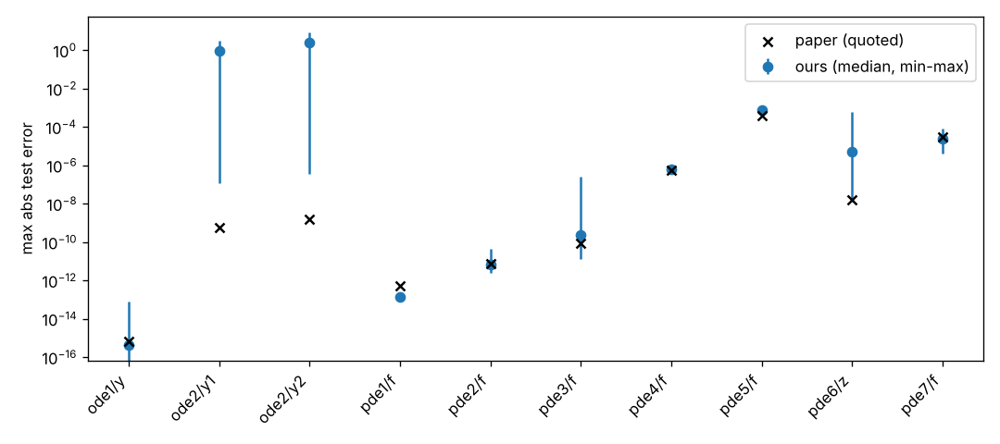

# X-TFC reproduction: measured results

Generated by `run_xtfc.py` from `results.json`. Machine: Linux-6.18.44-fc-v153-x86_64-with-glibc2.39, Python 3.13.17.

## Primary protocol

| Case | Field | Target (test max) | Ours: median [min, max] | Scored on | Seeds | Status | Paper mean | Our mean (median) | lstsq median | Wall (all seeds) |
|---|---|---|---|---|---|---|---|---|---|---|
| ode1 | y | 6.661e-16 | 4.44e-16 [0, 8.4e-14] | paper_points_max | 1000 | **reproduced** | - | 2.59e-16 | 2.7 ms | 16 s |
| ode2 | y1 | 5.543e-10 | 0.908 [1.2e-07, 3.1] | paper_points_max | 1000 | **not reproduced** | - | 0.109 | 45.6 ms | 80 s |
| ode2 | y2 | 1.581e-09 | 2.59 [3.5e-07, 8.7] | paper_points_max | 1000 | **not reproduced** | - | 0.266 | 45.6 ms | 80 s |
| pde1 | f | 5.054e-13 | 1.37e-13 [7.8e-14, 2e-13] | test_max | 10 | **reproduced** | 7.64e-14 | 2.75e-14 | 10.8 ms | 8 s |
| pde2 | f | 7.581e-12 | 7.13e-12 [2.6e-12, 4.5e-11] | test_max | 10 | **reproduced** | 1.32e-12 | 1.21e-12 | 9.7 ms | 7 s |
| pde3 | f | 8.977e-11 | 2.34e-10 [1.4e-11, 2.5e-07] | test_max | 10 | **reproduced** | 1.07e-11 | 4.43e-11 | 89.8 ms | 13 s |
| pde4 | f | 5.785e-07 | 6.54e-07 [3.8e-07, 1.1e-06] | test_max | 10 | **reproduced** | 6.93e-08 | 9.72e-08 | 10.6 ms | 7 s |
| pde5 | f | 0.0004025 | 0.000726 [0.00051, 0.0012] | test_max | 10 | **reproduced** | 2.09e-05 | 6.26e-05 | 50.9 ms | 53 s |
| pde6 | z | 1.657e-08 | 5.45e-06 [1.9e-08, 0.00059] | test_max | 10 | **not reproduced** | 1.02e-09 | 3.35e-07 | 206.9 ms | 15 s |
| pde7 | f | 2.978e-05 | 2.35e-05 [3.9e-06, 8e-05] | test_max | 10 | **reproduced** | 8.08e-07 | 1.59e-06 | 334.4 ms | 66 s |

## All variants

| Case | Variant | Field | median [min, max] | converged |
|---|---|---|---|---|
| ode1 | primary | y | 4.44e-16 [0, 8.4e-14] | 0/1000 |
| ode1 | n = L = 50 (declared secondary) | y | 6.66e-16 [0, 1.3e-13] | 0/1000 |
| ode2 | primary | y1 | 0.908 [1.2e-07, 3.1] | 0/1000 |
| ode2 | primary | y2 | 2.59 [3.5e-07, 8.7] | 0/1000 |
| ode2 | inputs mapped to [-1, 1] (post-hoc, not used for status) | y1 | 3.54e-09 [7.3e-14, 0.0012] | 45/1000 |
| ode2 | inputs mapped to [-1, 1] (post-hoc, not used for status) | y2 | 9.98e-09 [7.5e-14, 0.0033] | 45/1000 |
| pde1 | primary | f | 1.37e-13 [7.8e-14, 2e-13] | 10/10 |
| pde1 | cgl (declared secondary) | f | 1.46e-13 [8.8e-14, 2.5e-13] | 10/10 |
| pde2 | primary | f | 7.13e-12 [2.6e-12, 4.5e-11] | 10/10 |
| pde2 | cgl (declared secondary) | f | 3.86e-12 [1.5e-12, 1.8e-11] | 10/10 |
| pde3 | primary | f | 2.34e-10 [1.4e-11, 2.5e-07] | 0/10 |
| pde3 | cgl (declared secondary) | f | 1.05e-11 [3.3e-12, 3e-08] | 0/10 |
| pde4 | primary | f | 6.54e-07 [3.8e-07, 1.1e-06] | 10/10 |
| pde4 | cgl (declared secondary) | f | 3.79e-07 [1.7e-07, 6e-07] | 10/10 |
| pde5 | primary | f | 0.000726 [0.00051, 0.0012] | 10/10 |
| pde5 | cgl (declared secondary) | f | 0.000341 [0.0002, 0.00044] | 10/10 |
| pde6 | primary | z | 5.45e-06 [1.9e-08, 0.00059] | 0/10 |
| pde6 | cgl (declared secondary) | z | 0.000146 [3.5e-08, 0.0018] | 0/10 |
| pde7 | primary | f | 2.35e-05 [3.9e-06, 8e-05] | 0/10 |
| pde7 | cgl (declared secondary) | f | 4.17e-05 [1.1e-05, 0.00012] | 0/10 |

