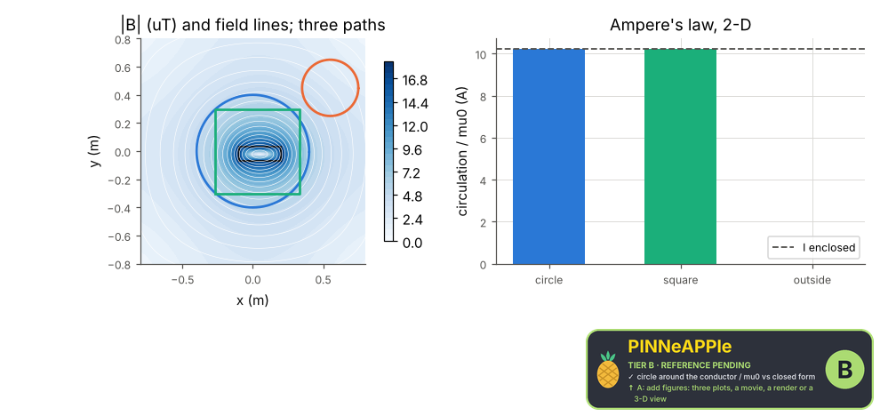
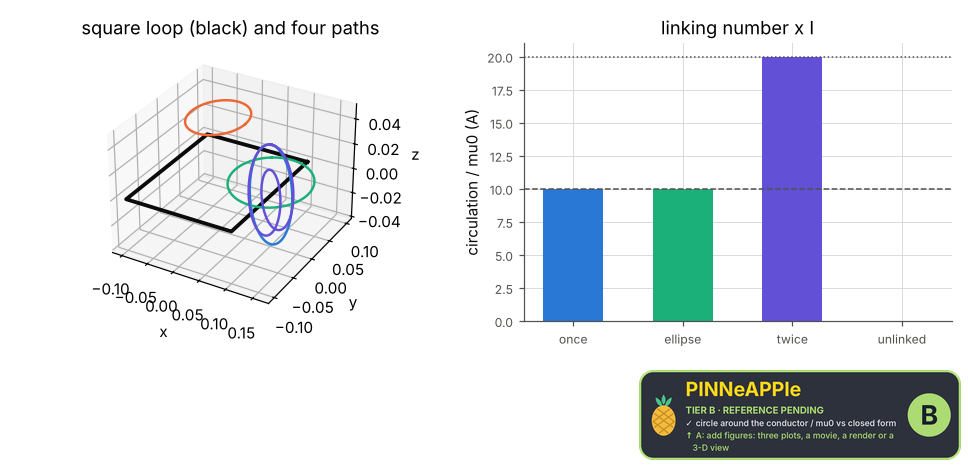

# Ampere's law

The circulation of B around closed paths equals mu0 times the current they enclose. 2-D: B from a finite-volume solution of lap A_z = -mu0 J_z for a rectangular conductor, integrated around a circle, a square and a path that encloses nothing. 3-D: B of a square loop (Biot-Savart) around paths that link it once, twice (a path winding twice) and not at all.

**Area:** `physics.electromagnetism` (magnetostatics) · **level:** academic · **kind:** theory · **dimensions:** 2D, 3D

```python
import pinneapple as pp

r = pp.science.run("em.ampere_law", dim="2D")    # also: "2D", "3D"
print(r)                     # comparisons with their references, checks, trust decision
```

## 2D

Trust report: **APPROVED** (score 1.00, coverage 100%); run time 1.5 s.

| quantity | computed | reference | rel. error | tolerance | reference kind | source |
|---|---|---|---|---|---|---|
| circle around the conductor / mu0 | 10.2076 A | 10.2083 A | 7.61e-05 | 0.002 | closed_form | Ampere's law: oint B.dl = mu0 I_enc (Griffiths eq. 5.55) |
| square around the conductor / mu0 | 10.2075 A | 10.2083 A | 8.15e-05 | 0.002 | closed_form | Ampere's law (the path shape does not matter) |
| circle enclosing nothing / mu0 | 3.80556e-05 A | 0 A | 3.81e-05 (abs.) | 0.02 (abs.) | conservation | Ampere's law: I_enc = 0 |

| physics check | result | value | limit |
|---|---|---|---|
| circulation error decreases with the grid | pass |  |  |



## 3D

Trust report: **APPROVED** (score 1.00, coverage 100%); run time 0.1 s.

| quantity | computed | reference | rel. error | tolerance | reference kind | source |
|---|---|---|---|---|---|---|
| circle around one side | 10 A | 10 A | 0.00e+00 | 1e-06 | closed_form | Ampere's law: oint B.dl = mu0 I x (linking number) (Jackson sec. 5.3) |
| tilted ellipse, linking once | 10 A | 10 A | 1.78e-16 | 1e-06 | closed_form | Ampere's law: oint B.dl = mu0 I x (linking number) (Jackson sec. 5.3) |
| path winding twice | 20 A | 20 A | 0.00e+00 | 1e-06 | closed_form | Ampere's law: oint B.dl = mu0 I x (linking number) (Jackson sec. 5.3) |
| path not linked (a circle inside the loop, above it) | -7.94093e-18 A | 0 A | 7.94e-18 (abs.) | 1e-08 (abs.) | conservation | Ampere's law: oint B.dl = mu0 I x (linking number) (Jackson sec. 5.3) |



## References

- Griffiths, Introduction to Electrodynamics, 4th ed., sec. 5.3
- Jackson, Classical Electrodynamics, 3rd ed., sec. 5.3

Lab item `manifest/examples/science/electromagnetism/ampere_law` (manifest `experiment.json`); figures marked `.sealed` carry its seal.

Regenerate: `python -m pinneapple_science report em.ampere_law`.
