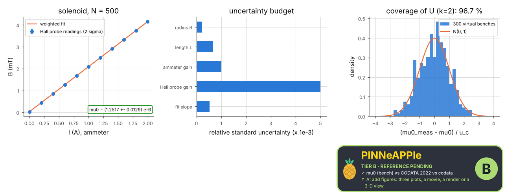

# Bench: measuring mu0 with a solenoid

A wound solenoid, a current supply, an ammeter and a Hall probe at the centre. The current is stepped, B read (averaged), B(I) fitted; mu0 = slope sqrt(L^2 + 4 R^2) / N with L and R from a caliper. The field is the 3-D Biot-Savart field of the actual helix plus Earth's field. The result carries its uncertainty budget and is compared with CODATA 2022.

**Area:** `physics.electromagnetism` (magnetostatics (laboratory)) · **level:** academic · **kind:** practice · **dimensions:** 3D

```python
import pinneapple as pp

r = pp.science.run("em.bench_mu0_solenoid", dim="3D")    # also: "3D"
print(r)                     # comparisons with their references, checks, trust decision
```

## 3D

Trust report: **APPROVED** (score 1.00, coverage 100%); run time 0.3 s.

| quantity | computed | reference | rel. error | tolerance | reference kind | source |
|---|---|---|---|---|---|---|
| mu0 (bench) vs CODATA 2022 | 1.25169e-06 N/A^2 | 1.25664e-06 N/A^2 | 3.94e-03 | 0.01 | codata | CODATA 2022 (Mohr et al., Rev. Mod. Phys. 97, 025002, 2025) |

| physics check | result | value | limit |
|---|---|---|---|
| stated uncertainty covers the truth about 95 % of the time | pass | 0.967 |  |
| the helix is close to a current sheet at the centre (systematic below 0.1 %) | pass |  |  |



## References

- JCGM 100:2008 (GUM)
- CODATA 2022: mu0 = 1.25663706127(20)e-6 N/A^2 (Mohr et al., Rev. Mod. Phys. 97, 025002 (2025))
- Griffiths, 4th ed., prob. 5.11 (finite solenoid)

Lab item `manifest/examples/science/electromagnetism/bench_mu0_solenoid` (manifest `experiment.json`); figures marked `.sealed` carry its seal.

Regenerate: `python -m pinneapple_science report em.bench_mu0_solenoid`.
