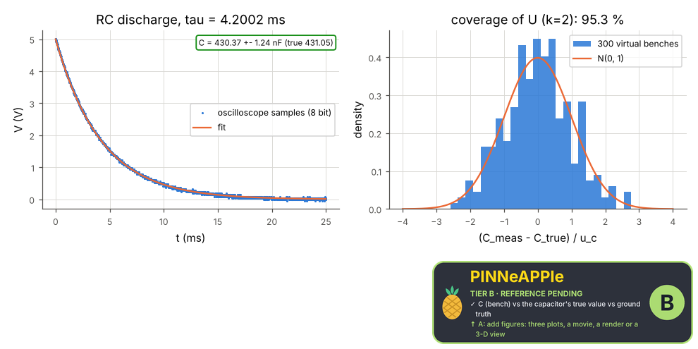

# Bench: capacitance from an RC discharge on an oscilloscope

A capacitor (nominal 470 nF, +-10 %) discharges through a resistor measured with an ohmmeter. An 8-bit oscilloscope with noise and a time-base error records V(t); an exponential fit gives tau and C = tau / R with its uncertainty, compared with the capacitor's true value (the bench's ground truth, hidden from the fit).

**Area:** `physics.electromagnetism` (circuits (laboratory)) · **level:** academic · **kind:** practice · **dimensions:** 0D

```python
import pinneapple as pp

r = pp.science.run("em.bench_rc_discharge", dim="0D")    # also: "0D"
print(r)                     # comparisons with their references, checks, trust decision
```

## 0D

Trust report: **APPROVED** (score 1.00, coverage 100%); run time 0.7 s.

| quantity | computed | reference | rel. error | tolerance | reference kind | source |
|---|---|---|---|---|---|---|
| C (bench) vs the capacitor's true value | 4.30371e-07 F | 4.31051e-07 F | 1.58e-03 | 0.0029 | ground_truth | the value the virtual bench was built with (drawn within the 10 % tolerance, hidden from the fit) |
| C vs the nominal label (470 nF +- 10 %) | 4.30371e-07 F | 4.7e-07 F | 8.43e-02 | 0.1 | ground_truth | manufacturer's tolerance band |

| physics check | result | value | limit |
|---|---|---|---|
| stated uncertainty covers the truth about 95 % of the time | pass | 0.953 |  |



## References

- JCGM 100:2008 (GUM)
- Nilsson & Riedel, Electric Circuits, 10th ed., sec. 7.2

Lab item `manifest/examples/science/electromagnetism/bench_rc_discharge` (manifest `experiment.json`); figures marked `.sealed` carry its seal.

Regenerate: `python -m pinneapple_science report em.bench_rc_discharge`.
