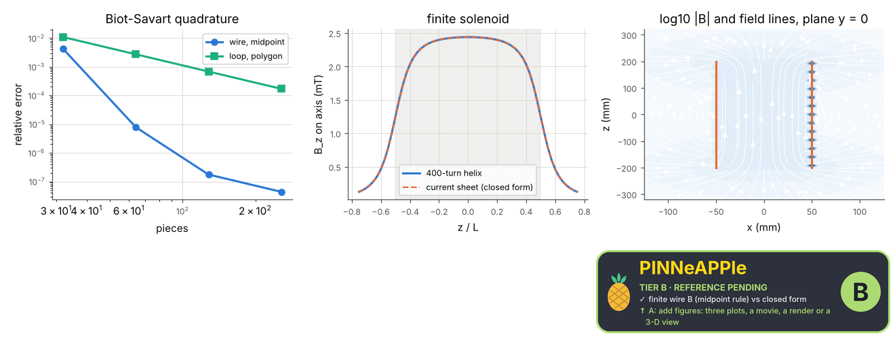

# Biot-Savart: wire, loop and solenoid

The Biot-Savart integral evaluated numerically (midpoint rule along a straight wire; polygonal filaments for a loop and a helical coil) against the closed forms: finite wire, loop (elliptic integrals, on and off the axis) and the finite solenoid on its axis.

**Area:** `physics.electromagnetism` (magnetostatics) · **level:** academic · **kind:** theory · **dimensions:** 3D

```python
import pinneapple as pp

r = pp.science.run("em.biot_savart", dim="3D")    # also: "3D"
print(r)                     # comparisons with their references, checks, trust decision
```

## 3D

Trust report: **APPROVED** (score 1.00, coverage 100%); run time 9.6 s.

| quantity | computed | reference | rel. error | tolerance | reference kind | source |
|---|---|---|---|---|---|---|
| finite wire B (midpoint rule) | 1.99519e-05 T | 1.99519e-05 T | 4.38e-08 | 0.0001 | closed_form | Griffiths eq. 5.37: B = mu0 I/(4 pi s) (sin t2 - sin t1) |
| loop B, 5 points on and off axis (worst) | 1.00017 |B|/|B_ref| | 1 |B|/|B_ref| | 1.71e-04 | 0.001 | closed_form | Jackson sec. 5.5: loop field with complete elliptic integrals (pp.em.statics.loop_field) |
| loop centre B | 2.5134e-05 T | 2.51327e-05 T | 5.02e-05 | 0.001 | closed_form | Griffiths ex. 5.6: B = mu0 I / (2 R) |
| solenoid centre B (helix) | 0.00243844 T | 0.00243823 T | 8.39e-05 | 0.002 | closed_form | Griffiths prob. 5.11: mu0 n I / 2 (cos a2 - cos a1), current sheet |
| solenoid end B (helix) | 0.00124696 T | 0.00124693 T | 2.19e-05 | 0.01 | closed_form | Griffiths prob. 5.11 at z = L/2 (about half the centre value) |
| long-solenoid limit mu0 n I | 0.00243823 T | 0.00251327 T | 2.99e-02 | 0.05 | limit | Ampere's law for an infinite solenoid (Griffiths ex. 5.9); L/R = 8 gives a finite-length deficit |

| physics check | result | value | limit |
|---|---|---|---|
| polygon loop converges at second order | pass | 2 |  |
| div B = 0 near the loop (pp.maxwell.gauss_magnetic) | pass | 0.000625 | 0.05 |



## References

- Griffiths, Introduction to Electrodynamics, 4th ed., ex. 5.5 (finite wire), ex. 5.6 (loop), prob. 5.11 (finite solenoid)
- Jackson, Classical Electrodynamics, 3rd ed., sec. 5.5 (loop, elliptic integrals)

Lab item `manifest/examples/science/electromagnetism/biot_savart` (manifest `experiment.json`); figures marked `.sealed` carry its seal.

Regenerate: `python -m pinneapple_science report em.biot_savart`.
