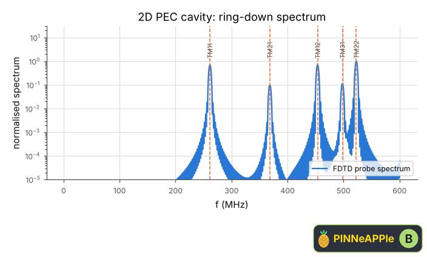
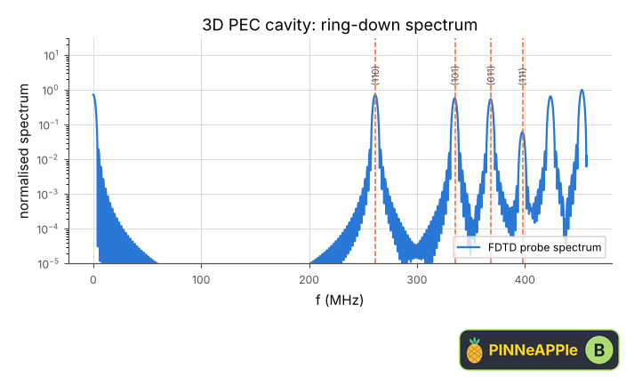

# Resonant cavity

A PEC cavity rung by a short pulse (FDTD). The spectrum of a probe signal shows the resonances; each peak is matched to the nearest mode of the closed form and its frequency error measured. 2-D: TM_mn modes of a rectangle; 3-D: TE/TM_mnp modes of a box.

**Area:** `physics.electromagnetism` (resonators) · **level:** academic · **kind:** theory · **dimensions:** 2D, 3D

```python
import pinneapple as pp

r = pp.science.run("em.cavity_resonance", dim="2D")    # also: "2D", "3D"
print(r)                     # comparisons with their references, checks, trust decision
```

## 2D

Trust report: **APPROVED** (score 1.00, coverage 100%); run time 7.5 s.

| quantity | computed | reference | rel. error | tolerance | reference kind | source |
|---|---|---|---|---|---|---|
| TM11 resonance | 2.61385e+08 Hz | 2.61388e+08 Hz | 1.35e-05 | 0.002 | closed_form | Pozar eq. 6.40: f = c/2 sqrt((m/a)^2 + (n/b)^2 + (l/d)^2) |
| TM21 resonance | 3.68407e+08 Hz | 3.68416e+08 Hz | 2.38e-05 | 0.002 | closed_form | Pozar eq. 6.40: f = c/2 sqrt((m/a)^2 + (n/b)^2 + (l/d)^2) |
| TM12 resonance | 4.53665e+08 Hz | 4.53749e+08 Hz | 1.86e-04 | 0.002 | closed_form | Pozar eq. 6.40: f = c/2 sqrt((m/a)^2 + (n/b)^2 + (l/d)^2) |
| TM31 resonance | 4.97998e+08 Hz | 4.98071e+08 Hz | 1.47e-04 | 0.002 | closed_form | Pozar eq. 6.40: f = c/2 sqrt((m/a)^2 + (n/b)^2 + (l/d)^2) |
| TM22 resonance | 5.22748e+08 Hz | 5.22776e+08 Hz | 5.36e-05 | 0.002 | closed_form | Pozar eq. 6.40: f = c/2 sqrt((m/a)^2 + (n/b)^2 + (l/d)^2) |

| physics check | result | value | limit |
|---|---|---|---|
| frequency error falls with the grid (numerical dispersion ~ h^2) | pass |  |  |



## 3D

Trust report: **APPROVED** (score 1.00, coverage 100%); run time 8.7 s.

| quantity | computed | reference | rel. error | tolerance | reference kind | source |
|---|---|---|---|---|---|---|
| (110) resonance | 2.6131e+08 Hz | 2.61388e+08 Hz | 2.99e-04 | 0.002 | closed_form | Pozar eq. 6.40: f = c/2 sqrt((m/a)^2 + (n/b)^2 + (l/d)^2) |
| (101) resonance | 3.34943e+08 Hz | 3.35178e+08 Hz | 7.02e-04 | 0.002 | closed_form | Pozar eq. 6.40: f = c/2 sqrt((m/a)^2 + (n/b)^2 + (l/d)^2) |
| (011) resonance | 3.68213e+08 Hz | 3.68416e+08 Hz | 5.51e-04 | 0.002 | closed_form | Pozar eq. 6.40: f = c/2 sqrt((m/a)^2 + (n/b)^2 + (l/d)^2) |
| (111) resonance | 3.97636e+08 Hz | 3.97743e+08 Hz | 2.69e-04 | 0.002 | closed_form | Pozar eq. 6.40: f = c/2 sqrt((m/a)^2 + (n/b)^2 + (l/d)^2) |

| physics check | result | value | limit |
|---|---|---|---|
| frequency error falls with the grid (numerical dispersion ~ h^2) | pass |  |  |



## References

- Pozar, Microwave Engineering, 4th ed., sec. 6.3 (eq. 6.40)
- Taflove & Hagness, 3rd ed., sec. 4.6 (numerical dispersion)

Lab item `manifest/examples/science/electromagnetism/cavity_resonance` (manifest `experiment.json`); figures marked `.sealed` carry its seal.

Regenerate: `python -m pinneapple_science report em.cavity_resonance`.
