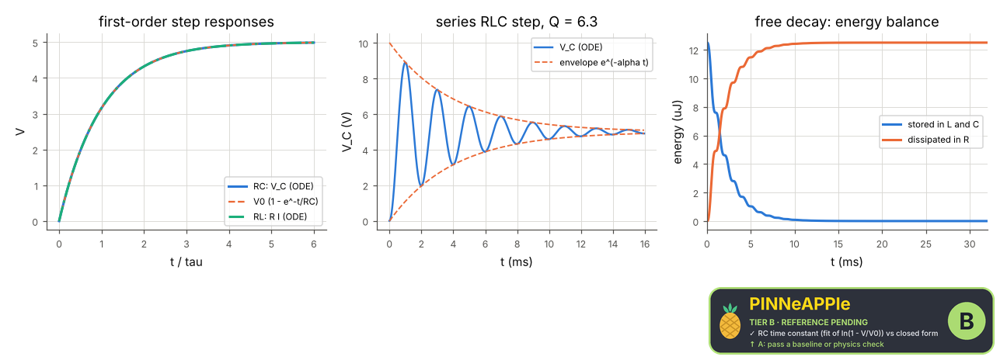

# RC, RL and RLC circuits

Step responses of RC, RL and series RLC circuits integrated numerically (Kirchhoff's laws as ODEs, scipy solve_ivp). The time constants, the damped frequency and the decay rate are measured from the waveforms (fits and zero crossings) and compared with the closed forms; in the free RLC decay the energy dissipated in R equals the energy first stored in C.

**Area:** `physics.electromagnetism` (circuits) · **level:** academic · **kind:** theory · **dimensions:** 0D

```python
import pinneapple as pp

r = pp.science.run("em.circuits_rc_rl_rlc", dim="0D")    # also: "0D"
print(r)                     # comparisons with their references, checks, trust decision
```

## 0D

Trust report: **APPROVED** (score 1.00, coverage 100%); run time 0.4 s.

| quantity | computed | reference | rel. error | tolerance | reference kind | source |
|---|---|---|---|---|---|---|
| RC time constant (fit of ln(1 - V/V0)) | 0.001 s | 0.001 s | 1.52e-11 | 1e-06 | closed_form | tau = R C (Nilsson & Riedel sec. 7.2) |
| RL time constant | 0.0001 s | 0.0001 s | 1.86e-11 | 1e-06 | closed_form | tau = L / R (Nilsson & Riedel sec. 7.1) |
| RL final current | 0.005 A | 0.005 A | 2.29e-12 | 1e-06 | closed_form | I(inf) = V0 / R; the value at 6 tau divided by (1 - e^-6) |
| RLC damped angular frequency (zero crossings) | 3152.38 rad/s | 3152.38 rad/s | 1.96e-11 | 0.0001 | closed_form | omega_d = sqrt(1/(L C) - (R/2L)^2) (Nilsson & Riedel sec. 8.3) |
| RLC decay rate (log decrement of extrema) | 250 1/s | 250 1/s | 7.96e-11 | 0.001 | closed_form | alpha = R / (2 L) (Nilsson & Riedel sec. 8.3) |
| energy dissipated in R (free decay) | 1.25e-05 J | 1.25e-05 J | 5.85e-11 | 1e-06 | conservation | energy conservation: 1/2 C V0^2 stored at t = 0 |



## References

- Nilsson & Riedel, Electric Circuits, 10th ed., ch. 7 (RL, RC) and ch. 8 (RLC)
- Griffiths, Introduction to Electrodynamics, 4th ed., sec. 7.1-7.2

Lab item `manifest/examples/science/electromagnetism/circuits_rc_rl_rlc` (manifest `experiment.json`); figures marked `.sealed` carry its seal.

Regenerate: `python -m pinneapple_science report em.circuits_rc_rl_rlc`.
