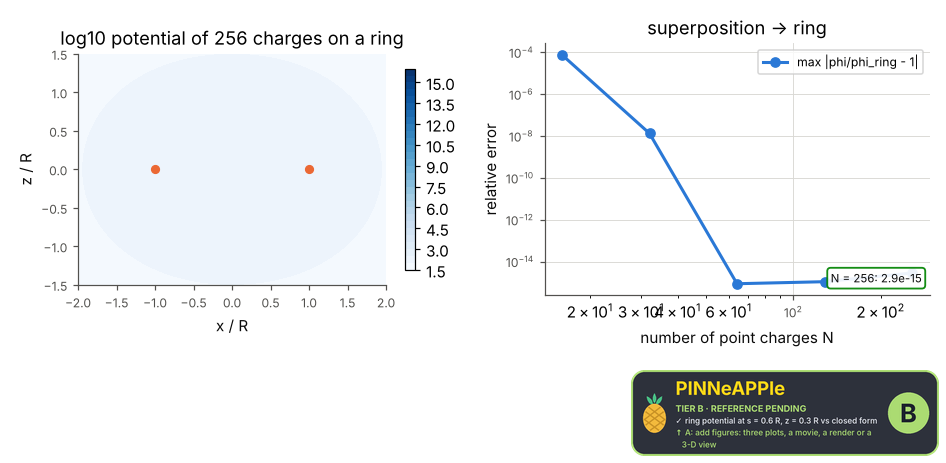
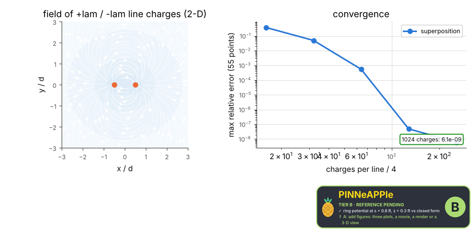

# Coulomb's law and superposition

A charged ring (3-D) and a pair of finite line charges (2-D cross-section) built from N point charges by superposition, against the closed forms; the error falls as N grows.

**Area:** `physics.electromagnetism` (electrostatics) · **level:** academic · **kind:** theory · **dimensions:** 3D, 2D

```python
import pinneapple as pp

r = pp.science.run("em.coulomb_superposition", dim="3D")    # also: "3D", "2D"
print(r)                     # comparisons with their references, checks, trust decision
```

## 3D

Trust report: **APPROVED** (score 1.00, coverage 100%); run time 0.4 s.

| quantity | computed | reference | rel. error | tolerance | reference kind | source |
|---|---|---|---|---|---|---|
| ring potential at s = 0.6 R, z = 0.3 R | 183.158 V | 183.158 V | 6.21e-16 | 1e-06 | closed_form | Jackson sec. 3.3: phi = Q/(4 pi eps0) (2/pi) K(m)/sqrt((R+s)^2+z^2) |
| axial field E_z(z = 0.75 R) | 1380.49 V/m | 1380.49 V/m | 6.59e-16 | 1e-10 | closed_form | Griffiths ex. 2.5: E_z = Q z / (4 pi eps0 (z^2 + R^2)^(3/2)) |
| far field -> point charge (r = 40 R) | 2.24478 V/m | 2.24689 V/m | 9.37e-04 | 0.001 | limit | Coulomb's law, multipole limit r >> R |

| physics check | result | value | limit |
|---|---|---|---|
| error falls to round-off (below 1e-12) as N grows | pass | 2.89e-15 | 1e-12 |



## 2D

Trust report: **APPROVED** (score 1.00, coverage 100%); run time 0.8 s.

| quantity | computed | reference | rel. error | tolerance | reference kind | source |
|---|---|---|---|---|---|---|
| line-pair field E_x at (0, d/2) | 898.396 V/m | 898.396 V/m | 3.81e-10 | 1e-06 | closed_form | Griffiths ex. 2.2: E = lam/(2 pi eps0 s) L/sqrt(L^2+s^2) per segment, superposed |
| finite line -> infinite line (s = 0.01 m, L = 1 m) | 1797.42 V/m | 1797.51 V/m | 5.00e-05 | 0.001 | limit | Gauss's law for an infinite line: lam / (2 pi eps0 s) |

| physics check | result | value | limit |
|---|---|---|---|
| worst error over the 55 points below 1e-6 | pass | 6.08e-09 | 1e-06 |



## References

- Griffiths, Introduction to Electrodynamics, 4th ed., ex. 2.2 (finite line) and ex. 2.5 (ring)
- Jackson, Classical Electrodynamics, 3rd ed., sec. 3.3 (ring potential, elliptic integral)

Lab item `manifest/examples/science/electromagnetism/coulomb_superposition` (manifest `experiment.json`); figures marked `.sealed` carry its seal.

Regenerate: `python -m pinneapple_science report em.coulomb_superposition`.
