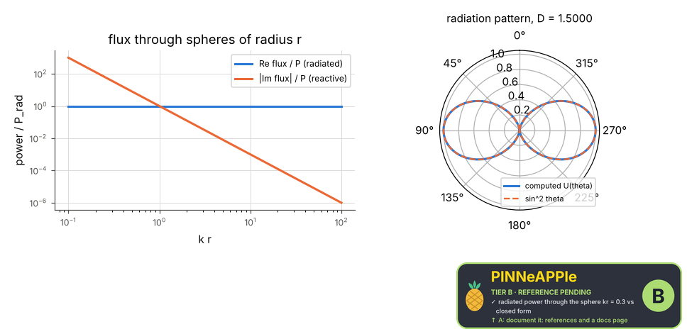
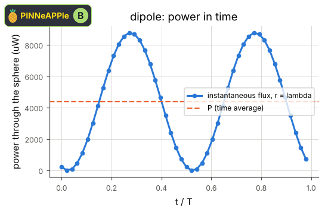
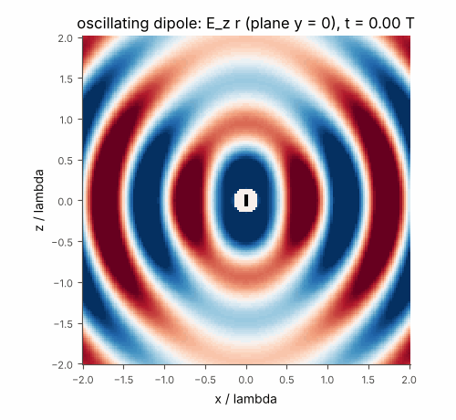

# Oscillating dipole and radiation

The complete near- and far-zone fields of an oscillating (Hertzian) dipole. 3-D: the time-averaged Poynting flux integrated over spheres from kr = 0.3 (reactive near zone) to kr = 30 is the same radiated power, eta k^2 |I l|^2 / (12 pi); the directivity is 1.5. 3D+t: the real fields in space and time, the energy through a sphere over one period, and Faraday and Ampere-Maxwell residuals of the 4-D field (pp.maxwell).

**Area:** `physics.electromagnetism` (radiation) · **level:** academic · **kind:** theory · **dimensions:** 3D, 3D+t

```python
import pinneapple as pp

r = pp.science.run("em.dipole_radiation", dim="3D")    # also: "3D", "3D+t"
print(r)                     # comparisons with their references, checks, trust decision
```

## 3D

Trust report: **APPROVED** (score 1.00, coverage 100%); run time 0.2 s.

| quantity | computed | reference | rel. error | tolerance | reference kind | source |
|---|---|---|---|---|---|---|
| radiated power through the sphere kr = 0.3 | 0.00438953 W | 0.00438953 W | 3.95e-16 | 1e-09 | closed_form | Balanis eq. 4-16: P = eta k^2 |I l|^2 / (12 pi) |
| radiated power through the sphere kr = 1 | 0.00438953 W | 0.00438953 W | 9.88e-16 | 1e-09 | closed_form | Balanis eq. 4-16: P = eta k^2 |I l|^2 / (12 pi) |
| radiated power through the sphere kr = 3 | 0.00438953 W | 0.00438953 W | 9.88e-16 | 1e-09 | closed_form | Balanis eq. 4-16: P = eta k^2 |I l|^2 / (12 pi) |
| radiated power through the sphere kr = 30 | 0.00438953 W | 0.00438953 W | 5.93e-16 | 1e-09 | closed_form | Balanis eq. 4-16: P = eta k^2 |I l|^2 / (12 pi) |
| directivity | 1.5  | 1.5  | 4.44e-16 | 0.001 | closed_form | Balanis eq. 4-31: D0 = 3/2 |

| physics check | result | value | limit |
|---|---|---|---|
| Gauss's law div D = rho (phasors, 26^3 grid) | pass | 0.000698 | 0.05 |
| Gauss's law for B, div B = 0 (phasors, 26^3 grid) | pass | 0.00084 | 0.05 |
| Faraday's law curl E = -dB/dt (phasors, 26^3 grid) | pass | 0.000766 | 0.05 |
| Ampere-Maxwell law curl H = J + dD/dt (phasors, 26^3 grid) | pass | 0.000982 | 0.05 |



## 3D+t

Trust report: **APPROVED** (score 1.00, coverage 100%); run time 7.5 s.

| quantity | computed | reference | rel. error | tolerance | reference kind | source |
|---|---|---|---|---|---|---|
| energy through the sphere r = lambda in one period | 4.38953e-12 J | 4.38953e-12 J | 9.20e-16 | 1e-09 | closed_form | Balanis eq. 4-16: P T |

| physics check | result | value | limit |
|---|---|---|---|
| Gauss's law div D = rho (x, y, z, t grid 21^3 x 64) | pass | 0.00113 | 0.05 |
| Gauss's law for B, div B = 0 (x, y, z, t grid 21^3 x 64) | pass | 0.00133 | 0.05 |
| Faraday's law curl E = -dB/dt (x, y, z, t grid 21^3 x 64) | pass | 0.000935 | 0.05 |
| Ampere-Maxwell law curl H = J + dD/dt (x, y, z, t grid 21^3 x 64) | pass | 0.000878 | 0.05 |
| Poynting energy balance (x, y, z, t grid 21^3 x 64) | pass | 3.73e-05 | 0.05 |
| the checks reject H scaled by 1.3 | pass |  |  |



Animation (3-D field in time): [dipole_3d_t.mp4](3D_plus_t/dipole_3d_t.mp4), 

## References

- Balanis, Antenna Theory, 3rd ed., sec. 4.2 (eqs. 4-8, 4-16)
- Jackson, Classical Electrodynamics, 3rd ed., sec. 9.2

Lab item `manifest/examples/science/electromagnetism/dipole_radiation` (manifest `experiment.json`); figures marked `.sealed` carry its seal.

Regenerate: `python -m pinneapple_science report em.dipole_radiation`.
