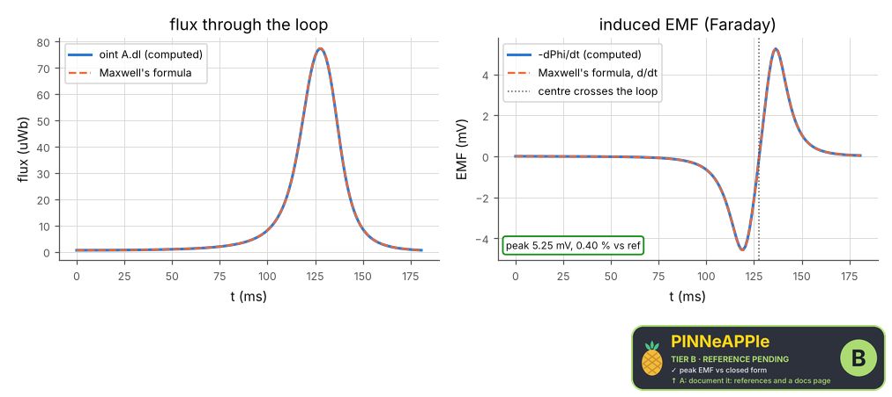
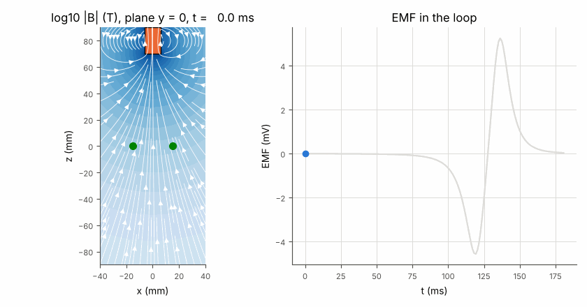

# Faraday's law: a magnet falling through a loop

A neodymium-like cylinder magnet falls along the axis of a wire loop. The 3-D field of the magnet is computed at every instant (vector potential and Biot-Savart of its bound surface current), the flux through the loop by Stokes' theorem, and the EMF = -dPhi/dt. Checked against Maxwell's coaxial-circle formula, the free-fall time at which the EMF changes sign, and the net flux change over the whole fall; the field in time is the animation.

**Area:** `physics.electromagnetism` (electromagnetic induction) · **level:** academic · **kind:** theory · **dimensions:** 3D+t

```python
import pinneapple as pp

r = pp.science.run("em.faraday_induction", dim="3D+t")    # also: "3D+t"
print(r)                     # comparisons with their references, checks, trust decision
```

## 3D+t

Trust report: **APPROVED** (score 1.00, coverage 100%); run time 136.5 s.

| quantity | computed | reference | rel. error | tolerance | reference kind | source |
|---|---|---|---|---|---|---|
| peak EMF | 0.00524896 V | 0.00526995 V | 3.98e-03 | 0.01 | closed_form | Maxwell (1873) art. 701: M of coaxial circles (pp.em.statics.mutual_inductance_coaxial_loops), summed over the rings, differentiated in time |
| flux at the centre crossing | 7.72419e-05 Wb | 7.7425e-05 Wb | 2.36e-03 | 0.01 | closed_form | Maxwell (1873) art. 701, summed over the rings |
| time of the EMF sign change | 0.127727 s | 0.127732 s | 3.82e-05 | 0.005 | closed_form | free fall from rest: z0 = g t^2 / 2 (the flux is largest with the magnet centred) |

| physics check | result | value | limit |
|---|---|---|---|
| net EMF integral = -(Phi_end - Phi_start) | pass | 5.87e-06 | 0.02 |
| Lenz: EMF < 0 wherever the flux grows | pass |  |  |
| div B = 0 above the magnet (pp.maxwell.gauss_magnetic) | pass | 0.0173 | 0.05 |



Animation (3-D field in time): [faraday_3d_t.mp4](3D_plus_t/faraday_3d_t.mp4), 

## References

- Griffiths, Introduction to Electrodynamics, 4th ed., sec. 6.2 (bound currents) and 7.2 (Faraday's law)
- J. C. Maxwell, A Treatise on Electricity and Magnetism (1873), vol. 2, art. 701 (mutual inductance of coaxial circles)
- Smythe, Static and Dynamic Electricity, 3rd ed., sec. 8.06

Lab item `manifest/examples/science/electromagnetism/faraday_induction` (manifest `experiment.json`); figures marked `.sealed` carry its seal.

Regenerate: `python -m pinneapple_science report em.faraday_induction`.
