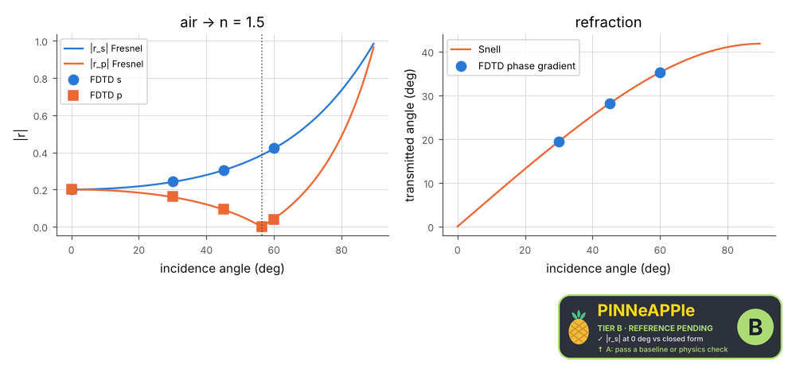

# Fresnel reflection and Snell's law

An oblique plane wave on a dielectric half-space in a 2-D FDTD with Bloch-periodic sides. The reflection coefficient for s and p polarisation is the ratio of two runs (with and without the medium); at Brewster's angle p is not reflected; the transmitted angle comes from the phase gradient of the field inside the medium, against Snell's law.

**Area:** `physics.electromagnetism` (optics) · **level:** academic · **kind:** theory · **dimensions:** 2D

```python
import pinneapple as pp

r = pp.science.run("em.fresnel_snell", dim="2D")    # also: "2D"
print(r)                     # comparisons with their references, checks, trust decision
```

## 2D

Trust report: **APPROVED** (score 1.00, coverage 100%); run time 52.3 s.

| quantity | computed | reference | rel. error | tolerance | reference kind | source |
|---|---|---|---|---|---|---|
| |r_s| at 0 deg | 0.201868  | 0.2  | 1.87e-03 (abs.) | 0.005 (abs.) | closed_form | Fresnel equations (Born & Wolf eqs. 1.5.20-21), pp.em.waves.fresnel |
| |r_p| at 0 deg | 0.201868  | 0.2  | 1.87e-03 (abs.) | 0.005 (abs.) | closed_form | Fresnel equations (Born & Wolf eqs. 1.5.20-21), pp.em.waves.fresnel |
| |r_s| at 30 deg | 0.24226  | 0.240408  | 1.85e-03 (abs.) | 0.005 (abs.) | closed_form | Fresnel equations (Born & Wolf eqs. 1.5.20-21), pp.em.waves.fresnel |
| |r_p| at 30 deg | 0.160767  | 0.1589  | 1.87e-03 (abs.) | 0.005 (abs.) | closed_form | Fresnel equations (Born & Wolf eqs. 1.5.20-21), pp.em.waves.fresnel |
| |r_s| at 45 deg | 0.30508  | 0.303337  | 1.74e-03 (abs.) | 0.005 (abs.) | closed_form | Fresnel equations (Born & Wolf eqs. 1.5.20-21), pp.em.waves.fresnel |
| |r_p| at 45 deg | 0.0939397  | 0.0920134  | 1.93e-03 (abs.) | 0.005 (abs.) | closed_form | Fresnel equations (Born & Wolf eqs. 1.5.20-21), pp.em.waves.fresnel |
| |r_s| at 60 deg | 0.421591  | 0.420204  | 1.39e-03 (abs.) | 0.005 (abs.) | closed_form | Fresnel equations (Born & Wolf eqs. 1.5.20-21), pp.em.waves.fresnel |
| |r_p| at 60 deg | 0.0401845  | 0.0424492  | 2.26e-03 (abs.) | 0.005 (abs.) | closed_form | Fresnel equations (Born & Wolf eqs. 1.5.20-21), pp.em.waves.fresnel |
| |r_p| at Brewster's angle 56.31 deg | 0.00212959  | 0  | 2.13e-03 (abs.) | 0.005 (abs.) | closed_form | Brewster: tan(theta_B) = n2 / n1 (Hecht eq. 4.65) |
| transmitted angle for 30 deg incidence | 19.4437 deg | 19.4712 deg | 1.41e-03 | 0.005 | closed_form | Snell's law n1 sin(t1) = n2 sin(t2) |
| transmitted angle for 45 deg incidence | 28.0944 deg | 28.1255 deg | 1.11e-03 | 0.005 | closed_form | Snell's law n1 sin(t1) = n2 sin(t2) |
| transmitted angle for 60 deg incidence | 35.2326 deg | 35.2644 deg | 9.00e-04 | 0.005 | closed_form | Snell's law n1 sin(t1) = n2 sin(t2) |



## References

- Born & Wolf, Principles of Optics, 7th ed., sec. 1.5
- Hecht, Optics, 5th ed., sec. 4.6
- Taflove & Hagness, 3rd ed., sec. 13 (periodic structures, Bloch boundaries)

Lab item `manifest/examples/science/electromagnetism/fresnel_snell` (manifest `experiment.json`); figures marked `.sealed` carry its seal.

Regenerate: `python -m pinneapple_science report em.fresnel_snell`.
