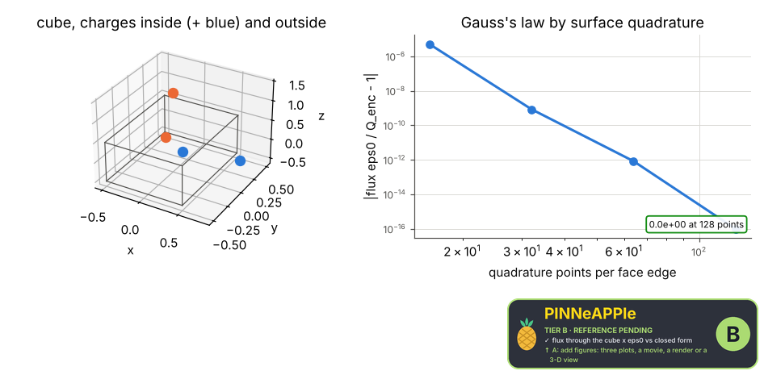
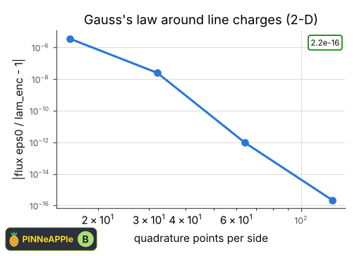

# Gauss's law

The flux of E through a closed surface (cube, 3-D) or curve (square, 2-D) by Gauss-Legendre quadrature equals the enclosed charge over eps0; charges outside contribute nothing. The divergence residual of a charged ball's field on a grid is checked with pp.maxwell.

**Area:** `physics.electromagnetism` (electrostatics) · **level:** academic · **kind:** theory · **dimensions:** 3D, 2D

```python
import pinneapple as pp

r = pp.science.run("em.gauss_law", dim="3D")    # also: "3D", "2D"
print(r)                     # comparisons with their references, checks, trust decision
```

## 3D

Trust report: **APPROVED** (score 1.00, coverage 100%); run time 0.2 s.

| quantity | computed | reference | rel. error | tolerance | reference kind | source |
|---|---|---|---|---|---|---|
| flux through the cube x eps0 | 1.5e-09 C | 1.5e-09 C | 0.00e+00 | 1e-06 | closed_form | Gauss's law: oint E.dA = Q_enc / eps0 (Griffiths eq. 2.13) |

| physics check | result | value | limit |
|---|---|---|---|
| charges outside contribute zero flux | pass | 0 | 1e-06 |
| div E = rho/eps0, Gaussian cloud on a 41^3 grid (pp.maxwell.gauss_electric) | pass | 0.00482 | 0.05 |
| the same check rejects a 20 % wrong charge density | pass |  |  |



## 2D

Trust report: **APPROVED** (score 1.00, coverage 100%); run time 0.2 s.

| quantity | computed | reference | rel. error | tolerance | reference kind | source |
|---|---|---|---|---|---|---|
| flux per unit length x eps0 | 2e-09 C/m | 2e-09 C/m | 2.07e-16 | 1e-06 | closed_form | Gauss's law in 2-D: oint E.n dl = lam_enc / eps0 |

| physics check | result | value | limit |
|---|---|---|---|
| error decreases with quadrature points | pass | 2.22e-16 |  |



## References

- Griffiths, Introduction to Electrodynamics, 4th ed., sec. 2.2
- Purcell & Morin, Electricity and Magnetism, 3rd ed., sec. 1.10

Lab item `manifest/examples/science/electromagnetism/gauss_law` (manifest `experiment.json`); figures marked `.sealed` carry its seal.

Regenerate: `python -m pinneapple_science report em.gauss_law`.
