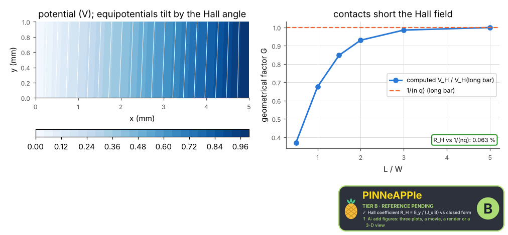

# Hall effect

A current through a semiconductor bar in a perpendicular field B: the 2-D potential with the Drude conductivity tensor (insulating edges carry the Hall condition), the Hall voltage at mid-length and the Hall coefficient against 1/(n q); the contacts short the Hall field in a short bar, shown by sweeping the length.

**Area:** `physics.electromagnetism` (transport in a magnetic field) · **level:** academic · **kind:** theory · **dimensions:** 2D

```python
import pinneapple as pp

r = pp.science.run("em.hall_effect", dim="2D")    # also: "2D"
print(r)                     # comparisons with their references, checks, trust decision
```

## 2D

Trust report: **APPROVED** (score 1.00, coverage 100%); run time 0.3 s.

| quantity | computed | reference | rel. error | tolerance | reference kind | source |
|---|---|---|---|---|---|---|
| Hall coefficient R_H = E_y / (J_x B) | -0.000623757 m^3/C | -0.000624151 m^3/C | 6.31e-04 | 0.002 | closed_form | Drude: R_H = 1/(n q) (Ashcroft & Mermin eq. 1.15) |

| physics check | result | value | limit |
|---|---|---|---|
| R_H error falls with the grid | pass |  |  |
| sign of V_H gives the carrier sign | pass |  |  |
| contacts short the Hall voltage in short bars (G rises with L/W) | pass |  |  |



## References

- Ashcroft & Mermin, Solid State Physics (1976), ch. 1, eqs. 1.15-1.19 (Drude Hall coefficient)
- Popovic, Hall Effect Devices, 2nd ed. (2004), sec. 4.2 (geometrical factor)

Lab item `manifest/examples/science/electromagnetism/hall_effect` (manifest `experiment.json`); figures marked `.sealed` carry its seal.

Regenerate: `python -m pinneapple_science report em.hall_effect`.
