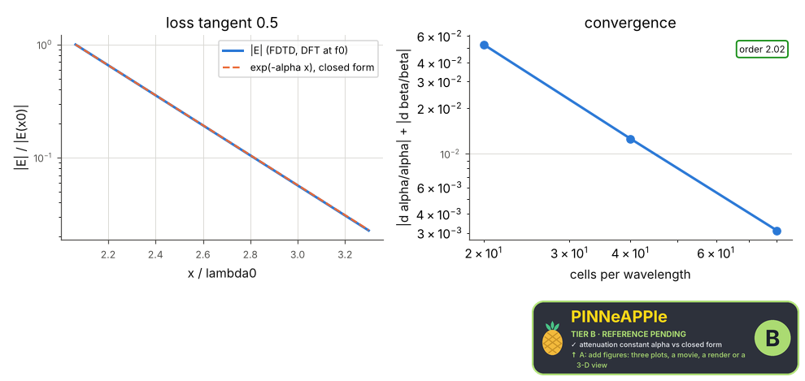

# Plane wave in a lossy medium

A pulse enters a conducting dielectric (1-D FDTD with CPML). From the DFT of the field inside it, the attenuation constant (slope of ln|E|) and the phase constant (slope of the unwrapped phase) are fitted and compared with gamma = sqrt(j omega mu (sigma + j omega eps)); the skin depth follows.

**Area:** `physics.electromagnetism` (wave propagation) · **level:** academic · **kind:** theory · **dimensions:** 1D

```python
import pinneapple as pp

r = pp.science.run("em.lossy_plane_wave", dim="1D")    # also: "1D"
print(r)                     # comparisons with their references, checks, trust decision
```

## 1D

Trust report: **APPROVED** (score 1.00, coverage 100%); run time 0.8 s.

| quantity | computed | reference | rel. error | tolerance | reference kind | source |
|---|---|---|---|---|---|---|
| attenuation constant alpha | 10.2083 Np/m | 10.183 Np/m | 2.48e-03 | 0.005 | closed_form | Pozar eq. 1.49: gamma = alpha + j beta = j omega sqrt(mu eps (1 - j sigma/(omega eps))) |
| phase constant beta | 43.1632 rad/m | 43.1361 rad/m | 6.29e-04 | 0.005 | closed_form | Pozar eq. 1.49 |

| physics check | result | value | limit |
|---|---|---|---|
| error falls with the grid | pass |  |  |



## References

- Pozar, Microwave Engineering, 4th ed., sec. 1.4 (eqs. 1.47-1.52)
- Taflove & Hagness, Computational Electrodynamics, 3rd ed., 2005 (FDTD, CPML)

Lab item `manifest/examples/science/electromagnetism/lossy_plane_wave` (manifest `experiment.json`); figures marked `.sealed` carry its seal.

Regenerate: `python -m pinneapple_science report em.lossy_plane_wave`.
