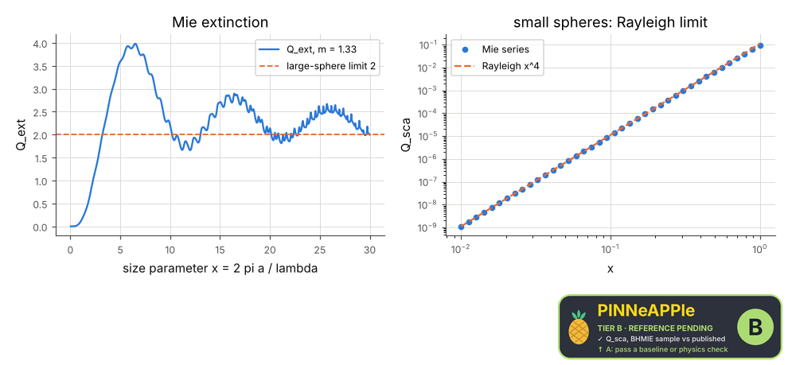

# Mie scattering by a sphere

Scattering and extinction efficiencies of a dielectric sphere from the Mie series (pp.em.mie): against the published BHMIE sample of Bohren & Huffman, the Rayleigh law for small spheres, the optical theorem (extinction from the forward amplitude) and the extinction paradox Q_ext -> 2 for large spheres.

**Area:** `physics.electromagnetism` (optics) · **level:** academic · **kind:** theory · **dimensions:** 3D

```python
import pinneapple as pp

r = pp.science.run("em.mie_scattering", dim="3D")    # also: "3D"
print(r)                     # comparisons with their references, checks, trust decision
```

## 3D

Trust report: **APPROVED** (score 1.00, coverage 100%); run time 0.4 s.

| quantity | computed | reference | rel. error | tolerance | reference kind | source |
|---|---|---|---|---|---|---|
| Q_sca, BHMIE sample | 3.10543  | 3.10543  | 1.44e-06 | 2e-05 | published | Bohren & Huffman (1983) app. A, BHMIE sample output (m = 1.55, x = 5.213) |
| Q_back, BHMIE sample | 2.92534  | 2.92534  | 2.22e-07 | 2e-05 | published | Bohren & Huffman (1983) app. A, BHMIE sample output (m = 1.55, x = 5.213) |
| Q_sca at x = 0.02 (Rayleigh) | 1.77577e-08  | 1.77582e-08  | 2.94e-05 | 0.001 | limit | Rayleigh: Q_sca = 8/3 x^4 |(m^2 - 1)/(m^2 + 2)|^2 (B&H eq. 5.8) |
| optical theorem: 4 Re S(0) / x^2 (absorbing sphere) | 1.9868  | 1.9868  | 2.24e-16 | 1e-10 | conservation | B&H eq. 4.76 (optical theorem) |
| Q_ext at x = 3000 (absorbing) | 2.00955  | 2  | 4.78e-03 | 0.01 | limit | van de Hulst sec. 8.22: Q_ext -> 2 (extinction paradox); correction ~ x^(-2/3) |



## References

- Bohren & Huffman, Absorption and Scattering of Light by Small Particles (1983), sec. 4.4 and app. A
- van de Hulst, Light Scattering by Small Particles (1957), sec. 8.22 (Q_ext -> 2)

Lab item `manifest/examples/science/electromagnetism/mie_scattering` (manifest `experiment.json`); figures marked `.sealed` carry its seal.

Regenerate: `python -m pinneapple_science report em.mie_scattering`.
