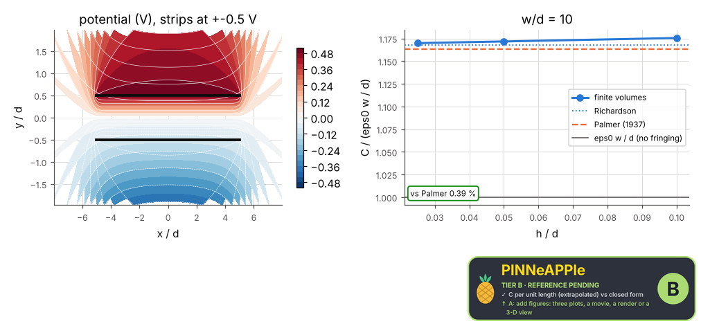
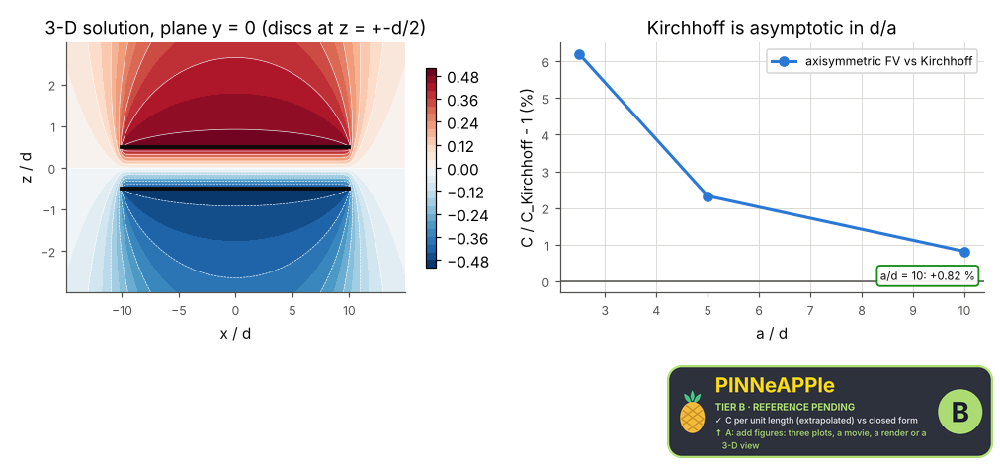

# Parallel-plate capacitor with edge effect

Capacitance of thin plates from the field energy of a finite-volume solution, refined three times and Richardson-extrapolated: strips in 2-D against Palmer's edge correction, discs in 3-D against Kirchhoff's formula. The excess over eps A / d is the fringing field.

**Area:** `physics.electromagnetism` (electrostatics) · **level:** academic · **kind:** theory · **dimensions:** 2D, 3D

```python
import pinneapple as pp

r = pp.science.run("em.parallel_plate_capacitor", dim="2D")    # also: "2D", "3D"
print(r)                     # comparisons with their references, checks, trust decision
```

## 2D

Trust report: **APPROVED** (score 1.00, coverage 100%); run time 1.3 s.

| quantity | computed | reference | rel. error | tolerance | reference kind | source |
|---|---|---|---|---|---|---|
| C per unit length (extrapolated) | 1.03434e-10 F/m | 1.0303e-10 F/m | 3.93e-03 | 0.01 | closed_form | Palmer (1937): eps0 (w/d) [1 + d/(pi w)(1 + ln(2 pi w/d))] |

| physics check | result | value | limit |
|---|---|---|---|
| solution in the asymptotic range (Roache) | pass | 1.03 |  |



## 3D

Trust report: **APPROVED** (score 1.00, coverage 100%); run time 154.4 s.

| quantity | computed | reference | rel. error | tolerance | reference kind | source |
|---|---|---|---|---|---|---|
| C, 3-D Cartesian (finest) vs axisymmetric | 3.26247e-10 F | 3.2703e-10 F | 2.39e-03 | 0.01 | convergence | this experiment: axisymmetric solution, Richardson extrapolated (independent discretisation of the same 3-D problem) |
| C, axisymmetric (extrapolated) | 3.2703e-10 F | 3.24381e-10 F | 8.17e-03 | 0.015 | closed_form | Kirchhoff (1877): eps0 [pi a^2/d + a (ln(16 pi a/d) - 1)], asymptotic d << a |

| physics check | result | value | limit |
|---|---|---|---|
| Kirchhoff's error falls as a/d grows (asymptotic formula) | pass |  |  |



## References

- H. B. Palmer, Trans. AIEE 56, 363 (1937)
- G. Kirchhoff, Monatsber. Akad. Wiss. Berlin (1877) 144
- Roache, ASME J. Fluids Eng. 116, 405 (1994) (Richardson extrapolation, GCI)

Lab item `manifest/examples/science/electromagnetism/parallel_plate_capacitor` (manifest `experiment.json`); figures marked `.sealed` carry its seal.

Regenerate: `python -m pinneapple_science report em.parallel_plate_capacitor`.
