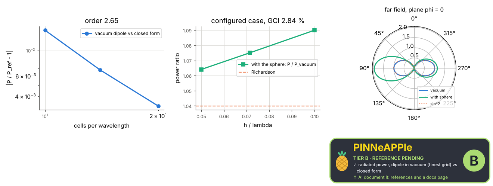
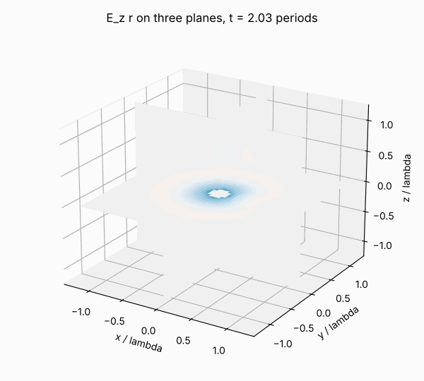

# FDTD in 3-D + time: configurable sources and materials, mesh convergence

A 3-D FDTD study configured by a plain dict (domain, cells per wavelength, sources, materials). The default runs a Hertzian dipole in vacuum on a refinement ladder: the radiated power (near-to-far-field transform) against the closed form, with the observed order, the Richardson-extrapolated value and the GCI; the Maxwell residuals of the field in x, y, z and t (pp.maxwell); then the configured case (the dipole beside a dielectric sphere) on the same ladder: no closed form exists, so it reports its extrapolated value, observed order and GCI against a declared accuracy target. The 3-D field in time is the animation and an interactive three.js viewer.

**Area:** `physics.electromagnetism` (computational electromagnetics) · **level:** research · **kind:** theory · **dimensions:** 3D+t

```python
import pinneapple as pp

r = pp.science.run("em.research_fdtd_3d", dim="3D+t")    # also: "3D+t"
print(r)                     # comparisons with their references, checks, trust decision
```

## 3D+t

Trust report: **APPROVED** (score 1.00, coverage 100%); run time 124.0 s.

| quantity | computed | reference | rel. error | tolerance | reference kind | source |
|---|---|---|---|---|---|---|
| radiated power, dipole in vacuum (finest grid) | 1.59015e-26 W | 1.58494e-26 W | 3.29e-03 | 0.02 | closed_form | Balanis eq. 4-16 with the current moment the grid actually drove |
| P / P_closed_form, Richardson-extrapolated | 1.00106  | 1  | 1.06e-03 | 0.01 | closed_form | Balanis eq. 4-16 |
| far-field pattern max |U/Umax - sin^2| | 0.00856227  | 0  | 8.56e-03 (abs.) | 0.02 (abs.) | closed_form | Hertzian dipole pattern sin^2(theta) (Balanis eq. 4-26a) |

| physics check | result | value | limit |
|---|---|---|---|
| error falls with the grid | pass |  |  |
| configured case: GCI of the finest grid within the target 0.05 | pass | 0.0284 | 0.05 |
| configured case: ratios converge monotonically | pass |  |  |
| Gauss's law div D = rho (x, y, z, t block 7^3 x 24, FDTD) | pass | 0.0215 | 0.05 |
| Gauss's law for B, div B = 0 (x, y, z, t block 7^3 x 24, FDTD) | pass | 2.38e-14 | 0.05 |
| Faraday's law curl E = -dB/dt (x, y, z, t block 7^3 x 24, FDTD) | pass | 0.00578 | 0.05 |
| Ampere-Maxwell law curl H = J + dD/dt (x, y, z, t block 7^3 x 24, FDTD) | pass | 0.0135 | 0.05 |
| discrete energy bounded after the source (CPML absorbs, no growth) | pass |  |  |



Animation (3-D field in time): [fdtd_3d_t.mp4](3D_plus_t/fdtd_3d_t.mp4), 

## References

- Taflove & Hagness, Computational Electrodynamics, 3rd ed. (2005), ch. 3-4, 7, 8
- Balanis, Antenna Theory, 3rd ed., eq. 4-16 (Hertzian dipole power)
- Roache, ASME J. Fluids Eng. 116, 405 (1994) (GCI)

Lab item `manifest/examples/science/electromagnetism/research_fdtd_3d` (manifest `experiment.json`); figures marked `.sealed` carry its seal.

Regenerate: `python -m pinneapple_science report em.research_fdtd_3d`.
