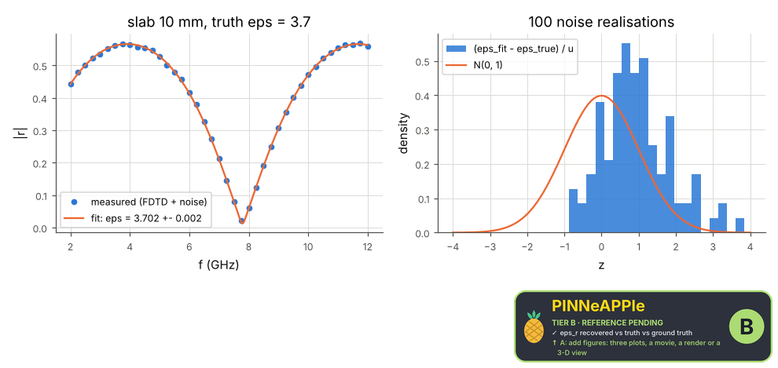

# Inverse problem: permittivity of a slab from its reflection spectrum

A dielectric slab of unknown permittivity and loss is measured in reflection: the 'measurement' is a 1-D FDTD run (with the CPML, the scheme's dispersion and added receiver noise), the model is the transfer-matrix reflection of pp.em.waves.multilayer. Least squares recovers eps_r and the conductivity with their covariance; the recovered values are compared with the truth the measurement was generated from (hidden from the fit), and the fit is repeated on noise realisations to check the stated uncertainty.

**Area:** `physics.electromagnetism` (inverse problems) · **level:** research · **kind:** theory · **dimensions:** 1D

```python
import pinneapple as pp

r = pp.science.run("em.research_inverse_permittivity", dim="1D")    # also: "1D"
print(r)                     # comparisons with their references, checks, trust decision
```

## 1D

Trust report: **APPROVED** (score 1.00, coverage 100%); run time 14.6 s.

| quantity | computed | reference | rel. error | tolerance | reference kind | source |
|---|---|---|---|---|---|---|
| eps_r recovered vs truth | 3.70173  | 3.7  | 4.66e-04 | 0.00091 | ground_truth | the permittivity the FDTD measurement was generated with (hidden from the fit) |
| sigma recovered vs truth | 0.0188373 S/m | 0.02 S/m | 5.81e-02 | 0.065 | ground_truth | as above |

| physics check | result | value | limit |
|---|---|---|---|
| FDTD measurement and transfer-matrix model agree below the noise | pass | 0.000972 | 0.004 |
| stated u(eps) consistent with the scatter (std of z between 0.7 and 1.5) | pass | 0.924 |  |



## References

- Baker-Jarvis et al., NIST Technical Note 1536 (2004), transmission/reflection methods
- Born & Wolf, Principles of Optics, 7th ed., sec. 1.6 (characteristic matrices)
- Tarantola, Inverse Problem Theory (2005), sec. 3.2

Lab item `manifest/examples/science/electromagnetism/research_inverse_permittivity` (manifest `experiment.json`); figures marked `.sealed` carry its seal.

Regenerate: `python -m pinneapple_science report em.research_inverse_permittivity`.
