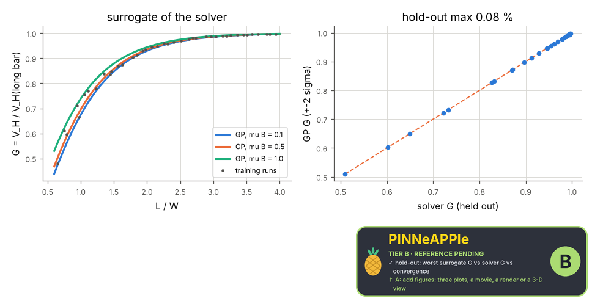

# Surrogate of the Hall geometrical factor with hold-out error

A Gaussian process (anisotropic kernel) trained on finite-difference Hall-bar solutions over the aspect ratio L/W and the Hall parameter mu B (Latin hypercube), its error measured on held-out solver runs it never saw, its +-2 sigma coverage (variance calibrated by leave-one-out on the training runs) and the long-bar limit G -> 1.

**Area:** `physics.electromagnetism` (surrogate models) · **level:** research · **kind:** theory · **dimensions:** 2D

```python
import pinneapple as pp

r = pp.science.run("em.research_surrogate_hall", dim="2D")    # also: "2D"
print(r)                     # comparisons with their references, checks, trust decision
```

## 2D

Trust report: **APPROVED** (score 1.00, coverage 100%); run time 1.4 s.

| quantity | computed | reference | rel. error | tolerance | reference kind | source |
|---|---|---|---|---|---|---|
| hold-out: worst surrogate G vs solver G | 0.510358  | 0.509955  | 7.90e-04 | 0.01 | convergence | the finite-difference solver on held-out inputs |
| solver: long bar G(L/W = 8) -> 1 | 0.999994  | 1  | 5.74e-06 | 0.001 | limit | Popovic sec. 4.2: G -> 1 for L/W >> 1 |

| physics check | result | value | limit |
|---|---|---|---|
| +-2 sigma coverage of the hold-out at least 80 % | pass | 0.8 | 0.8 |



## References

- Rasmussen & Williams, Gaussian Processes for Machine Learning (2006), ch. 2 and 5
- Popovic, Hall Effect Devices, 2nd ed. (2004), sec. 4.2

Lab item `manifest/examples/science/electromagnetism/research_surrogate_hall` (manifest `experiment.json`); figures marked `.sealed` carry its seal.

Regenerate: `python -m pinneapple_science report em.research_surrogate_hall`.
