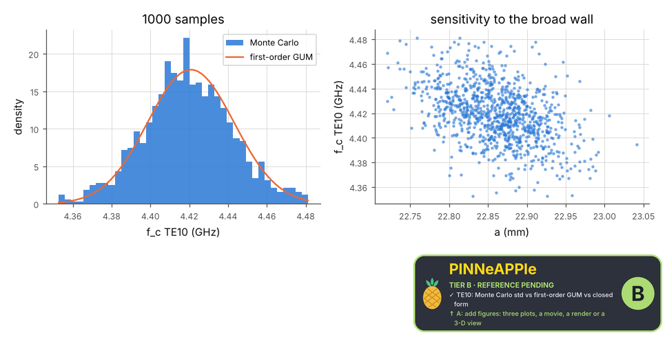

# Uncertainty of waveguide cut-offs by Monte Carlo

Manufacturing tolerances of a dielectric-filled rectangular guide (a, b, eps_r with stated standard deviations) propagated through the finite-difference eigen-solver by Monte Carlo: mean, standard deviation and 95 % interval of the TE10 and TE20 cut-offs, the sampling error of the Monte Carlo itself, against first-order (GUM) propagation with the closed-form sensitivities.

**Area:** `physics.electromagnetism` (uncertainty quantification) · **level:** research · **kind:** theory · **dimensions:** 2D

```python
import pinneapple as pp

r = pp.science.run("em.research_uq_waveguide", dim="2D")    # also: "2D"
print(r)                     # comparisons with their references, checks, trust decision
```

## 2D

Trust report: **APPROVED** (score 1.00, coverage 100%); run time 18.9 s.

| quantity | computed | reference | rel. error | tolerance | reference kind | source |
|---|---|---|---|---|---|---|
| TE10: Monte Carlo std vs first-order GUM | 2.2863e+07 Hz | 2.23e+07 Hz | 2.52e-02 | 0.067 | closed_form | JCGM 100 eq. 10 with df/da = -f/a, df/deps = -f/(2 eps) (Pozar eq. 3.84) |
| TE10: Monte Carlo mean vs nominal | 4.41927e+09 Hz | 4.42082e+09 Hz | 3.52e-04 | 0.002 | closed_form | Pozar eq. 3.84 at the nominal dimensions (FD discretisation error included) |
| TE20: Monte Carlo std vs first-order GUM | 4.57067e+07 Hz | 4.46001e+07 Hz | 2.48e-02 | 0.067 | closed_form | JCGM 100 eq. 10 with df/da = -f/a, df/deps = -f/(2 eps) (Pozar eq. 3.84) |
| TE20: Monte Carlo mean vs nominal | 8.8348e+09 Hz | 8.84165e+09 Hz | 7.75e-04 | 0.002 | closed_form | Pozar eq. 3.84 at the nominal dimensions (FD discretisation error included) |

| physics check | result | value | limit |
|---|---|---|---|
| b does not enter TE10 or TE20 (sensitivity ~ 0) | pass | 0.0167 | 0.15 |



## References

- JCGM 101:2008 (GUM supplement 1, Monte Carlo propagation)
- JCGM 100:2008 eq. 10
- Pozar, Microwave Engineering, 4th ed., eq. 3.84

Lab item `manifest/examples/science/electromagnetism/research_uq_waveguide` (manifest `experiment.json`); figures marked `.sealed` carry its seal.

Regenerate: `python -m pinneapple_science report em.research_uq_waveguide`.
