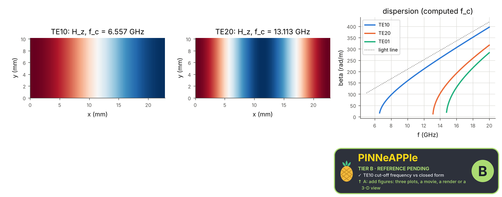

# Rectangular waveguide modes

Cut-off wavenumbers of the TE and TM modes of a WR-90 guide from a finite-difference Helmholtz eigenproblem on its cross-section (Neumann for H_z, Dirichlet for E_z), refined twice, against k_c = sqrt((m pi/a)^2 + (n pi/b)^2); the dispersion beta(f) follows.

**Area:** `physics.electromagnetism` (guided waves) · **level:** academic · **kind:** theory · **dimensions:** 2D

```python
import pinneapple as pp

r = pp.science.run("em.waveguide_modes", dim="2D")    # also: "2D"
print(r)                     # comparisons with their references, checks, trust decision
```

## 2D

Trust report: **APPROVED** (score 1.00, coverage 100%); run time 1.2 s.

| quantity | computed | reference | rel. error | tolerance | reference kind | source |
|---|---|---|---|---|---|---|
| TE10 cut-off frequency | 6.55701e+09 Hz | 6.55714e+09 Hz | 1.98e-05 | 0.001 | closed_form | Pozar eq. 3.84: f_c = c/(2 pi) sqrt((m pi/a)^2 + (n pi/b)^2) |
| TE20 cut-off frequency | 1.31132e+10 Hz | 1.31143e+10 Hz | 7.93e-05 | 0.001 | closed_form | Pozar eq. 3.84: f_c = c/(2 pi) sqrt((m pi/a)^2 + (n pi/b)^2) |
| TE01 cut-off frequency | 1.47521e+10 Hz | 1.47536e+10 Hz | 1.00e-04 | 0.001 | closed_form | Pozar eq. 3.84: f_c = c/(2 pi) sqrt((m pi/a)^2 + (n pi/b)^2) |
| TE11 cut-off frequency | 1.61437e+10 Hz | 1.61451e+10 Hz | 8.71e-05 | 0.001 | closed_form | Pozar eq. 3.84: f_c = c/(2 pi) sqrt((m pi/a)^2 + (n pi/b)^2) |
| TE30 cut-off frequency | 1.96679e+10 Hz | 1.96714e+10 Hz | 1.78e-04 | 0.001 | closed_form | Pozar eq. 3.84: f_c = c/(2 pi) sqrt((m pi/a)^2 + (n pi/b)^2) |
| TM mode 1 cut-off frequency | 1.61437e+10 Hz | 1.61451e+10 Hz | 8.71e-05 | 0.001 | closed_form | Pozar eq. 3.106 |
| TM mode 2 cut-off frequency | 1.97378e+10 Hz | 1.97396e+10 Hz | 9.11e-05 | 0.001 | closed_form | Pozar eq. 3.106 |
| TM mode 3 cut-off frequency | 2.45856e+10 Hz | 2.45893e+10 Hz | 1.50e-04 | 0.001 | closed_form | Pozar eq. 3.106 |

| physics check | result | value | limit |
|---|---|---|---|
| second-order convergence | pass | 2 |  |



## References

- Pozar, Microwave Engineering, 4th ed., sec. 3.3 (eqs. 3.84, 3.106)

Lab item `manifest/examples/science/electromagnetism/waveguide_modes` (manifest `experiment.json`); figures marked `.sealed` carry its seal.

Regenerate: `python -m pinneapple_science report em.waveguide_modes`.
