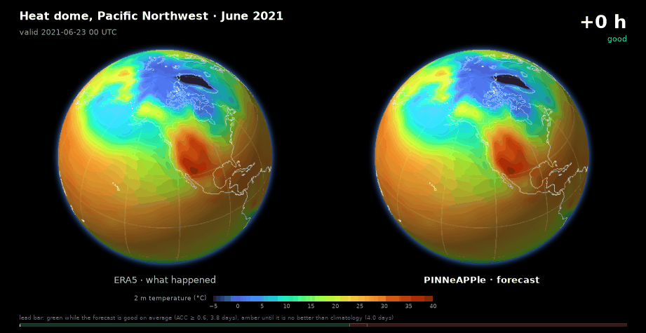
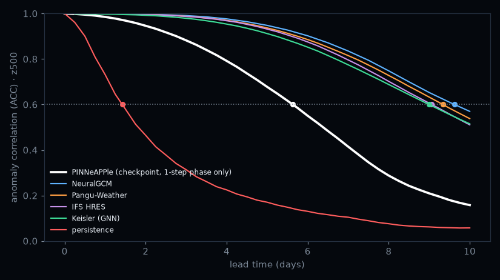

# Weather forecasting on ERA5: how many days a model is good for, and extreme events

A global forecast model trained with `pinneapple_physics.weather` on ERA5 (WeatherBench2, public, no account), scored
by lead time against persistence, climatology and the published IFS HRES, Pangu-Weather, Keisler and NeuralGCM
forecasts on the same 2020 cases, with the useful horizon (ACC >= 0.6) and the no-skill horizon (RMSE reaches
climatology), a per-forecast horizon from an ensemble, and seven extreme events forecast against what happened.

**Status: the experiment is half way.** Phase 1 of training (6-hour steps, about 2 h on 4 CPU cores) is done and its
weights are in `checkpoints/phase1_step15000_fp16.pt`; the rollout phases (2, 4 and 8 steps), which carry the skill
beyond 3-5 days, have not run (the cloud session that trained it is recycled when idle). Preview with the phase-1
weights, 21 forecasts of 2020:

| model | z500 RMSE day 3 | day 5 | useful (ACC >= 0.6) |
|---|---|---|---|
| PINNeAPPle, phase 1 only | 397 | 673 | 5.6 days |
| IFS HRES / Pangu / NeuralGCM | 104-125 | 251-288 | 9.1-9.6 days |
| persistence | 923 | 1017 | 1.4 days |





## Resume the experiment (a machine that stays on: 4+ cores, 16 GB RAM, 10 GB disk)

```bash
pip install -e . gcsfs
# 1. ERA5 1990-2022 on the 64 x 32 grid + climatology (about 35 min, 5 GB)
python -c "from pinneapple_physics.weather.data import download, Era5Store, climatology; \
download('wx/era5', (1990, 2022), normalization='examples/weather_forecasting/checkpoints/era5_64x32_normalization.json'); \
climatology(Era5Store('wx/era5'))"
# 2. the remaining training phases from the phase-1 weights (resumable: rerun the same command after a stop)
python -c "from pinneapple_physics.weather.train import train; \
train('wx/era5', 'wx/run2', hours=4.5, schedule=((1, 0.2), (2, 0.27), (4, 0.27), (8, 0.26)), lr=4e-4, \
init_from='examples/weather_forecasting/checkpoints/phase1_step15000_fp16.pt')"
# 3. scores, horizons, ensemble, events and GIFs (the 2020 baseline scores and the 2024 RS flood states are in data/)
python examples/weather_forecasting/run_use_cases.py wx/era5 wx/run2/model.pt wx/results
```

`train` writes `run2/last.pt` every 200 steps and continues from it when restarted. On a CPU with AMX/AVX-512 bf16
it uses mixed precision (about 27 samples/s on 4 cores); a GPU is not needed but makes it much faster.

## Files

- `score_baselines.py`: scores of persistence, climatology and the published models on 2020 (already in
  `data/baselines_2020.json`).
- `run_use_cases.py`: skill figures, `horizon.json` (useful and no-skill horizons per variable, per-forecast horizon
  from the ensemble checked against the real one), one GIF per event and `events.json` (days ahead each event was
  well forecast, next to IFS HRES and Pangu-Weather).
- `data/rs_floods_2024_40.npy`: ERA5 states of the 2024 Rio Grande do Sul floods (ARCO, 0.25 degree averaged onto
  the grid; float16), so the slow download is not repeated.
- `hurricane_ian.py`: Hurricane Ian 2022 end to end — the best track, the vortex inside the reanalysis and inside two
  published forecasts, with the lead at which each stops being usable (see the section below).

## A hurricane end to end: Ian 2022 (#366)

`hurricane_ian.py` is the part of the #366 showcase this library can measure today: one storm in the official record,
in a reanalysis and in two published global forecasts, with the number each stage earns. It is not the five-stage
globe of the issue — the satellite imagery (#264), the satellite nowcast, the operational hydrology chain (#327) and
the twin3d scene of the flooded neighbourhood (#284) are separate work that does not exist here yet. What is here is
the chain from the analysis to the forecast horizon, and the measurement that tells the showcase where that chain has
to hand over.

```bash
python examples/weather_forecasting/hurricane_ian.py --coarse     # needs a network the first time; writes _out/hurricane_ian/
```

Only the storm's box (161 x 201 cells) is read from each store, and only the crop is kept — 38 MB in
`~/.cache/pinneapple/hurricane`, nothing in the repository. `--offline` afterwards is free.

Measured on 2026-11-26 for Ian (`AL092022`, 40 records from 22 Sep 18 UTC to 1 Oct 06 UTC, peak 140 kt at 937 hPa),
with the centre tracked as the deepest pressure minimum within 400 km of the previous position:

| stage | what it measured |
|---|---|
| **now** — ERA5 0.25°, 23-29 Sep, 28 times | the storm found at 28/28 times; median track error **17 km** (max 94), central pressure **+7 hPa** too shallow, equivalent wind -10 kt |
| **next days** — IFS HRES, 10 initialisations, +6 to +120 h | track error **19 km at +6 h, 46 at +24, 105 at +48, 262 at +120**; intensity -13 kt (+10 hPa); the 20 kt intensity error is reached at **52 h** |
| **next days** — Pangu-Weather, same initialisations | **20, 30, 38, 148 km**; intensity -25 kt (+17 hPa); the 20 kt intensity error is reached at +6 h |
| **the grid** — the same two on 64 x 32 (5.625°) | the storm is present at **34 %** (IFS) and **25 %** (Pangu) of the leads, and 23-24 hPa too shallow when it is found |

The last row is the honest note the issue asks to put on screen: a cell 5.625° wide is about 500 km across, wider than
the storm's core, so the question stops being "how wrong is the track" and becomes "is there a storm in the field at
all" — and a quarter to a third of the time there is not. That is why a chain for the last hours before landfall hands
over to a finer model instead of asserting skill the grid cannot hold.

Two measures are worth reading carefully:

- **Intensity is compared in two units.** Central pressure directly, and maximum wind through the Atkinson & Holliday
  (1977) relation `W = 6.7 (1010 - p)^0.644`. The relation turns a grid minimum into an *equivalent* wind — it is
  named wherever it appears and it is not a model wind; both sides of the comparison use it, so the sign is a
  comparison of intensities and not of two wind definitions.
- **The 500 km track horizon never arrives within the five days measured** and, at +120 h, exactly half the forecasts
  still have a storm and an official position to compare, which is the coin toss the caller set — so the honest
  statement is the *found fraction* falling, not a track error blowing past a threshold. `summary.json` carries both,
  together with the store, variable, initialisation and licence behind every lead it quotes.

`_out/hurricane_ian/` holds `summary.json` (every number with its protocol and data provenance), `ian_globe.png`,
`ian_globe.gif` (the reanalysis crossing the Earth-2 globe, 6 h a frame) and `ian_track_<model>.png` (track and
intensity error by lead, with the horizons marked).

## Data and attribution

ERA5 reanalysis (Hersbach et al., 2020) from the Copernicus Climate Change Service (C3S), read through WeatherBench2
(Rasp et al., 2024) and the ARCO-ERA5 bucket of Google Research. Contains modified Copernicus Climate Change Service
information; neither the European Commission nor ECMWF is responsible for any use of it. The published forecasts
(IFS HRES, Pangu-Weather, Keisler, NeuralGCM) are read from WeatherBench2; only their scores are stored here.
Coastlines: Natural Earth (public domain).

The hurricane case reads the NHC North Atlantic Hurricane Database (HURDAT2; Landsea & Franklin, 2013,
<https://www.nhc.noaa.gov/data/hurdat/>), a US Government work in the public domain, downloaded once and cited with
its file name and SHA-256 in `summary.json`; the store it was read from, the variable and the licence accompany every
number, and only the extracted crop is cached, never the raw global field.
